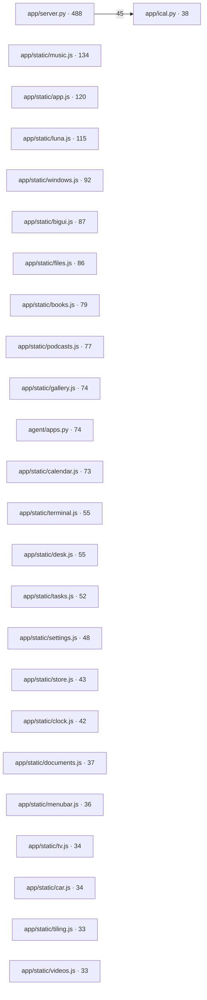
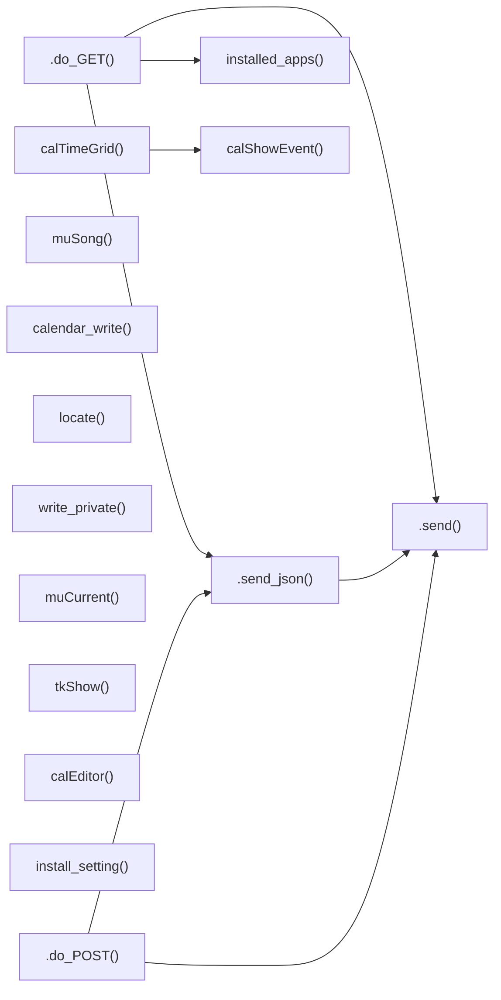

# Codemap: adleros

← [README](README.md)

> Generated from commit `216b6a4` by `scripts/codemap.py`. Regenerate it from the workspace root with `python3 scripts/codemap.py adleros`; don't edit it by hand.

## Files

Each box is a source file and its function count; an arrow means calls into that file.

(26 smaller files not drawn.)

## Hubs

The most connected functions: where a change reaches furthest.

| Function | Where | Called by | Calls |
|---|---|---|---|
| `.do_GET()` | `app/server.py:7441` | 1 | 55 |
| `.send_json()` | `app/server.py:7381` | 40 | 1 |
| `.do_POST()` | `app/server.py:7595` | 0 | 35 |
| `muSong()` | `app/static/music.js:58` | 34 | 0 |
| `calendar_write()` | `app/server.py:4630` | 1 | 29 |
| `locate()` | `app/server.py:5742` | 25 | 2 |
| `write_private()` | `app/server.py:177` | 27 | 0 |
| `muCurrent()` | `app/static/music.js:62` | 26 | 0 |
| `.send()` | `app/server.py:7367` | 25 | 0 |
| `tkShow()` | `app/static/tasks.js:186` | 18 | 7 |
| `installed_apps()` | `app/server.py:275` | 20 | 3 |
| `calEditor()` | `app/static/calendar.js:1122` | 2 | 20 |
| `install_setting()` | `app/server.py:577` | 21 | 1 |
| `calShowEvent()` | `app/static/calendar.js:692` | 4 | 17 |
| `calTimeGrid()` | `app/static/calendar.js:556` | 1 | 20 |

## Functions

### `agent/agent.py`

- `stamp()` L60
- `log()` L64
- `write_private()` L70
- `rewrite()` L79
- `save_job()` L89 → `write_private()`
- `prune_jobs()` L93
- `read_request()` L102
- `load_actions()` L119
- `validate_params()` L131
- `set_config()` L159 → `rewrite()`
- `expand()` L176
- `run()` L192 → `save_job()`
- `run_for_result()` L217
- `process()` L236 → `read_request()`, `log()`, `stamp()`, `validate_params()`, `save_job()`, `set_config()`, `expand()`, `run_for_result()`, `run()`
- `main()` L304 → `load_actions()`, `process()`, `prune_jobs()`

### `agent/apps.py`

- `say()` L110
- `read_env()` L114
- `rewrite()` L132
- `compose_file()` L153
- `folder_compose_files()` L165 → `compose_file()`
- `setting()` L182 → `read_env()`
- `catalog()` L186
- `registry_app()` L202
- `registry_apps()` L220 → `registry_app()`
- `catalog_app()` L246 → `folder_compose_files()`
- `every_app()` L252 → `read_env()`, `catalog()`, `catalog_app()`, `registry_apps()`, `store_templates()`
- `all_apps()` L273 → `every_app()`
- `docker_env()` L280
- `compose()` L286 → `untrusted()`, `say()`, `docker_env()`
- `run_installer()` L297 → `say()`, `docker_env()`
- `containers()` L305 → `docker_env()`
- `app_status()` L336 → `containers()`, `summarize()`
- `usage()` L363 → `docker_env()`, `app_status()`, `parse_bytes()`
- `scoped()` L400
- `pre_start()` L405 → `untrusted()`, `say()`, `docker_env()`, `read_env()`
- `start()` L419 → `pre_start()`, `say()`, `compose()`, `first_failure()`, `scoped()`
- `stop()` L430 → `compose()`, `first_failure()`, `scoped()`
- `restart()` L434 → `app_status()`, `say()`, `start()`, `compose()`, `first_failure()`, `scoped()`
- `update()` L441 → `compose()`, `first_failure()`, `scoped()`, `say()`, `start()`
- `logs()` L450 → `scoped()`, `docker_env()`
- `remove_containers()` L468 → `compose()`, `first_failure()`, `scoped()`
- `set_chosen()` L475 → `read_env()`, `catalog()`, `rewrite()`
- `set_setting()` L491 → `rewrite()`
- `set_roots()` L506 → `untrusted()`, `set_setting()`, `say()`
- `write_record()` L526 → `write_private()`
- `set_registry_installed()` L533 → `write_record()`
- `delete()` L537 → `remove_containers()`, `say()`, `forget()`, `set_registry_installed()`, `set_chosen()`, `run_installer()`
- `install()` L555 → `set_registry_installed()`, `start()`, `store_install()`, `set_chosen()`, `say()`, `run_installer()`
- `image_path()` L570
- `known_apps()` L580
- `classify()` L598 → `image_path()`, `known_apps()`
- `host_address()` L626 → `setting()`
- `new_app_id()` L648 → `slug()`, `catalog()`
- `store_install()` L704 → `apps_dir()`, `registry_apps()`, `free_port()`, `setting()`, `render_env()`, `rewrite()`, `make_mount_dirs()`, `say()`, `host_address()`, `compose()`, +1
- `plan_file()` L746 → `classify()`, `backing()`
- `record_for()` L788 → `backing()`, `web_port()`, `image_path()`, `new_app_id()`, `host_address()`
- `discover()` L814 → `setting()`, `say()`, `every_app()`, `known_apps()`, `web_writable()`, `find_compose_files()`, `services()`, `plan_file()`, `record_for()`, `write_record()`, +1
- `proxy_hosts()` L859 → `host_address()`, `registry_apps()`
- `use_proxy_addresses()` L886 → `proxy_hosts()`, `registry_apps()`, `host_address()`, `services()`, `write_record()`, `say()`
- `first_failure()` L919
- `web_writable()` L932 → `setting()`
- `untrusted()` L944 → `web_writable()`
- `importable()` L949 → `untrusted()`
- `services()` L963 → `docker_env()`
- `find_compose_files()` L997 → `compose_file()`
- `scan()` L1016 → `every_app()`, `find_compose_files()`, `importable()`, `taken_services()`, `services()`
- `import_app()` L1054 → `importable()`, `services()`, `every_app()`, `taken_services()`, `new_app_id()`, `classify()`, `write_record()`, `say()`
- `add_site()` L1100 → `every_app()`, `new_app_id()`, `write_record()`, `say()`
- `forget()` L1130 → `registry_app()`, `say()`
- `set_url()` L1144 → `registry_app()`, `host_address()`, `say()`, `write_record()`
- `firefox_container()` L1168 → `docker_env()`
- `firefox_prefs()` L1204 → `rewrite()`
- `firefox_quit()` L1224 → `registry_apps()`, `firefox_container()`, `firefox_prefs()`, `docker_env()`
- `firefox_url()` L1238 → `registry_apps()`, `firefox_container()`, `firefox_prefs()`, `docker_env()`
- `main()` L1281 → `firefox_url()`, `firefox_quit()`, `discover()`, `scan()`, `set_roots()`, `import_app()`, `add_site()`, `forget()`, `set_url()`, `all_apps()`, +4
- … and 14 less-connected functions

### `agent/connect.py`

- `say()` L39
- `read_env()` L43
- `set_setting()` L62
- `Install` L85
- `.__init__()` L89 → `.registry()`, `read_env()`
- `.registry()` L118
- `.env()` L128 → `read_env()`
- `.url()` L131 → `.env()`
- `.folder()` L138
- `call()` L144
- `said()` L161
- `wait_for()` L172 → `say()`
- `Terminal` L191
- `.__init__()` L194
- `.ask()` L202
- `.yes()` L210 → `.ask()`
- `.password()` L213
- `.new_password()` L216 → `.password()`, `say()`
- `paperless()` L229 → `read_env()`, `call()`, `wait_for()`, `set_setting()`, `said()`, `say()`
- `immich()` L256 → `call()`, `wait_for()`, `said()`, `say()`, `set_setting()`
- `subsonic_ok()` L300 → `call()`
- `navidrome()` L308 → `call()`, `wait_for()`, `say()`, `said()`, `subsonic_ok()`, `set_setting()`
- `main()` L350 → `Install`, `Terminal`, `say()`

### `agent/files.py`

- `setting()` L35
- `folder()` L48
- `places()` L53 → `folder()`, `setting()`
- `Refused` L64
- `locate()` L68 → `Refused`
- `files_path()` L96
- `good_name()` L101
- `changeable()` L106 → `Refused`
- `unique_name()` L112
- `move()` L121
- `copy()` L134
- `op_text()` L143 → `locate()`, `changeable()`, `Refused`, `files_path()`
- `op_mkdir()` L165 → `locate()`, `good_name()`, `Refused`, `files_path()`
- `op_rename()` L176 → `locate()`, `changeable()`, `good_name()`, `Refused`, `files_path()`
- `op_delete()` L188 → `Refused`, `locate()`, `changeable()`, `files_path()`, `move()`
- `op_restore()` L202 → `locate()`, `move()`, `unique_name()`
- `op_transfer()` L225 → `locate()`, `Refused`, `changeable()`, `unique_name()`, `copy()`, `move()`, `files_path()`
- `read_request()` L245 → `Refused`
- `main()` L265 → `read_request()`, `setting()`, `Refused`, `places()`

### `agent/maint`

- `run()` L9

### `agent/tailscale.py`

- `ts()` L24
- `status()` L28 → `ts()`
- `host_path()` L46 → `places()`, `locate()`
- `get()` L58 → `places()`, `host_path()`, `ts()`, `move()`, `unique_name()`
- `send()` L91 → `host_path()`, `ts()`

### `agent/terminal.py`

- `log()` L51
- `setting()` L55
- `enabled()` L68 → `setting()`
- `login_shell()` L72
- `start_folder()` L85 → `setting()`
- `ours()` L94
- `write_ended()` L103
- `read_small()` L110
- `set_size()` L116
- `Session` L122
- `.__init__()` L123 → `login_shell()`, `start_folder()`, `set_size()`, `log()`
- `.pump_output()` L149
- `.pump_input()` L162 → `ours()`
- `.check_size()` L185 → `ours()`, `read_small()`, `set_size()`
- `.wanted_closed()` L198
- `.end()` L201 → `write_ended()`, `log()`
- `new_requests()` L231 → `ours()`, `read_small()`, `log()`, `write_ended()`
- `tidy()` L265 → `ours()`
- `main()` L283 → `enabled()`, `new_requests()`, `write_ended()`, `Session`, `log()`, `tidy()`

### `app/ical.py`

- `parse()` L22 → `parse_line()`
- `parse_line()` L45
- `text()` L76
- `prop()` L81
- `props()` L89
- `zones()` L95 → `prop()`, `named_zone()`
- `named_zone()` L117
- `value_of()` L132 → `named_zone()`
- `values_of()` L153 → `value_of()`
- `duration()` L158
- `local()` L168
- `events()` L180 → `zones()`, `prop()`, `value_of()`, `local()`, `duration()`, `text()`, `props()`, `values_of()`
- `rrule()` L218
- `month_days()` L241
- `nth()` L247
- `period()` L260 → `day_in()`, `month_days()`, `nth()`
- `day_in()` L321 → `month_days()`
- `periods_before()` L326
- `starts()` L340 → `periods_before()`, `period()`
- `until_of()` L373 → `value_of()`, `local()`
- `instant()` L387
- `expand()` L392 → `rrule()`, `local()`, `starts()`, `until_of()`, `add_occurrence()`
- `sort_key()` L437
- `add_occurrence()` L441 → `instant()`, `iso()`
- `iso()` L471
- `escape()` L477
- `fold()` L482
- `param_text()` L497
- `serialize()` L504 → `fold()`
- `emit()` L509 → `param_text()`
- `_reindex()` L525
- `remove()` L531 → `_reindex()`
- `put()` L537 → `_reindex()`
- `add()` L551
- `when_text()` L555
- `offset_text()` L569
- `vtimezone()` L576 → `offset_text()`, `month_days()`
- `rrule_text()` L612

### `app/musictags.py`

- `read_tags()` L36 → `_mp3()`, `_flac()`, `_ogg()`, `_mp4()`, `_wav()`, `_tidy()`
- `read_cover()` L58 → `_id3()`, `_flac()`, `_ogg()`, `_mp4()`
- `read_comment()` L76 → `_id3()`
- `read_lyrics()` L84 → `_id3()`, `_flac()`, `_ogg()`, `_mp4()`
- `_number()` L106
- `_genre()` L112
- `_tidy()` L123 → `_number()`, `_genre()`
- `_syncsafe()` L168
- `_unsync()` L172
- `_id3_text()` L176
- `_id3_split_desc()` L196
- `_id3_decode()` L207
- `_id3()` L212 → `_syncsafe()`, `_unsync()`, `_id3_split_desc()`, `_image_mime()`, `_id3_decode()`, `_sylt()`, `_id3_text()`
- `_sylt()` L327 → `_id3_split_desc()`, `_id3_decode()`
- `_image_mime()` L343
- `_mp3()` L365 → `_id3()`, `_mp3_length()`
- `_mp3_length()` L388
- `_vorbis_comments()` L421 → `_flac_picture()`
- `_flac_picture()` L458 → `_image_mime()`
- `_pick_cover()` L470
- `_flac()` L476 → `_vorbis_comments()`, `_flac_picture()`, `_pick_cover()`
- `_ogg_packets()` L513
- `_ogg()` L530 → `_ogg_packets()`, `_vorbis_comments()`, `_pick_cover()`
- `_atoms()` L563
- `_mp4()` L586 → `_atoms()`, `_mp4_items()`
- `_mp4_items()` L621 → `_atoms()`, `_image_mime()`
- `_wav()` L665

### `app/server.py`

- `write_private()` L177
- `read_env_file()` L187
- `installed_apps()` L275 → `registry_apps()`, `read_env_file()`, `read_catalog()`
- `load_settings()` L396
- `save_settings()` L404 → `load_settings()`, `write_private()`
- `admin_on()` L427 → `admin_until()`
- `install_setting()` L577 → `read_env_file()`
- `place_on()` L1563 → `place_host()`
- `places_on()` L1568 → `place_on()`
- `radio_stations()` L1928
- `radio_logo_find()` L2243 → `_logo_core()`, `_logo_words()`, `_logo_stream()`, `radio_open()`, `_radio_browser()`, `_logo_stem()`, `_logo_site()`, `_logo_named()`, `_web_get()`, `_StationPage`, +1
- `music_dir()` L2484 → `install_setting()`, `locate()`, `place_path()`
- `music_item()` L2590 → `locate()`, `music_dir()`, `place_path()`
- `navidrome_bring()` L2943 → `navidrome_matcher()`, `navidrome_songs()`, `match()`, `navidrome_call()`, `music_favorites()`, `save_favorites()`, `navidrome_id()`
- `abs_conn()` L3670 → `install_setting()`, `installed_apps()`
- `abs_json()` L3696 → `abs_open()`
- `pods_local()` L4040 → `pods_scan()`
- `calendar_state()` L4441 → `caldav()`, `caldav_home()`, `caldav_calendars()`, `caldav_events()`
- `calendar_write()` L4630 → `caldav()`, `calendar_state()`, `calendar_fields()`, `cal_times()`, `cal_text()`, `add()`, `cal_rule()`, `put()`, `cal_stamp()`, `cal_zones_used()`, +19
- `cal_split()` L4851 → `prop()`, `events()`, `rrule()`, `starts()`, `put()`, `props()`, `values_of()`, `cal_wall()`, `remove()`, `add()`, +2
- `vk()` L4962 → `vikunja()`
- `tasks_move_in()` L5131 → `tasks_local()`, `vk_projects()`, `vk_all()`, `vk()`, `vk_body()`, `tasks_local_save()`
- `tasks_read()` L5255 → `tasks_connected()`, `tasks_read_local()`, `vk_projects()`, `vk_all()`, `vk_id()`, `vk()`, `vk_task()`, `vk_date()`
- `tasks_write()` L5327 → `tasks_connected()`, `tasks_local()`, `tasks_write_local()`, `tasks_local_save()`, `vk_id()`, `task_fields()`, `vk()`, `vk_body()`, `vk_projects()`, `vk_task()`
- `locate()` L5742 → `place_on()`, `nested()`
- `place_path()` L5764
- `monica_conn()` L6311 → `install_setting()`, `installed_apps()`
- `monica_json()` L6326 → `monica_conn()`
- `carddav_state()` L6726 → `carddav()`, `install_setting()`, `carddav_books()`, `dav()`, `dav_responses()`, `card_info()`
- `card_detail()` L6830 → `card_by_id()`, `card_public()`, `monica_conn()`, `monica_for()`, `monica_json()`, `contacts_link()`, `monica_error()`
- `card_write()` L6877 → `carddav()`, `card_fields()`, `card_by_id()`, `dav_raw()`, `card_text()`, `contacts_links()`, `monica_conn()`, `monica_json()`, `contact_fields_body()`, `carddav_state()`, +2
- `jf_json()` L6975 → `jf_open()`
- `.send()` L7367
- `.send_json()` L7381 → `.send()`
- `.settings_payload()` L7410 → `read_env_file()`, `display_name()`, `search_url()`, `selected_wallpaper_id()`, `wallpaper_options()`, `installed_apps()`, `device_info()`, `backups_info()`, `action_summary()`, `load_actions()`, +4
- `.do_GET()` L7441 → `.send()`, `.serve_static()`, `.logged_in()`, `selected_wallpaper_id()`, `.send_json()`, `wallpaper_path()`, `.serve_file()`, `dock_icon_path()`, `installed_apps()`, `placed()`, +45
- `.do_POST()` L7595 → `.cross_site()`, `.send_json()`, `.login()`, `.session_token()`, `revoke()`, `.cookie_header()`, `.send()`, `.logged_in()`, `.read_json()`, `.update_settings()`, +25
- `.login()` L7690 → `.client()`, `lockout_remaining()`, `.send_json()`, `.read_json()`, `password_ok()`, `record_failure()`, `.cookie_header()`, `new_session()`
- `.update_settings()` L7707 → `.send_json()`, `installed_apps()`, `collection_choices()`, `app_folders()`, `app_order()`, `widget_catalog()`, `valid_search_url()`, `wallpaper_path()`, `placements()`, `save_settings()`
- `.change_password()` L7800 → `.client()`, `lockout_remaining()`, `.send_json()`, `password_ok()`, `record_failure()`, `hash_password()`, `save_settings()`, `.cookie_header()`, `new_session()`
- `.files_get()` L7820 → `places_on()`, `.send_json()`, `trash_items()`, `search_files()`, `place_host()`, `admin_on()`, `locate()`, `list_folder()`, `place_path()`, `root_writes()`, +3
- `.notes_get()` L7930 → `places_on()`, `.send_json()`, `load_settings()`, `vault_list()`, `default_vault()`, `vault_index()`, `vault_search()`
- `.notes_post()` L7947 → `places_on()`, `.send_json()`, `vault_rename()`, `load_settings()`, `locate()`, `good_name()`, `place_path()`, `save_settings()`, `vault_list()`
- `.music_get()` L7990 → `radio_logos_soon()`, `.send_json()`, `radio_listed()`, `.radio_get()`, `places_on()`, `navidrome_sync()`, `music_counts()`, `music_favorites()`, `music_plays()`, `music_library()`, +8
- `.radio_post()` L8120 → `.send_json()`, `radio_stations()`, `radio_save()`, `radio_logo_forget()`, `radio_listed()`, `radio_logos_soon()`, `radio_parse()`, `locate()`, `radio_url()`, `radio_add()`
- `.music_post()` L8193 → `.radio_post()`, `places_on()`, `.send_json()`, `music_item()`, `music_played()`, `navidrome_scrobble()`, `music_favorite()`, `music_dir()`, `music_library()`, `.music_list_file()`, +4
- `.books_get()` L8258 → `books_dir()`, `books_list()`, `books_abs_items()`, `books_abs_match()`, `books_state()`, `.send_json()`, `pods_status()`, `abs_open()`, `write_private()`, `.send()`, +7
- `.books_post()` L8359 → `.send_json()`, `pods_connect()`, `book_path()`, `books_save_state()`, `abs_conn()`, `book_key()`, `write_private()`, `.send()`
- `.podcasts_get()` L8404 → `.send_json()`, `pods_status()`, `abs_library()`, `abs_error()`, `pods_local_library()`, `abs_item()`, `pods_local_item()`, `pods_cover()`, `.send()`, `pods_local_file()`, +5
- `.iptv_get()` L8499 → `.send_json()`, `iptv_settings()`, `iptv_channels()`, `iptv_via()`, `iptv_sign()`, `.send()`, `.iptv_relay()`
- `.contacts_get()` L8588 → `contacts_status()`, `.send_json()`, `carddav_status()`, `carddav_state()`, `card_public()`, `card_detail()`, `card_by_id()`, `vcard_props()`, `.send()`, `contacts_list()`, +2
- `.videos_get()` L8667 → `.send_json()`, `videos_status()`, `videos_local()`, `.videos_stream()`, `.videos_image()`, `jf_home()`, `jf_library()`, `jf_detail()`, `jf_search()`, `jf_error()`
- `.podcasts_post()` L8779 → `.send_json()`, `pods_connect()`, `abs_play()`, `pods_local_play()`, `abs_sync()`, `pods_local()`, `pods_local_file()`, `pods_progress_set()`, `abs_json()`, `abs_subscribe()`, +3
- `.gallery_get()` L8897 → `gallery_status()`, `.send_json()`, `gallery_query()`, `immich_json()`, `.gallery_local_reply()`, `.gallery_local_thumb()`, `.gallery_album_zip()`, `.gallery_stream()`
- `.documents_get()` L8979 → `documents_status()`, `.send_json()`, `documents_local()`, `documents_query()`, `paperless_json()`, `paperless_all()`, `.paperless_stream()`
- `.documents_post()` L9132 → `locate()`, `.send_json()`, `paperless_post_file()`, `good_name()`, `unique_name()`, `paperless_open()`, `place_path()`
- `.files_post()` L9282 → `places_on()`, `.send_json()`, `locate()`, `is_top()`, `.root_change()`, `place_path()`, `good_name()`, `is_kept()`, `.root_refused()`, `to_trash()`, +5
- `.do_PUT()` L9410 → `.send()`, `.cross_site()`, `.send_json()`, `.logged_in()`, `.documents_upload()`, `places_on()`, `locate()`, `good_name()`, `unique_name()`, `place_path()`
- `.open_terminal()` L9457 → `admin_on()`, `.send_json()`, `terminal_enabled()`, `terminal_sessions()`, `close_abandoned()`, `locate()`, `place_host()`, `terminal_append()`, `write_private()`
- `.set_admin()` L9518 → `.send_json()`, `.client()`, `lockout_remaining()`, `password_ok()`, `record_failure()`, `save_settings()`, `close_terminals()`, `admin_left()`
- … and 428 less-connected functions

### `app/static/app.js`

- `el()` L58
- `svg()` L71
- `api()` L90
- `motionOK()` L101
- `fadeBackground()` L106 → `motionOK()`, `coverLava()`
- `coverLava()` L194 → `el()`, `coverPalette()`
- `lavaTick()` L213 → `lavaDraw()`, `motionOK()`
- `lavaDraw()` L226 → `motionOK()`
- `viewIn()` L264 → `motionOK()`
- `ghostOut()` L274 → `motionOK()`
- `favPress()` L291 → `favBusy()`, `motionOK()`, `favPop()`
- `favPop()` L304 → `motionOK()`, `el()`
- `monogram()` L394 → `hue()`, `initials()`
- `plateFor()` L401 → `el()`, `monogram()`
- `tile()` L415 → `ownTile()`, `plateFor()`, `el()`, `svg()`, `opensHere()`, `openApp()`, `setStatus()`
- `ownTile()` L446 → `el()`
- `layout()` L484 → `geometry()`, `phoneLayout()`, `homeGroups()`, `gridKey()`, `draw()`
- `homeGroups()` L572 → `ownApps()`, `groupApps()`
- `draw()` L606 → `el()`, `setPageCount()`, `tile()`, `goToPage()`
- `setPageCount()` L635 → `el()`, `goToPage()`, `updatePager()`
- `goToPage()` L652 → `pageGlideStop()`, `updatePager()`
- `updatePager()` L660
- `pageShow()` L703
- `pageGlideStop()` L711
- `pageGlide()` L718 → `pageGlideStop()`, `pageShow()`, `goToPage()`
- `onPagesDown()` L766 → `arranging()`, `phoneLayout()`, `pageGlideStop()`, `pageUnrubber()`, `pageShow()`
- `appById()` L849
- `phoneLayout()` L901
- `bounce()` L903
- `fixedDockItem()` L909 → `el()`, `bounce()`, `toast()`
- `builtinDockItem()` L924 → `el()`, `bounce()`
- `pinnedDockItem()` L940 → `builtinDockItem()`, `el()`, `plateFor()`, `bounce()`, `opensHere()`, `openApp()`
- `buildDock()` L959 → `phoneLayout()`, `dockKeyFor()`, `el()`
- `setPinned()` L1001 → `toast()`, `api()`, `showLock()`, `buildDock()`
- `dockDims()` L1023 → `phoneLayout()`
- `toast()` L1085 → `ghostOut()`
- `openMenu()` L1100 → `el()`, `closeMenu()`
- `closeMenu()` L1125 → `ghostOut()`
- `openApp()` L1144 → `toast()`
- `menuFor()` L1173 → `openWindowFor()`, `closeItem()`, `menuForItem()`
- `menuForItem()` L1185 → `appById()`, `isPinned()`, `setPinned()`, `newWindowItem()`, `openApp()`, `collectionDialog()`, `toast()`
- `onPressStart()` L1245 → `arranging()`, `menuFor()`, `openMenu()`
- `onPressMove()` L1258 → `sortable()`, `closeMenu()`, `startArranging()`, `beginDrag()`
- `arranging()` L1297
- `clearMerge()` L1342
- `dropOnDock()` L1354 → `pinFor()`, `setPinned()`, `toast()`
- `onSortMove()` L1368 → `beginDrag()`, `overDock()`, `edgeTurn()`, `holdOver()`, `mergeZone()`, `clearMerge()`, `moveBefore()`
- `dropAcrossPages()` L1428 → `collectionOrder()`, `appById()`, `placeApp()`
- `beginDrag()` L1434 → `closeMenu()`
- `onSortUp()` L1470 → `clearMerge()`, `dropOnDock()`, `overDock()`, `dropAcrossPages()`, `saveArrangement()`
- `placeApp()` L1503 → `api()`, `showLock()`, `toast()`, `layout()`, `refresh()`, `appById()`, `goToPage()`
- `collectionDialog()` L1528 → `el()`, `placeApp()`
- `saveArrangement()` L1561 → `collectionOrder()`, `api()`, `showLock()`, `toast()`, `buildDock()`, `layout()`, `gridKey()`, `homeGroups()`
- `closeSearch()` L1636
- `renderResults()` L1653 → `searchFilesSoon()`, `el()`, `plateFor()`, `svg()`, `computerName()`, `select()`, `runResult()`
- `runResult()` L1706 → `closeSearch()`, `openApp()`, `webSearch()`, `confirmLogout()`
- `showLock()` L1748 → `stopRefresh()`, `stopArranging()`, `closeSearch()`, `closeMenu()`
- `showDesktop()` L1814 → `refresh()`, `buildDock()`, `startRefresh()`
- `refresh()` L1843 → `api()`, `showLock()`, `layout()`, `setStatus()`, `buildDock()`
- `startRefresh()` L1873 → `stopRefresh()`, `refresh()`
- … and 60 less-connected functions

### `app/static/bigui.js`

- `bigOn()` L46
- `bigShow()` L49
- `bigBuild()` L69
- `bigNowEntry()` L87
- `bigHasSong()` L88
- `bigOpen()` L89 → `bigRail()`, `bigHasSong()`, `bigNowEntry()`, `bigDraw()`, `bigBuild()`, `bigShow()`, `bigViewerClose()`, `bigLiveClose()`
- `bigOpenPage()` L110 → `bigOpen()`, `bigOn()`, `bigPush()`
- `bigClose()` L115 → `bigHide()`, `bigViewerClose()`, `bigLiveClose()`
- `bigBack()` L127 → `bigOn()`, `bigLiveClose()`, `bigViewerClose()`, `bigDraw()`, `bigClose()`
- `bigRemember()` L139
- `bigPush()` L145 → `bigRemember()`, `bigDraw()`
- `bigRail()` L153 → `bigTick()`
- `bigTick()` L168 → `bigOn()`, `bigMini()`, `bigNowUpdate()`
- `bigDraw()` L178 → `bigHeadBack()`, `bigContent()`, `bigMini()`, `bigNowUpdate()`
- `bigContent()` L246 → `bigNowPage()`, `bigHero()`, `bigSection()`
- `bigSection()` L271 → `bigRow()`, `bigTile()`
- `bigPress()` L290 → `bigOn()`, `bigOpenPage()`, `bigPush()`
- `bigBar()` L298
- `bigArt()` L306
- `bigRow()` L308 → `bigPress()`, `bigArt()`, `bigBar()`
- `bigTile()` L316 → `bigArt()`, `bigBar()`, `bigPress()`
- `bigMini()` L324
- `bigListen()` L355 → `bigClose()`, `bigNowEntry()`, `bigNowUpdate()`, `bigOn()`, `bigBuild()`, `bigShow()`, `bigRail()`, `bigRemember()`, `bigDraw()`
- `bigNowPage()` L375 → `bigNowSeekBar()`, `bigNowFav()`
- `bigNowSeekBar()` L398 → `bigNowSeek()`
- `bigNowLength()` L415
- `bigNowSeek()` L421 → `bigNowLength()`, `bigNowUpdate()`
- `bigNowSkip()` L427 → `bigNowLength()`, `bigNowUpdate()`
- `bigLyricsLoad()` L446 → `bigLyricsDraw()`
- `bigLyricsDraw()` L457 → `bigLyricsFollow()`
- `bigNowUpdate()` L505 → `bigLyricsLoad()`, `bigLyricsDraw()`
- `bigViewerOpen()` L567 → `bigViewerZoom()`, `bigViewerStep()`, `bigViewerPlace()`, `bigViewerShow()`
- `bigViewerShow()` L609
- `bigViewerStep()` L622 → `bigViewerShow()`, `bigViewerZoom()`
- `bigViewerZoom()` L632 → `bigViewerPlace()`
- `bigViewerPlace()` L643
- `bigViewerClose()` L650
- `bigKeys()` L661 → `bigLiveBanner()`, `bigLiveStep()`, `bigLiveResume()`, `bigNowSkip()`, `bigViewerStep()`
- `bigCount()` L695
- `bigAlbumItem()` L697 → `bigAlbumPage()`
- `bigListItem()` L700 → `bigCount()`, `bigPlaylistPage()`
- `bigMusicRecent()` L706 → `bigAlbumItem()`, `bigListItem()`
- `bigMusicRoot()` L720 → `bigMusicReady()`, `bigCount()`, `bigHasSong()`, `bigListen()`, `bigMusicRecent()`, `bigArtistPage()`
- `bigSongs()` L735 → `bigListen()`
- `bigPlayButtons()` L745 → `bigListen()`
- `bigAlbumPage()` L750 → `bigPlayButtons()`, `bigSongs()`
- `bigPlaylistPage()` L754 → `bigCount()`, `bigPlayButtons()`, `bigSongs()`
- `bigArtistPage()` L758 → `bigCount()`, `bigListen()`, `bigSongs()`
- `bigPodContinue()` L774 → `bigListen()`
- `bigPodItem()` L784 → `bigCount()`, `bigPodPage()`
- `bigPodsRoot()` L790 → `bigPodsReady()`, `bigPodContinue()`, `bigEpisode()`
- `bigEpisode()` L802 → `bigListen()`
- `bigPodPage()` L810 → `bigListen()`, `bigCount()`, `bigEpisode()`
- `bigVideoItem()` L829 → `bigPlayVideo()`, `bigVideoPage()`
- `bigChannelItem()` L1019 → `bigChannelArt()`, `bigLivePlay()`
- `bigLivePlay()` L1041 → `bigOn()`, `bigOpen()`, `bigLiveStep()`, `bigLiveBanner()`, `bigLiveResume()`, `bigLiveTune()`
- `bigLiveTune()` L1107 → `bigLiveFavShow()`, `bigLiveDrop()`, `bigChannelArt()`, `bigLiveBanner()`
- `bigLiveStep()` L1143 → `bigLiveTune()`
- `bigLiveBanner()` L1151
- `bigLiveClose()` L1159 → `bigLiveDrop()`
- … and 27 less-connected functions

### `app/static/books.js`

- `bkGet()` L37
- `bkPost()` L44
- `bkSavePrefs()` L51
- `openBooks()` L55 → `bkBuild()`, `bkLoad()`
- `bkBuild()` L69 → `bkRender()`, `bkSaveNow()`, `bkCloseBook()`, `bkResizeSoon()`, `bkRenderSide()`
- `bkLoad()` L94 → `bkCoversSoon()`, `bkGet()`, `bkRender()`, `bkRenderSide()`
- `bkRenderSide()` L112 → `bkRender()`
- `bkConnectPage()` L138 → `bkLoad()`, `bkPost()`
- `bkRender()` L193 → `bkConnectPage()`, `bkGrid()`
- `bkCover()` L230 → `bkCoverImg()`
- `bkCoverImg()` L240
- `bkGrid()` L247 → `bkCover()`, `bkOpenBook()`
- `bkHero()` L258 → `bkCover()`, `bkOpenBook()`
- `bkCoversSoon()` L269 → `bkDrawCover()`, `bkPost()`, `bkCoverImg()`
- `bkPdfOpen()` L289
- `bkDrawCover()` L295 → `bkPdfOpen()`
- `bkOpenBook()` L318 → `bkById()`, `bkSaveNow()`, `bkCloseBook()`, `bkGet()`, `bkSmallScreen()`, `bkReaderBuild()`, `bkPdfOpen()`, `bkPdfText()`, `bkLayout()`
- `bkCloseBook()` L361 → `bkSaveNow()`, `bkLoad()`
- `bkReaderBuild()` L376 → `bkCloseBook()`, `bkContents()`, `bkSetView()`, `bkSetRtl()`, `bkFont()`, `bkCountText()`, `bkGo()`, `bkTurn()`, `bkPointer()`, `bkResizeSoon()`
- `bkSetRtl()` L417 → `bkSavePrefs()`, `bkDirMark()`, `bkShow()`
- `bkDirMark()` L428
- `bkSetView()` L441 → `bkPosExact()`, `bkPdfText()`, `bkSavePrefs()`, `bkLayout()`, `bkSaveSoon()`
- `bkFont()` L455 → `bkPosExact()`, `bkSavePrefs()`, `bkLayout()`
- `bkResizeSoon()` L468 → `bkLayout()`, `bkPosExact()`
- `bkSmallScreen()` L481
- `bkMeasureBox()` L485 → `bkSmallScreen()`
- `bkLayout()` L506 → `bkMeasureBox()`, `bkDirMark()`, `bkShow()`, `bkStart()`, `bkSections()`, `bkFlow()`
- `bkStart()` L532
- `bkSectionHtml()` L565 → `bkGet()`
- `bkFlowEl()` L574
- `bkPlace()` L581 → `bkFlowEl()`, `bkSectionHtml()`
- `bkFlow()` L598 → `bkPosSection()`, `bkPlace()`, `bkColumns()`, `bkColumnOf()`, `bkRecount()`, `bkShow()`, `bkStart()`, `bkFootUpdate()`, `bkPosNow()`
- `bkPosSection()` L647
- `bkTextNodes()` L663
- `bkColOfRect()` L674
- `bkColumnOf()` L680 → `bkPlace()`, `bkColOfRect()`, `bkTextNodes()`
- `bkOffsetOf()` L703 → `bkPlace()`, `bkTextNodes()`, `bkColOfRect()`
- `bkWhere()` L727
- `bkPosExact()` L734 → `bkWhere()`, `bkOffsetOf()`, `bkPosNow()`
- `bkPosNow()` L746 → `bkWhere()`
- `bkFace()` L763 → `bkPdfFace()`, `bkWhere()`, `bkFlowEl()`, `bkSectionHtml()`
- `bkPdfFace()` L788 → `bkPdfDraw()`
- `bkPdfDraw()` L801
- `bkShow()` L835 → `bkStart()`, `bkFace()`, `bkFootUpdate()`, `bkSaveSoon()`, `bkPdfDraw()`
- `bkCountText()` L856
- `bkFootUpdate()` L862 → `bkCountText()`
- `bkGo()` L874 → `bkStart()`, `bkShow()`, `bkTurn()`
- `bkTurn()` L886 → `bkCurlAuto()`, `bkSlideAuto()`
- `bkCurlStart()` L947 → `bkFace()`
- `bkCurlDraw()` L986 → `bkShade()`, `bkFold()`, `bkPoly()`
- `bkCurlAnimate()` L1023 → `bkCurlDraw()`
- `bkCurlAuto()` L1036 → `bkCurlStart()`, `bkCurlRetarget()`, `bkCurlDraw()`, `bkCurlAnimate()`, `bkCurlEnd()`
- `bkCurlEnd()` L1074 → `bkShow()`
- `bkSlideAuto()` L1082 → `bkFace()`, `bkShow()`
- `bkPointer()` L1103 → `bkMx()`, `bkCurlStart()`, `bkLocal()`, `bkCurlDraw()`, `bkSlideStart()`, `bkSlideMove()`, `bkTurn()`, `bkCurlAnimate()`, `bkCurlEnd()`, `bkSlideEnd()`, +1
- `bkGoTo()` L1284 → `bkGo()`, `bkPosSection()`, `bkColumnOf()`
- `bkFollow()` L1291 → `bkWhere()`, `bkGoTo()`
- `bkPdfText()` L1301 → `bkNoText()`, `bkGet()`, `bkPageText()`, `bkPost()`
- `bkSaveSoon()` L1384 → `bkPosExact()`, `bkSaveNow()`
- `bkSaveNow()` L1389 → `bkPosNow()`
- … and 19 less-connected functions

### `app/static/calendar.js`

- `CAL_HOUR()` L32
- `calYmd()` L44
- `calFromYmd()` L45
- `calAdd()` L46
- `calMidnight()` L47
- `calSameDay()` L48
- `calDays()` L49 → `calMidnight()`
- `calZone()` L50
- `calWeekStart()` L62 → `calAdd()`, `calMidnight()`
- `calTime()` L64
- `calLong()` L65
- `calRange()` L68 → `calAdd()`, `calWeekStart()`
- `calView()` L75
- `openCalendar()` L79 → `calBuild()`, `calCheck()`, `calRender()`, `calTick()`
- `calKeepFocus()` L90
- `calBuild()` L103 → `calMidnight()`, `calGo()`, `calSetView()`, `calListsPop()`, `calNew()`, `calStep()`, `calPopClose()`, `calEdit()`, `calDelete()`, `calDraw()`
- `calTick()` L173 → `calNowLine()`, `calLoad()`, `calDraw()`, `calSameDay()`
- `calSave()` L194
- `calSetView()` L196 → `calSave()`, `calRender()`
- `calGo()` L203 → `calMidnight()`, `calRender()`
- `calStep()` L209 → `calView()`, `calAdd()`, `calSameDay()`, `calMidnight()`, `calRender()`
- `calLoad()` L221 → `calRange()`, `calYmd()`, `calZone()`, `calRender()`, `calNoteError()`, `calDraw()`, `calRenderSide()`
- `calColor()` L255
- `calCalendar()` L257
- `calEventColor()` L259 → `calCalendar()`, `calColor()`
- `calLong24()` L267
- `calLastDay()` L270 → `calMidnight()`
- `calRender()` L274 → `calView()`, `calRenderNote()`, `calRenderSide()`, `calRange()`, `calYmd()`, `calDraw()`
- `calDraw()` L291 → `calKeepFocus()`
- `calDrawNow()` L293 → `calView()`, `calTitle()`, `calPopClose()`, `calVisible()`, `calMonth()`, `calTimeGrid()`
- `calTitle()` L305 → `calLong()`, `calRange()`
- `calRenderSide()` L348 → `calKeepFocus()`
- `calRenderSideNow()` L350 → `calRenderSide()`, `calWeekStart()`, `calAdd()`, `calRange()`, `calLong()`, `calSameDay()`, `calView()`, `calGo()`, `calListsBox()`
- `calListsBox()` L380 → `calColor()`, `calSave()`, `calRenderSide()`, `calDraw()`
- `calListsPop()` L410 → `calPopClose()`, `calListsBox()`, `calPopOpen()`
- `calMonth()` L417 → `calRange()`, `calAdd()`, `calLong()`, `calYmd()`, `calSameDay()`, `calNew()`, `calCanEdit()`, `calDraw()`, `calRenderSide()`, `calGo()`, +7
- `calChip()` L520 → `calEventColor()`, `calTime()`, `calShowEvent()`, `calEventHooks()`, `calDayDrag()`
- `calAgenda()` L536 → `calAdd()`, `calLong()`, `calLong24()`, `calTime()`, `calEventColor()`, `calShowEvent()`
- `calTimeGrid()` L556 → `calRange()`, `CAL_HOUR()`, `calAdd()`, `calLong()`, `calSameDay()`, `calGo()`, `calSave()`, `calLong24()`, `calDays()`, `calLastDay()`, +10
- `calNowLine()` L680 → `calYmd()`, `CAL_HOUR()`, `calMidnight()`
- `calShowEvent()` L692 → `calEventColor()`, `calCalendar()`, `calLastDay()`, `calLong()`, `calSameDay()`, `calAdd()`, `calMidnight()`, `calTime()`, `calZone()`, `calRuleParse()`, +7
- `calPopOpen()` L749 → `calPopClose()`
- `calPopClose()` L771 → `calKeepFocus()`
- `calCanEdit()` L775
- `calMinutes()` L776
- `calWhen()` L782 → `calYmd()`
- `calFocus()` L787
- `calSend()` L789 → `calZone()`, `calLoad()`
- `calScope()` L801 → `calFocus()`
- `calEventHooks()` L819 → `calCanEdit()`, `calShowEvent()`, `calEdit()`, `calDelete()`
- `calColumnHooks()` L835 → `calCanEdit()`, `calNew()`, `calTime()`
- `calTimeDrag()` L883 → `calCanEdit()`, `calTime()`, `calShifted()`, `calDraw()`, `calCommit()`
- `calDayDrag()` L946 → `calCanEdit()`, `calFromYmd()`, `calAdd()`, `calRange()`, `calView()`, `calEventColor()`, `calYmd()`, `calDays()`, `calCommit()`, `calShifted()`
- `calCommit()` L1001 → `calScope()`, `calDraw()`, `calWhen()`, `calSend()`
- `calDelete()` L1013 → `calPopClose()`, `calScope()`, `calFocus()`, `calDraw()`, `calSend()`
- `calNew()` L1032 → `calCanEdit()`, `calMidnight()`, `calAdd()`, `calEditor()`, `calSameDay()`
- `calEdit()` L1048 → `calPopClose()`, `calEditor()`
- `calRuleParse()` L1056 → `calYmd()`
- `calRuleSentence()` L1099 → `calWdName()`, `calList()`, `calMonthName()`, `calFromYmd()`
- `calEditor()` L1122 → `calAdd()`, `calYmd()`, `calMinutes()`, `calRuleParse()`, `calRulePreset()`, `calFromYmd()`, `calRuleSentence()`, `calWdName()`, `calMonthName()`, `calCalendar()`, +10
- … and 13 less-connected functions

### `app/static/car.js`

- `carOn()` L40
- `setCar()` L42 → `carOn()`, `carShow()`
- `carLeave()` L60 → `setCar()`
- `carBuild()` L71 → `carLeave()`, `carPaging()`, `carSeekBar()`, `carLyricsMode()`, `carFull()`, `carMusicReady()`, `carPods()`, `carNavigate()`
- `carPaging()` L120
- `carShow()` L174 → `carBuild()`, `carUpdate()`, `carPlacesLoad()`, `carNextEvent()`
- `carDuration()` L187 → `carPods()`, `carMusicReady()`
- `carClock()` L192
- `carShowAt()` L197 → `carDuration()`, `carClock()`
- `carSeekBar()` L206 → `carDuration()`, `carShowAt()`, `carPods()`, `carUpdate()`
- `carPods()` L234
- `carMusicReady()` L235
- `carToggle()` L237 → `carPods()`, `carMusicReady()`
- `carUpdate()` L248 → `carOn()`, `carNextEvent()`, `carEventShow()`, `carPods()`, `carMusicReady()`, `carLyricsLoad()`, `carShowAt()`
- `carLyricsWanted()` L298
- `carLyricsLoad()` L300 → `carLyricsWanted()`, `carMusicReady()`, `carPods()`, `carLyricsDraw()`
- `carLyricsDraw()` L319 → `carPods()`, `carLyricsFollow()`
- `carLyricsFollow()` L332 → `carLyricsWanted()`
- `carLyricsMode()` L353 → `carGlide()`, `carLyricsLoad()`
- `carGlide()` L361
- `carFull()` L376 → `carMorph()`, `carLyricsLoad()`
- `carMorph()` L395 → `carLyricsFollow()`
- `carNextEvent()` L409 → `carEventShow()`
- `carEventShow()` L416
- `carPlacesClean()` L431
- `carPlaces()` L435 → `carPlacesClean()`
- `carPlacesLoad()` L437 → `carPlaces()`, `carPlacesClean()`, `carPlacesSave()`
- `carPlacesSave()` L448 → `carPlacesClean()`
- `carGo()` L457 → `carPlaces()`, `carPlacesSave()`
- `carPlacesChange()` L469 → `carPlaces()`, `carPlacesSave()`
- `carNavigate()` L478 → `carGo()`, `carNavigateDraw()`, `carPlacesLoad()`
- `carCorner()` L494
- `carNavigateDraw()` L500 → `carPlaces()`, `carCorner()`, `carPlacesChange()`, `carGo()`
- `carNameIt()` L536 → `carPlaces()`, `carPlacesChange()`, `carNavigateDraw()`, `carCorner()`

### `app/static/clock.js`

- `clData()` L42
- `clSave()` L49 → `clSendSoon()`
- `clSendSoon()` L57
- `clSync()` L66 → `clSendSoon()`, `clRingEnd()`, `clRender()`
- `clockNextAlarm()` L81 → `clData()`, `clNextFire()`
- `clNextFire()` L92
- `openClock()` L105 → `clBuild()`, `clRender()`
- `toggleClock()` L111 → `openClock()`
- `closeClock()` L112
- `clBuild()` L117
- `clRender()` L132
- `clHead()` L148 → `clRender()`
- `clTz()` L165
- `clCity()` L166
- `clOffset()` L168
- `clParts()` L174
- `clAlarmTime()` L179 → `clParts()`
- `clDaysText()` L184
- `clDuration()` L192
- `clWorld()` L201 → `clRender()`, `clData()`, `clOffset()`, `clTz()`, `clParts()`, `clSave()`, `clCity()`, `clHead()`, `clMap()`
- `clMap()` L240 → `clTz()`, `clCity()`, `clParts()`
- `clAddCity()` L286 → `clTz()`, `clCity()`, `clData()`, `clSave()`, `clRender()`
- `clAlarms()` L316 → `clData()`, `clAlarmTime()`, `clSave()`, `clSaysWhen()`, `clDaysText()`, `clAlarmEditor()`, `clHead()`
- `clSaysWhen()` L347 → `clNextFire()`
- `clAlarmEditor()` L355 → `clSoundPicker()`, `clData()`, `clSave()`, `clSoundStop()`, `clRender()`, `clSaysWhen()`
- `clSoundPicker()` L402 → `clSoundPlay()`, `clSoundStop()`
- `clSwElapsed()` L410
- `clStopwatch()` L412 → `clRender()`, `clData()`, `clSave()`, `clSwElapsed()`, `clDial()`, `clDuration()`
- `clDial()` L465
- `clTimerLeft()` L490
- `clTimers()` L492 → `clRender()`, `clData()`, `clHead()`, `clDuration()`, `clSave()`, `clSoundPicker()`, `clSoundStop()`, `clStartTimer()`, `clTimerLeft()`
- `clStartTimer()` L555 → `clData()`, `clSave()`, `clRender()`
- `clCheck()` L567 → `clData()`, `clSave()`, `clRender()`, `clDuration()`, `clRing()`, `clDue()`, `clAlarmTime()`
- `clDue()` L593
- `clRing()` L598 → `clData()`, `clRingEnd()`, `clSave()`, `clStartTimer()`, `clSoundPlay()`
- `clRingEnd()` L630 → `clData()`, `clSave()`, `clSoundStop()`
- `clNotes()` L648
- `clWav()` L657 → `clNotes()`
- `clPlayer()` L680
- `clUnlock()` L689 → `clPlayer()`, `clWav()`
- `clSoundPlay()` L698 → `clSoundStop()`, `clPlayer()`, `clWav()`
- `clSoundStop()` L707

### `app/static/contacts.js`

- `ctDav()` L31
- `ctOnline()` L32 → `ctDav()`
- `ctGet()` L36
- `ctPost()` L43
- `openContacts()` L52 → `ctBuild()`, `ctLoad()`
- `toggleContacts()` L57 → `openContacts()`
- `closeContacts()` L58
- `ctBuild()` L60 → `ctLoadList()`, `ctShow()`
- `ctLoad()` L86 → `ctGet()`, `ctSource()`, `ctList()`, `ctOnline()`, `ctShow()`, `ctLoadList()`, `ctRender()`
- `ctLoadList()` L94 → `ctList()`, `ctOnline()`, `ctDav()`, `ctGet()`
- `ctAvatar()` L120
- `ctList()` L128 → `ctRows()`
- `ctRows()` L134 → `ctOnline()`, `ctAvatar()`, `ctShow()`
- `ctSource()` L156 → `ctDav()`, `ctShow()`
- `ctShow()` L163 → `ctList()`
- `ctRender()` L171 → `ctShow()`, `ctConnectPage()`, `ctOnline()`, `ctCardPage()`, `ctDav()`, `ctPersonPage()`, `ctCardEdit()`, `ctEditPage()`, `ctLoadList()`, `ctRows()`
- `ctPersonPage()` L202 → `ctGet()`, `ctShow()`, `ctPost()`, `ctLoadList()`, `ctAvatar()`
- `ctEditPage()` L294 → `ctGet()`, `ctShow()`, `ctPost()`, `ctLoadList()`
- `ctConnectPage()` L325 → `ctDav()`, `ctOnline()`, `ctPost()`, `ctLoad()`, `ctShow()`
- `ctTypeName()` L374
- `ctCardPage()` L376 → `ctGet()`, `ctShow()`, `ctPost()`, `ctLoadList()`, `ctTypeName()`, `ctAvatar()`
- `ctCardEdit()` L452 → `ctGet()`, `ctShow()`, `ctPost()`, `ctLoadList()`

### `app/static/desk.js`

- `widgetSize()` L27
- `deskApps()` L48
- `onDesk()` L56 → `deskApps()`
- `setOnDesk()` L57 → `deskApps()`, `deskPlaces()`, `saveDeskPlaces()`, `pinName()`, `renderDesk()`
- `pinName()` L68
- `deskHomeNode()` L73 → `deskRows()`, `placeIcon()`
- `deskAppNodes()` L85 → `deskPlaces()`, `deskApps()`, `deskHomeNode()`, `deskRows()`, `placeIcon()`
- `deskWidgetList()` L103
- `saveDeskWidgets()` L111
- `deskCols()` L114
- `underWidget()` L118 → `deskWidgetList()`, `widgetSize()`
- `fitsWidget()` L124 → `deskRows()`, `underWidget()`
- `widgetSpot()` L133 → `deskRows()`, `deskCols()`, `fitsWidget()`
- `iconUnderWidget()` L146 → `underWidget()`
- `separateWidgets()` L152 → `deskWidgetList()`, `widgetSize()`, `widgetSpot()`, `saveDeskWidgets()`
- `clearUnderWidgets()` L167 → `separateWidgets()`
- `addDeskWidget()` L171 → `deskWidgetList()`, `widgetSize()`, `deskCols()`, `widgetSpot()`, `saveDeskWidgets()`, `clearUnderWidgets()`, `renderDesk()`
- `removeDeskWidget()` L181 → `deskWidgetList()`, `saveDeskWidgets()`, `renderDesk()`
- `deskWidgetNodes()` L187 → `deskWidgetList()`, `widgetSize()`, `deskRows()`
- `updateDeskWidgets()` L209
- `deskWidgetPicker()` L215 → `addDeskWidget()`
- `deskPlaces()` L237
- `saveDeskPlaces()` L240
- `deskRows()` L243
- `placeIcon()` L246
- `deskNode()` L251
- `iconsOverlap()` L255
- `placeKey()` L263
- `slotRow()` L264
- `deskOrder()` L265 → `deskIcons()`
- `deskTaken()` L272 → `deskWidgetList()`, `widgetSize()`, `deskIcons()`, `placeKey()`
- `cellFree()` L285 → `deskRows()`
- `nearestFree()` L291 → `deskRows()`, `deskCols()`, `cellFree()`
- `firstFree()` L304 → `deskCols()`, `cellFree()`, `deskRows()`
- `deskLayout()` L314 → `deskPlaces()`, `deskTaken()`, `deskOrder()`, `placeKey()`, `slotRow()`, `deskRows()`, `cellFree()`, `placeIcon()`, `nearestFree()`, `firstFree()`, +2
- `deskPut()` L353 → `slotRow()`, `deskTaken()`, `cellFree()`, `nearestFree()`
- `refreshDesk()` L360 → `renderDesk()`
- `renderDesk()` L372 → `deskAppNodes()`, `deskWidgetNodes()`, `deskLayout()`, `deskPlaces()`, `deskRows()`, `placeIcon()`, `deskPickedFiles()`, `deskIcons()`, `deskPick()`, `deskKey()`
- `deskIcons()` L413
- `deskKey()` L414
- `deskPickedFiles()` L415 → `deskIcons()`
- `deskSetPicked()` L417 → `deskIcons()`, `deskKey()`
- `deskPick()` L422 → `deskKey()`, `deskIcons()`, `deskSetPicked()`
- `deskDown()` L443 → `deskSetPicked()`
- `deskTarget()` L457
- `deskMove()` L472 → `deskIcons()`, `deskTarget()`
- `deskUp()` L502 → `moveDeskWidget()`, `deskGroupUp()`, `deskPlace()`, `deskTarget()`, `deskMoveTo()`
- `deskGroupUp()` L528 → `deskTarget()`, `deskPlaces()`, `saveDeskPlaces()`, `deskCellAt()`, `iconCell()`, `deskPut()`, `deskLayout()`
- `moveDeskWidget()` L566 → `deskCellAt()`, `deskWidgetList()`, `widgetSize()`, `widgetSpot()`, `saveDeskWidgets()`, `clearUnderWidgets()`, `renderDesk()`
- `deskMoveTo()` L581 → `deskPlaces()`, `saveDeskPlaces()`
- `deskCellAt()` L593 → `deskRows()`
- `iconCell()` L599 → `deskRows()`
- `rememberDeskPlace()` L603 → `deskPut()`, `iconCell()`, `saveDeskPlaces()`
- `deskPlace()` L609 → `deskCellAt()`, `iconCell()`, `deskPut()`, `saveDeskPlaces()`, `deskLayout()`
- `deskMenu()` L616 → `setOnDesk()`, `deskWidgetList()`, `removeDeskWidget()`, `deskKey()`, `deskSetPicked()`, `deskPickedFiles()`, `deskCellAt()`, `deskWidgetPicker()`

### `app/static/dialer.js`

- `phData()` L34
- `phSave()` L38
- `phSync()` L46 → `phData()`, `phSave()`, `phRender()`
- `phDial()` L57
- `phTail()` L59 → `phDial()`
- `phCall()` L63 → `phDial()`, `phWho()`, `phData()`, `phSave()`, `phRender()`
- `phWho()` L80 → `phTail()`
- `phPeople()` L87
- `openPhone()` L97 → `phRender()`, `phPeople()`, `phBuild()`
- `togglePhone()` L104 → `openPhone()`
- `closePhone()` L105
- `phBuild()` L107 → `phType()`, `phKeypadShow()`, `phCall()`, `phDial()`
- `phRender()` L134
- `phAvatar()` L148
- `phRow()` L152
- `phFavorites()` L160 → `phData()`, `phSave()`, `phCall()`, `phRow()`
- `phRecents()` L173 → `phData()`, `phWho()`, `phCall()`, `phRow()`, `phSave()`
- `phContacts()` L195 → `phTail()`, `phAvatar()`
- `phPerson()` L220 → `phRender()`, `phData()`, `phTail()`, `phSave()`, `phCall()`, `phRow()`, `phAvatar()`
- `phKeypad()` L246 → `phType()`, `phCall()`, `phData()`, `phKeypadShow()`
- `phType()` L276 → `phKeypadShow()`
- `phKeypadShow()` L281 → `phWho()`

### `app/static/documents.js`

- `docGet()` L33
- `docDate()` L40
- `docColor()` L41
- `openDocuments()` L45 → `docsBuild()`, `docsCheck()`
- `toggleDocuments()` L51 → `openDocuments()`
- `closeDocuments()` L53
- `docsBuild()` L55 → `docNav()`, `docRenderSide()`, `docShow()`, `docUpload()`, `docSendable()`, `docCopyLocal()`, `docUploadPaths()`
- `docsCheck()` L110 → `docGet()`, `docIndexMeta()`, `docRenderSide()`, `docRender()`
- `docIndexMeta()` L119
- `docSavePrefs()` L124
- `docRenderSide()` L128 → `docColor()`, `docShow()`, `docSavePrefs()`, `docCopyLocal()`, `docUploadPaths()`
- `docShow()` L176 → `docRender()`
- `docNav()` L188 → `docRender()`, `docRenderSide()`
- `docRender()` L200 → `docSetupPage()`, `docLocalDoc()`, `docDocView()`
- `docSetupPage()` L215 → `docShow()`
- `docTitleFor()` L237
- `docParams()` L247
- `docListView()` L258 → `docTitleFor()`, `docRender()`, `docSavePrefs()`, `docFilterChips()`, `docMore()`
- `docMore()` L280 → `docGet()`, `docParams()`, `docCard()`, `docRow()`
- `docFilterChips()` L294 → `docShow()`
- `docTagChips()` L311 → `docColor()`
- `docHighlights()` L323
- `docCard()` L339 → `docDate()`, `docTagChips()`, `docHighlights()`, `docShow()`
- `docRow()` L353 → `docHighlights()`, `docTagChips()`, `docDate()`, `docShow()`
- `docSendable()` L373
- `docUploadPaths()` L374 → `docsRefreshSoon()`
- `docCopyLocal()` L390
- `docReloadLocal()` L397 → `docGet()`, `docRenderSide()`, `docRender()`
- `docDownloadTo()` L405
- `docInfoToggle()` L419
- `docDocView()` L424 → `docGet()`, `docNav()`, `docShow()`, `docDownloadTo()`, `docColor()`, `docDate()`, `docInfoToggle()`
- `docUpload()` L485 → `docsRefreshSoon()`
- `docsRefreshSoon()` L509 → `docGet()`, `docIndexMeta()`, `docRenderSide()`, `docRender()`
- `docLocalNote()` L524 → `docShow()`
- `docLocalName()` L539
- `docLocalList()` L541 → `docLocalName()`, `docRender()`, `docSavePrefs()`, `docLocalNote()`, `docShow()`
- `docLocalDoc()` L570 → `docNav()`, `docShow()`, `docDownloadTo()`, `docLocalName()`, `docLocalNote()`, `docInfoToggle()`

### `app/static/drawer.js`

- `drawerOpen()` L9
- `toggleDrawer()` L11 → `closeDrawer()`, `drawerOpen()`, `openDrawer()`
- `openDrawer()` L16 → `renderDrawer()`
- `closeDrawer()` L30 → `drawerOpen()`
- `drawerMatches()` L38
- `builtIns()` L71
- `builtInTile()` L73 → `closeDrawer()`
- `renderLibrary()` L92 → `builtIns()`, `closeDrawer()`
- `renderDrawer()` L124 → `renderLibrary()`, `drawerMatches()`, `builtIns()`

### `app/static/files.js`

- `hostPath()` L26
- `copyLocationItem()` L31 → `hostPath()`
- `makeFileWin()` L43 → `wireFiles()`, `filesNav()`
- `filesHere()` L54
- `filesWent()` L55
- `filesNav()` L60 → `filesHere()`, `showTrash()`, `showFolder()`
- `frontFiles()` L68 → `mainFiles()`
- `fileWinOf()` L69
- `join()` L90
- `parentOf()` L91
- `placeOf()` L92
- `fileUrl()` L93
- `when()` L95
- `filesHome()` L108
- `toggleFiles()` L109 → `filesHome()`, `openFiles()`
- `openFiles()` L111 → `showFolder()`
- `newFilesWindow()` L119 → `filesHome()`, `openFiles()`, `makeFileWin()`, `closeFiles()`
- `closeFiles()` L137
- `showFolder()` L147 → `filesHere()`, `filesHosts()`, `filesWent()`, `renderFiles()`
- `crumbs()` L175 → `showFolder()`
- `crumbsEdit()` L190 → `hostPath()`, `crumbs()`, `renderTrash()`, `filesTyped()`, `showFolder()`
- `renderPlaces()` L230 → `tsOpen()`, `tsStale()`, `tsStatus()`, `showFolder()`, `showTrash()`
- `tsStatus()` L268 → `tsStale()`
- `tsReceive()` L302 → `tsStatus()`, `tsExplain()`, `refreshFiles()`
- `tsOpen()` L320 → `tsReceive()`, `showFolder()`
- `tsSendItem()` L329 → `tsSend()`
- `tsSend()` L330 → `tsStatus()`, `tsExplain()`
- `renderFiles()` L363 → `renderPlaces()`, `renderNote()`, `renderTools()`, `renderTrash()`, `crumbs()`, `hiddenShown()`, `sortEntries()`, `join()`, `when()`, `openEntry()`, +6
- `filesSort()` L410
- `sortEntries()` L414 → `filesSort()`, `byName()`, `extOf()`
- `setFilesSort()` L422 → `filesSort()`, `renderFiles()`
- `renderTools()` L427 → `filesSort()`
- `entryKeys()` L448 → `pickedPaths()`, `deletePaths()`, `renamePath()`, `clip()`, `clipPaths()`, `pickable()`, `setPicked()`, `entryMenu()`
- `pickable()` L480
- `pickedPaths()` L481
- `setPicked()` L483
- `pickRow()` L488 → `setPicked()`, `pickable()`
- `manyMenu()` L507 → `tsSendable()`, `tsSendItem()`, `clipPaths()`, `deletePaths()`
- `entryMenu()` L578 → `openEntry()`, `newFilesWindow()`, `editFile()`, `downloadFile()`, `tsSendable()`, `tsSendItem()`, `clip()`, `copyLocationItem()`, `renamePath()`, `deletePaths()`
- `openEntry()` L601 → `filesOpen()`, `frontFiles()`, `openFiles()`, `showFolder()`, `viewFile()`, `downloadFile()`
- `downloadFile()` L615 → `fileUrl()`
- `nameDialog()` L644
- `rootOk()` L665 → `placeOf()`
- `filesPost()` L677
- `newFolder()` L703 → `rootOk()`, `nameDialog()`, `filesPost()`, `refreshFiles()`
- `newTextFile()` L709 → `rootOk()`, `nameDialog()`, `filesPost()`, `join()`, `refreshFiles()`
- `renamePath()` L719 → `rootOk()`, `nameDialog()`, `filesPost()`, `refreshFiles()`
- `deletePaths()` L725 → `rootOk()`, `filesPost()`, `refreshFiles()`
- `refreshFiles()` L736 → `showFolder()`
- `clip()` L743 → `renderTools()`
- `clipPaths()` L749 → `clip()`, `renderTools()`
- `paste()` L756 → `rootOk()`, `filesPost()`, `watchTask()`, `refreshFiles()`
- `watchTask()` L769 → `pollTasks()`
- `copyInto()` L814 → `filesPost()`, `watchTask()`, `refreshFiles()`
- `uploadFiles()` L822 → `placeOf()`, `showFolder()`
- `showTrash()` L851 → `filesHere()`, `filesWent()`, `renderFiles()`
- `renderTrash()` L865 → `rootOk()`, `filesPost()`, `fromLabel()`, `showTrash()`, `when()`
- `fileDropTarget()` L925 → `fileWinOf()`, `appDropTarget()`
- `fileUp()` L966 → `fileDropTarget()`, `deletePaths()`, `parentOf()`, `rootOk()`, `filesPost()`, `watchTask()`, `fromLabel()`, `refreshFiles()`
- `wireFiles()` L997 → `closeFiles()`, `setFilesSort()`, `filesSort()`, `newFolder()`, `newTextFile()`, `paste()`, `copyInto()`, `uploadFrom()`, `tsItem()`, `dragBox()`, +10
- … and 26 less-connected functions

### `app/static/folders.js`

- `folderTile()` L13 → `openFolder()`
- `saveFolders()` L29 → `renderFolder()`
- `orderOf()` L49
- `copyFolders()` L54
- `newFolderId()` L56
- `mergeOnto()` L63 → `copyFolders()`, `orderOf()`, `saveFolders()`, `newFolderId()`
- `addToFolder()` L81 → `copyFolders()`, `orderOf()`, `saveFolders()`
- `removeFromFolder()` L90 → `closeFolder()`, `saveFolders()`, `copyFolders()`, `orderOf()`
- `dissolveFolder()` L108 → `copyFolders()`, `orderOf()`, `closeFolder()`, `saveFolders()`
- `renameFolder()` L120 → `copyFolders()`, `saveFolders()`
- `folderDialog()` L129 → `addToFolder()`, `copyFolders()`, `newFolderId()`, `orderOf()`, `saveFolders()`
- `openFolder()` L160 → `renderFolder()`
- `closeFolder()` L168
- `renderFolder()` L179 → `closeFolder()`
- `folderDragEnd()` L200 → `removeFromFolder()`, `copyFolders()`, `saveFolders()`

### `app/static/gallery.js`

- `gaThumb()` L38
- `gaQuery()` L39
- `gaRowHeight()` L40
- `gaLocal()` L44
- `gaDay()` L47
- `gaDayLabel()` L48 → `gaDay()`
- `gaMonthLabel()` L55
- `gaGet()` L61
- `openGallery()` L70 → `galleryBuild()`, `galleryCheck()`
- `galleryBuild()` L83 → `gaRenderSide()`, `gaShow()`
- `galleryCheck()` L109 → `gaGet()`, `gaRenderSide()`, `gaRender()`
- `gaRenderSide()` L124 → `gaShow()`, `gaImmichApp()`
- `gaShow()` L153 → `gaRender()`
- `gaNav()` L164 → `gaStep()`, `gaRender()`, `gaRenderSide()`
- `gaRender()` L177 → `gaStopTimeline()`, `gaSetupPage()`, `gaLocalPhotos()`, `gaPhotosView()`, `gaTimelineInto()`, `gaAlbumsView()`, `gaAlbumView()`, `gaPersonView()`, `gaSearchView()`, `gaPlacesView()`, +1
- `gaSetupPage()` L218 → `gaShow()`
- `gaTimelineInto()` L245 → `gaGet()`, `gaQuery()`, `gaEstimate()`, `gaMonthLabel()`, `gaHideBucket()`, `gaShowBucket()`
- `gaEstimate()` L276 → `gaRowHeight()`
- `gaLoadBucket()` L282 → `gaGet()`, `gaQuery()`
- `gaShowBucket()` L292 → `gaLoadBucket()`, `gaDrawBucket()`
- `gaDrawBucket()` L300 → `gaLayout()`, `gaTile()`
- `gaHideBucket()` L310
- `gaRelayout()` L319 → `gaDrawFaces()`, `gaDrawBucket()`, `gaEstimate()`
- `gaLayout()` L333 → `gaRowHeight()`, `gaLocal()`, `gaDay()`, `gaDayLabel()`
- `gaTile()` L363 → `gaThumb()`, `gaDuration()`, `gaOpen()`, `gaMenuItems()`
- `gaPhotosView()` L382 → `gaGet()`, `gaThumb()`, `gaMemorySource()`, `gaOpen()`, `gaTimelineInto()`
- `gaAlbumsView()` L405 → `gaGet()`, `gaThumb()`, `gaShow()`
- `gaAlbumView()` L425 → `gaGet()`, `gaDownloadAlbum()`, `gaTimelineInto()`
- `gaDownloadAlbum()` L437 → `gaGet()`
- `gaPlacesView()` L454 → `gaGet()`, `gaThumb()`, `gaShow()`
- `gaPeopleView()` L467 → `gaGet()`, `gaShow()`, `gaRender()`
- `gaPersonView()` L485 → `gaGet()`, `gaTimelineInto()`
- `gaSearchView()` L496 → `gaLayout()`, `gaTile()`
- `gaOpen()` L530 → `gaBuildViewer()`, `gaShowAsset()`
- `gaPhotoWindow()` L540 → `gaViewerKeys()`
- `gaBuildViewer()` L553 → `gaPlayLive()`, `gaReveal()`, `gaRenderInfo()`, `gaDownload()`, `gaStep()`, `gaFind()`, `gaMenuItems()`, `gaCloseViewer()`, `gaPhotoWindow()`
- `gaCloseViewer()` L596
- `gaNeighbor()` L607 → `gaLoadBucket()`
- `gaFind()` L631
- `gaStep()` L638 → `gaNeighbor()`, `gaShowAsset()`
- `gaShowAsset()` L645 → `gaFind()`, `gaSegments()`, `gaShowFile()`, `gaThumb()`, `gaDayLabel()`, `gaLocal()`, `gaNeighbor()`, `gaGet()`, `gaWhen()`, `gaDrawFaces()`, +1
- `gaDrawFaces()` L699
- `gaWhen()` L721
- `gaRenderInfo()` L726 → `gaCloseViewer()`, `gaShow()`, `gaWhen()`, `gaGet()`
- `gaPlayLive()` L769 → `gaFind()`
- `gaDownload()` L779 → `gaDownloadId()`
- `gaViewerKeys()` L790 → `gaCloseViewer()`, `gaStep()`, `gaRenderInfo()`
- `gaReveal()` L829 → `gaFind()`, `gaCloseViewer()`, `gaShow()`, `gaShowBucket()`
- `gaMenuItems()` L863 → `gaDownloadId()`, `gaFavorite()`, `gaArchive()`, `gaAddToAlbum()`, `gaTrash()`
- `gaChange()` L875
- `gaFavorite()` L886 → `gaChange()`, `gaGone()`
- `gaArchive()` L899 → `gaChange()`, `gaGone()`
- `gaTrash()` L905 → `gaChange()`, `gaGone()`
- `gaGone()` L913 → `gaNeighbor()`, `gaShowAsset()`, `gaCloseViewer()`, `gaDrawBucket()`
- `gaAddToAlbum()` L931 → `gaGet()`, `gaThumb()`, `gaChange()`
- `gaMapView()` L973 → `gaGet()`, `gaMercator()`
- `draw()` L1008 → `gaTileUrl()`, `gaThumb()`, `openCluster()`, `fit()`
- `openCluster()` L1091 → `fit()`, `gaThumb()`, `gaOpen()`
- `gaLocalPhotos()` L1203 → `gaLocalNote()`, `gaEstimate()`, `gaMonthLabel()`, `gaHideBucket()`, `gaShowBucket()`
- `gaShowFile()` L1237 → `gaDayLabel()`, `gaLocal()`, `gaNeighbor()`
- … and 14 less-connected functions

### `app/static/iptv.js`

- `ltGet()` L28
- `ltPost()` L34
- `openIptv()` L43 → `ltBuild()`, `ltLoad()`
- `toggleIptv()` L48 → `openIptv()`
- `closeIptv()` L49 → `ltStop()`
- `ltBuild()` L54 → `ltRender()`
- `ltLoad()` L80 → `ltGet()`, `ltSide()`, `ltRender()`
- `ltReady()` L105 → `ltLoad()`
- `ltGroups()` L111
- `ltSide()` L117 → `ltGroups()`
- `ltShow()` L135 → `ltSide()`, `ltRender()`
- `ltVisible()` L144
- `ltRender()` L152 → `ltPlaylistsPage()`, `ltVisible()`
- `ltTile()` L171 → `ltPost()`, `ltSide()`, `ltPlay()`
- `ltHls()` L204
- `ltTune()` L222 → `ltHls()`
- `ltPlay()` L246 → `ltStop()`, `ltTune()`
- `ltStop()` L268
- `ltKeys()` L280 → `ltStop()`, `ltPlay()`
- `ltPlaylistsPage()` L294 → `ltPost()`, `ltLoad()`

### `app/static/keyboard.js`

- `topLayer()` L43
- `visible()` L53
- `focusables()` L62
- `focusItem()` L67
- `focusStart()` L76 → `focusables()`, `focusItem()`
- `center()` L92
- `nearest()` L95 → `center()`
- `turnPage()` L118 → `topLayer()`
- `pageAcross()` L126 → `focusItem()`
- `moveFocus()` L142 → `topLayer()`, `focusables()`, `focusStart()`, `nearest()`, `center()`, `pageAcross()`, `focusItem()`
- `moveArranged()` L159
- `menuForFocused()` L179
- `keyboardHelp()` L190
- `typing()` L204
- `caretAtStart()` L211

### `app/static/luna.js`

- `mdIsNote()` L25
- `mdNoteName()` L26
- `mdFolderOf()` L27
- `mdFull()` L28
- `mdSetting()` L29
- `mdTab()` L30
- `mdResolve()` L39 → `mdFolderOf()`, `mdNorm()`
- `mdLinkTo()` L62 → `mdSetting()`, `mdFolderOf()`, `mdRelative()`, `mdNoteName()`
- `openLuna()` L87 → `mdBuild()`, `mdWelcome()`, `mdLoadVault()`, `mdOpen()`, `mdRel()`
- `mdLoadVault()` L102 → `mdSaveAll()`, `mdIndex()`, `mdFolderThere()`, `mdNewTab()`, `mdApplyLook()`, `mdDrawAll()`, `mdTab()`, `mdLoadTab()`, `mdRefreshIndex()`
- `mdRefreshIndex()` L131 → `mdIndex()`, `mdLoadTab()`, `mdRenderSide()`, `mdRenderRight()`, `mdTab()`, `mdFolderSig()`, `mdRenderMain()`
- `mdIndex()` L150 → `mdIsNote()`, `mdResolve()`
- `mdBuild()` L246 → `mdPane()`, `mdOpenGraph()`, `mdSwitcher()`, `mdNewNote()`, `mdDailyNote()`, `mdToggleRight()`, `mdTab()`, `mdFilesFrom()`, `mdPasteFiles()`, `mdFocus()`
- `mdKeys()` L297 → `mdFocus()`, `mdSwitcher()`, `mdSave()`, `mdTab()`, `mdSetMode()`, `mdOpenGraph()`, `mdPane()`
- `mdDrawAll()` L334 → `mdRenderSide()`, `mdRenderTabs()`, `mdRenderMain()`, `mdRenderRight()`
- `mdRenderSide()` L343 → `mdVaultMenu()`, `mdNewNote()`, `mdNewFolder()`, `mdTree()`, `mdSearchPane()`, `mdTagsPane()`
- `mdTree()` L366 → `mdFolderOf()`, `mdTab()`, `mdFolderMenu()`, `mdDragRow()`, `mdIsNote()`, `mdNoteName()`, `mdOpen()`, `mdFileMenu()`, `mdMoveInto()`
- `mdMoveInto()` L428 → `mdFolderOf()`, `mdRename()`
- `mdFileMenu()` L433 → `mdOpen()`, `mdRenameDialog()`, `mdMoveDialog()`, `mdDelete()`, `mdFull()`, `mdIsNote()`, `mdFolderOf()`
- `mdFolderMenu()` L445 → `mdOpenFolder()`, `mdNewFolder()`, `mdNewNote()`, `mdDelete()`, `mdRenameDialog()`, `mdFull()`
- `mdSearchFor()` L508 → `mdPane()`
- `mdNewTab()` L515
- `mdOpen()` L522 → `mdIsNote()`, `mdNewTab()`, `mdTab()`, `mdSave()`, `mdWent()`, `mdActivate()`
- `mdNav()` L555 → `mdTab()`, `mdLocThere()`, `mdSave()`, `mdNewTab()`, `mdLoc()`, `mdActivate()`
- `mdActivate()` L573 → `mdKeepTabs()`, `mdTab()`, `mdRenderTabs()`, `mdRenderSide()`, `mdLoadTab()`, `mdRenderMain()`, `mdRenderRight()`
- `mdCloseTab()` L591 → `mdSave()`, `mdKeepTabs()`, `mdDrawAll()`, `mdTab()`, `mdLoadTab()`
- `mdRenderTabs()` L602 → `mdTabName()`, `mdCloseTab()`
- `mdLoadTab()` L622 → `mdFull()`, `mdRenderMain()`, `mdRenderRight()`, `mdRenderTabs()`, `mdTab()`
- `mdRenderMain()` L637 → `mdTab()`, `mdNewNote()`, `mdSwitcher()`, `mdGraphView()`, `mdFolderView()`, `mdFileView()`, `mdBaseView()`, `mdNoteView()`
- `mdNoteView()` L657 → `mdNoteName()`, `mdFolderOf()`, `mdRename()`, `mdSetMode()`, `mdNoteMenu()`, `mdCrumbs()`, `mdLiveNote()`, `mdCtx()`, `mdDirty()`, `mdWireEditor()`, +4
- `mdLiveNote()` L715 → `mdDirty()`, `mdCtx()`, `mdWireEditor()`, `mdSave()`, `mdNoteDrops()`
- `mdWireEditor()` L741 → `mdComplete()`, `mdSourceKeys()`, `mdPasteFiles()`
- `mdNoteMenu()` L815 → `mdFocus()`, `mdMoveDialog()`, `mdRenameDialog()`, `mdSetting()`, `mdInsertTemplate()`, `mdOpenGraph()`, `mdLinkTo()`, `mdNoteName()`, `mdFull()`, `mdFolderOf()`, +1
- `mdCtx()` L831 → `mdSetting()`, `mdResolve()`, `mdFollow()`, `mdSearchFor()`, `mdDirty()`, `mdVaultEmbed()`, `mdFull()`, `mdBaseCtx()`
- `mdFollow()` L856 → `mdScrollToHeading()`, `mdIsNote()`, `mdCreate()`, `mdOpen()`
- `mdEmbedTools()` L878 → `mdOpen()`, `mdFull()`, `mdTab()`, `mdUnembed()`, `mdRefreshIndex()`
- `mdUnembed()` L916 → `mdTab()`, `mdEmbedBlock()`, `mdDirty()`, `mdRenderMain()`
- `mdVaultEmbed()` L1067 → `mdResolve()`, `mdFull()`, `mdEmbedTools()`, `mdPdfDrawn()`, `mdPdfPages()`, `mdBaseCtx()`, `mdText()`, `mdNoteName()`, `mdIsNote()`, `mdOpen()`
- `mdCrumbs()` L1137 → `mdFolderOf()`, `mdFolderNote()`, `mdFileHome()`, `mdUpNote()`, `mdNoteName()`, `mdNav()`, `mdOpen()`, `mdOpenFolder()`
- `mdOpenFolder()` L1202 → `mdNewTab()`, `mdTab()`, `mdSave()`, `mdWent()`, `mdActivate()`
- `mdFolderView()` L1236 → `mdTabName()`, `mdFolderOf()`, `mdFolderMenu()`, `mdNewFolder()`, `mdNewNote()`, `mdFolderThere()`, `mdFolderItems()`, `mdFolderSig()`, `mdCrumbs()`, `mdOpen()`, +6
- `mdCompleteDraw()` L1382 → `mdFolderOf()`, `mdNoteName()`, `mdCompletePick()`
- `mdCompletePick()` L1402 → `mdLinkTo()`, `mdNoteName()`, `mdCompleteClose()`
- `mdPasteFiles()` L1437 → `mdAttachmentDir()`, `mdFull()`, `mdLineEnd()`, `mdFileName()`, `mdUpload()`, `mdLinkTo()`, `mdDirty()`, `mdRenderMain()`, `mdRefreshIndex()`
- `mdDirty()` L1532 → `mdRenderTabs()`, `mdSave()`
- `mdSave()` L1541 → `mdFull()`, `mdNoteName()`, `mdLoadTab()`, `mdCreate()`, `mdRenderTabs()`, `mdTab()`
- `mdCreate()` L1579 → `mdFull()`, `mdIndex()`, `mdRenderSide()`, `mdRefreshIndex()`
- `mdNewNote()` L1592 → `mdNewNoteDir()`, `mdTab()`, `mdCreate()`, `mdOpen()`
- `mdNewFolder()` L1611 → `mdFull()`, `mdRefreshIndex()`
- `mdRename()` L1623 → `mdSetting()`, `mdSave()`, `mdPost()`, `mdRefreshIndex()`, `mdKeepTabs()`, `mdDrawAll()`, `mdTab()`, `mdLoadTab()`
- `mdRenameDialog()` L1649 → `mdIsNote()`, `mdNoteName()`, `mdFolderOf()`, `mdRename()`
- `mdDelete()` L1673 → `mdFull()`, `mdKeepTabs()`, `mdRefreshIndex()`, `mdDrawAll()`
- `mdRenderRight()` L1685 → `mdTab()`, `mdIsNote()`, `mdNoteName()`, `mdOpen()`, `mdFollow()`, `mdCaretToLine()`, `mdScrollToHeading()`, `mdSearchFor()`
- `mdSwitcher()` L1723 → `mdNoteName()`, `mdFolderOf()`, `mdNewNoteDir()`, `mdTab()`, `mdCreate()`, `mdOpen()`
- `mdDailyNote()` L1777 → `mdSetting()`, `mdDate()`, `mdOpen()`, `mdFill()`, `mdNoteName()`, `mdText()`, `mdCreate()`
- `mdInsertTemplate()` L1797 → `mdSetting()`, `mdFolderOf()`, `mdNoteName()`, `mdFill()`, `mdText()`, `mdDirty()`, `mdRenderMain()`
- `mdOpenGraph()` L1819 → `mdNewTab()`, `mdActivate()`
- `mdGraphView()` L1831 → `mdSetting()`, `mdGraphData()`, `mdOpen()`, `mdSearchFor()`
- `mdBaseView()` L1883 → `mdBaseCtx()`, `mdSetMode()`, `mdDirty()`, `mdSave()`, `mdCrumbs()`
- `mdBaseCtx()` L1897 → `mdFolderOf()`, `mdNoteName()`, `mdOpen()`, `mdResolve()`, `mdFull()`
- … and 55 less-connected functions

### `app/static/markdown.js`

- `yamlParse()` L18
- `scalar()` L24 → `splitFlow()`
- `splitFlow()` L42
- `block()` L56
- `node()` L70 → `scalar()`, `block()`
- `mdFrontmatter()` L112 → `yamlParse()`
- `mdIndent()` L146
- `mdSlug()` L147
- `mdRender()` L151 → `mdFrontmatter()`, `mdProperties()`, `mdBlocks()`, `mdInline()`, `mdSlug()`
- `mdProperties()` L169 → `mdInline()`
- `mdBlocks()` L178 → `mdHtml()`, `mdInline()`, `mdSlug()`, `mdQuote()`, `mdCells()`, `mdList()`, `mdSoloEmbed()`
- `mdShowable()` L300
- `mdSoloEmbed()` L301 → `mdShowable()`
- `mdCells()` L312
- `mdQuote()` L329 → `mdInline()`
- `mdList()` L345 → `mdIndent()`, `startsLikeBlock()`, `mdInline()`
- `startsLikeBlock()` L388
- `mdInline()` L425
- `mdLink()` L464 → `mdInline()`
- `mdEmbed()` L482 → `mdLink()`
- `mdHtml()` L523 → `mdHtmlNodes()`
- `mdHtmlNodes()` L528 → `mdHtmlElement()`
- `mdHtmlElement()` L548 → `mdHtmlStyle()`, `mdHtmlSrc()`
- `mdHtmlSrc()` L592
- `mdHtmlStyle()` L602
- `mdInlineHtml()` L615 → `mdHtmlElement()`, `mdInline()`

### `app/static/mdbases.js`

- `mdBase()` L15 → `baseRows()`, `baseCards()`, `baseTable()`
- `baseRows()` L39 → `baseFile()`, `baseFilter()`, `baseValue()`, `baseCompare()`
- `baseFile()` L64
- `baseFilter()` L75 → `baseEval()`, `baseTruthy()`
- `baseTruthy()` L87
- `baseCompare()` L89
- `baseValue()` L98 → `baseEval()`
- `baseTokens()` L104
- `baseEval()` L117 → `baseTokens()`, `baseCall()`, `baseMethod()`, `baseResolve()`, `baseProp()`, `baseTruthy()`, `baseArith()`, `baseCompare()`, `baseDateish()`
- `baseResolve()` L207 → `baseProp()`
- `baseProp()` L224
- `baseMethod()` L231 → `baseResolve()`
- `baseCall()` L256 → `baseResolve()`, `baseTruthy()`, `baseDateish()`
- `baseDuration()` L273
- `baseDateish()` L280
- `baseArith()` L287 → `baseDateish()`, `baseDuration()`
- `baseColumns()` L297
- `baseLabel()` L304
- `baseCell()` L311 → `baseValue()`
- `baseTable()` L327 → `baseColumns()`, `baseLabel()`, `baseCell()`
- `baseCards()` L334 → `baseColumns()`, `baseValue()`, `baseCell()`, `baseLabel()`

### `app/static/mdflow.js`

- `mdLiveCRLF()` L21
- `mdFlow()` L24 → `mdFlowMake()`
- `mdFlowStop()` L32
- `mdFlowOf()` L39
- `mfParts()` L50
- `mfLineKind()` L94
- `mfMk()` L108
- `mfTxt()` L109
- `mfTok()` L110
- `mfInline()` L118 → `mfTxt()`, `mfMk()`, `mfTok()`
- `mfLine()` L159 → `mfLineKind()`, `mfMk()`, `mfInline()`
- `mdFlowMake()` L182
- `plan()` L206 → `mfParts()`, `mfLine()`, `widget()`
- `widget()` L220
- `draw()` L231 → `plan()`
- `posOf()` L261
- `selection()` L280 → `posOf()`
- `domPoint()` L291
- `setCaret()` L308 → `activate()`, `domPoint()`
- `activate()` L319
- `follow()` L339 → `activate()`, `selection()`
- `setText()` L348 → `selection()`, `draw()`, `setCaret()`
- `change()` L365 → `setText()`
- `back()` L370 → `selection()`, `setText()`
- `.load()` L566 → `mdLiveCRLF()`
- `.stop()` L575

### `app/static/mdgraph.js`

- `mdGraph()` L10 → `groupTest()`
- `tick()` L48
- `fit()` L84
- `draw()` L100
- `frame()` L144 → `tick()`, `fit()`, `draw()`
- `nodeAt()` L154
- `groupTest()` L216

### `app/static/mdinsert.js`

- `mdEditorAt()` L21
- `mdHold()` L46
- `mdPut()` L61
- `mdWrap()` L80 → `mdPut()`
- `mdLines()` L89 → `mdPut()`
- `mdInsertHooks()` L163 → `mdSwapEmbed()`, `mdInsertMenu()`
- `mdInsertMenu()` L216 → `mdHold()`, `mdEditorAt()`, `mdPut()`, `mdInsertPalette()`
- `mdInsertButton()` L247 → `mdInsertMenu()`
- `mdInsertPalette()` L261 → `mdHold()`
- `mdTableDialog()` L306 → `mdHold()`, `mdPut()`
- `mdNewPage()` L336 → `mdHold()`, `mdPut()`
- `mdPickFiles()` L357 → `mdHold()`
- `mdNoteLink()` L373 → `mdHold()`, `mdPut()`
- `mdFootnote()` L409 → `mdPut()`
- `mdSwapEmbed()` L424
- `mdVaultFilePick()` L447 → `mdHold()`, `mdPut()`

### `app/static/menubar.js`

- `dndOn()` L27
- `mbButton()` L50
- `mbBuild()` L58 → `mbButton()`, `mbLogoItems()`, `mbMenu()`, `mbAppItems()`, `mbWindowItems()`, `mbGoItems()`, `mbLyricsBox()`, `mbCloseAll()`, `ccToggle()`, `ncToggle()`, +3
- `mbTick()` L79
- `mbUpdate()` L97 → `ncOpen()`
- `landRail()` L114 → `mbTick()`, `mbUpdate()`, `landMenu()`, `mbLogoItems()`, `ccClose()`, `ncToggle()`, `mbCloseAll()`, `ccToggle()`, `ncClose()`
- `landMenu()` L134 → `ccClose()`, `ncClose()`
- `mbLyricsOn()` L148
- `mbLyricsBox()` L150 → `mbCloseAll()`
- `mbLyricsLoad()` L157 → `mbLyricsShow()`
- `mbLyricsShow()` L172 → `mbLyricsOn()`
- `setMenuLyrics()` L195 → `mbLyricsShow()`
- `mbMenu()` L203 → `ccClose()`, `ncClose()`
- `mbCloseAll()` L214 → `ccClose()`, `ncClose()`
- `mbLogoItems()` L220
- `mbAppItems()` L233
- `mbWindowItems()` L247
- `mbGoItems()` L256
- `ccOpen()` L266
- `ccClose()` L267 → `ccOpen()`
- `ccToggle()` L272 → `ccClose()`, `ccOpen()`, `ncClose()`, `ccRender()`
- `ccRow()` L289
- `ccTile()` L295
- `ccSlider()` L301
- `ccRender()` L310 → `ccNowPlaying()`, `ccRow()`, `ccClose()`, `ccTile()`, `dndOn()`, `ccSlider()`, `ccSystem()`
- `ccNowPlaying()` L343 → `ccPodcastPlaying()`, `ccClose()`
- `ccPodcastPlaying()` L364 → `ccClose()`
- `ccSystem()` L380 → `ccClose()`
- `ncOpen()` L394
- `ncClose()` L395 → `ncOpen()`, `mbUpdate()`
- `ncToggle()` L404 → `ncClose()`, `ncOpen()`, `ccClose()`, `ncRender()`, `mbUpdate()`
- `ncClear()` L434 → `ncRender()`
- `ncCard()` L443 → `ncClear()`, `ncClose()`
- `ncRender()` L457 → `ncCard()`, `ncWidgets()`
- `ncWidgets()` L486 → `ncClose()`
- `mbWidgetsUpdate()` L510 → `ncOpen()`, `ccOpen()`, `ccSystem()`

### `app/static/music.js`

- `muSong()` L58
- `muIsStation()` L59
- `muNorm()` L60
- `muArtists()` L61
- `muCurrent()` L62
- `muTime()` L67
- `muLength()` L75 → `muSong()`
- `muCount()` L82
- `musicLoad()` L95 → `musicMessage()`, `musicIndex()`, `musicLoadStations()`, `musicSync()`, `musicRestore()`, `musicRenderSide()`, `musicRender()`
- `musicBuild()` L195 → `musicSearchBox()`, `musicBar()`, `musicMiniView()`, `miniRestore()`, `musicRenderSide()`, `musicMessage()`, `musicBarUpdate()`
- `musicRenderSide()` L254 → `musicShow()`, `musicListMenu()`, `musicDropOn()`, `musicNewList()`
- `musicShow()` L285 → `musicSetPanel()`, `musicRender()`
- `musicRender()` L313 → `musicAlbumView()`, `musicPlaylistView()`, `musicMarkPlaying()`
- `musicGo()` L335 → `musicShow()`
- `musicAlbumKey()` L336 → `muNorm()`
- `musicArt()` L340 → `muSong()`, `musicStationArt()`, `muCover()`
- `musicIconButton()` L358
- `musicHead()` L364
- `musicPlayButtons()` L369 → `musicButton()`, `musicPlayList()`, `musicRadio()`
- `musicArtistCard()` L398 → `muSong()`, `musicCard()`, `muCount()`, `musicArt()`, `musicGo()`, `musicPlayList()`, `musicIdsMenu()`
- `musicListArt()` L407 → `musicAlbumKey()`, `muSong()`, `musicArt()`
- `musicListCard()` L414 → `musicCard()`, `muCount()`, `musicListArt()`, `musicGo()`, `musicListMenu()`, `musicPlayList()`
- `musicTable()` L478 → `musicRow()`, `musicVirtual()`, `musicTableEvents()`
- `musicRow()` L491 → `muSong()`, `muNorm()`, `muCount()`, `musicAlbumKey()`, `musicArt()`, `muArtists()`, `musicFavButton()`, `muTime()`
- `musicTableEvents()` L507 → `musicPlayList()`, `musicToggleFavorite()`, `musicGo()`, `musicIdsMenu()`, `musicReorder()`
- `musicSongsView()` L561 → `musicRender()`, `musicSorted()`, `musicSave()`, `muCount()`, `muLength()`, `musicHead()`, `musicPlayButtons()`, `musicTable()`
- `musicToggleFavorite()` L616 → `musicFavButtonsFor()`, `musicMarkFavorites()`, `muSong()`
- `musicFavoritesView()` L645 → `musicSorted()`, `musicHead()`, `musicSave()`, `muCount()`, `muLength()`, `musicPlayButtons()`, `musicTable()`
- `musicAlbumView()` L718 → `muSong()`, `muNorm()`, `musicGo()`, `musicIconButton()`, `musicIdsMenu()`, `musicArt()`, `muCount()`, `muLength()`, `musicPlayButtons()`, `musicDiscs()`, +1
- `musicArtistsView()` L744 → `musicVirtual()`, `musicArt()`, `muSong()`, `muCount()`, `musicGo()`, `musicIdsMenu()`, `musicHead()`
- `musicArtistView()` L769 → `muSong()`, `musicAlbumKey()`, `musicSorted()`, `musicArt()`, `muCount()`, `musicPlayButtons()`, `musicTable()`, `musicRender()`
- `musicPlaylistView()` L807 → `musicIconButton()`, `musicListMenu()`, `musicRenameList()`, `musicListArt()`, `muCount()`, `muLength()`, `musicPlayButtons()`, `musicTable()`
- `musicSaveList()` L821 → `musicRenderSide()`
- `musicListMenu()` L874 → `musicPlayList()`, `musicAddToQueue()`, `musicPlayNext()`, `musicRadio()`, `musicDeleteList()`, `musicRenameList()`
- `musicIdsMenu()` L934 → `muSong()`, `musicPlayNext()`, `musicAddToQueue()`, `musicRadio()`, `musicPickList()`, `musicToggleFavorite()`, `musicRender()`, `musicSaveList()`, `musicAlbumKey()`, `musicGo()`, +1
- `musicHomeView()` L974 → `musicAlbumKey()`, `muSong()`, `musicStations()`, `muCount()`, `musicHead()`, `musicButton()`, `musicRadio()`, `musicNavidromeNote()`, `musicShelf()`, `musicShow()`
- `musicSearchView()` L1075 → `muNorm()`, `musicHomeView()`, `musicHead()`, `muCount()`, `musicShelf()`, `musicTable()`
- `musicRadio()` L1161 → `musicRadioPick()`, `musicPlayList()`
- `musicPlayList()` L1177 → `muSong()`, `muShuffled()`, `musicStart()`
- `musicStart()` L1201 → `muCurrent()`, `musicNowPlaying()`, `muSong()`, `muUrl()`, `muIsStation()`, `musicStationWatch()`, `musicRadioMore()`, `musicSaveSoon()`
- `musicNext()` L1240 → `musicStart()`, `musicRadioMore()`, `musicBarUpdate()`
- `musicPlayNext()` L1258 → `muSong()`, `muCurrent()`, `musicPlayList()`, `musicRenderPanel()`, `musicSaveSoon()`
- `musicAddToQueue()` L1270 → `muSong()`, `muCurrent()`, `musicPlayList()`, `musicRenderPanel()`, `musicSaveSoon()`
- `musicSetShuffle()` L1283 → `muCurrent()`, `muShuffled()`, `musicBarUpdate()`, `musicRenderPanel()`, `musicSaveSoon()`
- `musicNowPlaying()` L1310 → `muCurrent()`, `muSong()`, `musicBarUpdate()`, `musicMarkPlaying()`, `musicRenderPanel()`, `musicMediaNext()`, `musicLyricsLoad()`, `muArtists()`, `muCover()`
- `musicBar()` L1336 → `muTime()`, `musicSaveSoon()`, `muCurrent()`, `muSong()`, `muNorm()`, `musicGo()`, `musicAlbumKey()`, `musicSetPanel()`, `musicIconButton()`, `musicToggleFavorite()`, +4
- `musicBarUpdate()` L1379 → `muCurrent()`, `muSong()`, `muArtists()`, `musicArt()`, `musicFavState()`, `musicBarTime()`, `musicMiniUpdate()`
- `musicBarTime()` L1413 → `muCurrent()`, `muSong()`, `muTime()`, `muIsStation()`, `musicMiniTime()`
- `musicMini()` L1464 → `miniSwitch()`, `muCurrent()`, `musicLyricsLoad()`, `musicMiniUpdate()`
- `musicMiniUpdate()` L1515 → `muCurrent()`, `muSong()`, `musicArt()`, `muCover()`, `muArtists()`, `musicMiniTime()`
- `musicMiniTime()` L1535 → `muCurrent()`, `muSong()`, `muTime()`, `muIsStation()`
- `musicSetPanel()` L1571 → `muCurrent()`, `musicLyricsLoad()`, `musicBarUpdate()`, `musicSaveSoon()`
- `musicRenderPanel()` L1581 → `musicMediaNext()`, `musicIconButton()`, `musicSetPanel()`, `musicLyricsBody()`, `musicLyricsFollow()`
- `musicQueueBody()` L1596 → `muCurrent()`, `muSong()`, `muArtists()`, `musicArt()`, `musicIconButton()`, `musicQueueRemove()`, `musicStart()`, `musicRenderPanel()`, `musicSaveSoon()`
- `musicLyricsLoad()` L1668 → `musicRenderPanel()`, `muSong()`, `musicParseLyrics()`, `musicMiniTime()`
- `musicLogosWatch()` L1820 → `musicSetStations()`, `musicRender()`, `muCurrent()`, `muIsStation()`, `musicNowPlaying()`
- `musicNetCard()` L1883 → `muCurrent()`, `musicCard()`, `musicStationArt()`, `muSong()`, `musicNetMenu()`, `musicPlayStation()`
- `musicStationsPost()` L1900 → `musicSetStations()`, `musicRender()`, `musicLogosWatch()`
- `musicSaveSoon()` L2050
- `musicRestore()` L2056 → `muIsStation()`, `muSong()`, `musicSetPanel()`, `musicBarUpdate()`, `musicStart()`
- … and 74 less-connected functions

### `app/static/notepad.js`

- `newNotepadWindow()` L22 → `makePad()`, `setPadFile()`, `showPad()`
- `openNotepad()` L29 → `showPad()`, `makePad()`, `setPadFile()`
- `makePad()` L55 → `closePad()`, `padFileMenu()`, `padViewMenu()`, `setPadDirty()`, `renderPadPreview()`, `padKeys()`, `padStatus()`, `savePad()`, `savePadAs()`, `padOpenFile()`, +2
- `showPad()` L103
- `setPadFile()` L112 → `setPadDirty()`, `renderPadPreview()`
- `setPadDirty()` L125 → `padStatus()`
- `padStatus()` L133
- `padFileMenu()` L140 → `openNotepad()`, `showPad()`, `padOpenFile()`, `savePad()`, `savePadAs()`, `padLoadVault()`, `closePad()`
- `padViewMenu()` L152 → `setPadWrap()`, `setPadMode()`
- `setPadWrap()` L165
- `setPadMode()` L170 → `renderPadPreview()`
- `renderPadPreview()` L182 → `setPadDirty()`, `padMdCtx()`, `continueList()`
- `padMdCtx()` L202 → `normalizePath()`, `padKind()`, `setPadDirty()`
- `normalizePath()` L235
- `padKind()` L244
- `padKeys()` L254 → `setPadDirty()`, `continueList()`, `renderPadPreview()`
- `continueList()` L270
- `savePad()` L290 → `savePadAs()`, `setPadDirty()`
- `savePadAs()` L307 → `filePicker()`, `setPadDirty()`
- `padMayLeave()` L326 → `choiceDialog()`, `savePad()`
- `closePad()` L337 → `padMayLeave()`
- `padOpenFile()` L350 → `filePicker()`, `setPadFile()`, `openNotepad()`
- `padLoadVault()` L363 → `padMayLeave()`, `closePad()`
- `choiceDialog()` L373
- `filePicker()` L394
- `go()` L407

### `app/static/notifications.js`

- `ago()` L23
- `notesOpen()` L32
- `loadNotes()` L34 → `notesOpen()`, `renderNotes()`
- `startNotes()` L55 → `stopNotes()`, `loadNotes()`
- `stopNotes()` L61 → `closeNotes()`
- `openTarget()` L67
- `renderNotes()` L74 → `ago()`, `closeNotes()`, `openTarget()`
- `openNotes()` L94 → `loadNotes()`, `renderNotes()`
- `closeNotes()` L106 → `notesOpen()`

### `app/static/phone.js`

- `applyPhone()` L15
- `tickPhoneClock()` L26
- `scrollParent()` L36
- `sheetSwipeable()` L46
- `sheetTouchStart()` L55 → `scrollParent()`
- `sheetTouchMove()` L67
- `sheetTouchEnd()` L87 → `settleSheet()`
- `settleSheet()` L106
- `homeTouchStart()` L114
- `homeTouchMove()` L120

### `app/static/podcasts.js`

- `pcKey()` L46
- `pcTime()` L49
- `pcLong()` L58
- `pcState()` L79 → `pcKey()`, `pcLong()`, `pcTime()`
- `pcGet()` L89
- `pcPost()` L96
- `openPodcasts()` L106 → `pcBuild()`, `pcLoad()`
- `pcBuild()` L127 → `pcShow()`, `pcBar()`, `pcMiniView()`, `pcNav()`, `pcRenderSide()`, `pcMessage()`, `pcBarUpdate()`
- `pcSavePrefs()` L173
- `pcLoad()` L179 → `pcGet()`, `pcMessage()`, `pcRenderSide()`, `pcRender()`
- `pcRenderSide()` L210 → `pcShow()`
- `pcShow()` L241 → `pcRender()`
- `pcNav()` L249 → `pcRenderSide()`, `pcRender()`
- `pcRender()` L261 → `pcItemPage()`, `pcFindPage()`, `pcDiscoverPage()`, `pcConnectPage()`, `pcNowPage()`
- `pcHead()` L280
- `pcArt()` L286
- `pcBarLine()` L304
- `pcTile()` L311 → `pcState()`, `pcLong()`, `pcArt()`, `pcBarLine()`, `pcShow()`, `pcItemMenu()`
- `pcItemMenu()` L325 → `pcShow()`, `pcState()`, `pcPlay()`, `pcMarkPlayed()`
- `pcShelf()` L335
- `pcContinueCard()` L361 → `pcEpisodeTitle()`, `pcArt()`, `pcLong()`, `pcTime()`, `pcBarLine()`, `pcDetail()`, `pcPlay()`, `pcShow()`, `pcMarkPlayed()`, `pcHide()`
- `pcNowPage()` L385 → `pcHead()`, `pcNothingYet()`, `pcContinueList()`, `pcShelf()`, `pcEpisodeRow()`
- `pcLibraryPage()` L419 → `pcRender()`, `pcSavePrefs()`, `pcHead()`, `pcLong()`, `pcShow()`, `pcSorted()`
- `pcFindPage()` L442 → `pcHead()`, `pcShelf()`, `pcEpisodeRow()`
- `pcDetail()` L456 → `pcGet()`
- `pcItemPage()` L463 → `pcNav()`, `pcShow()`, `pcItemDraw()`, `pcDetail()`
- `pcItemDraw()` L477 → `pcState()`, `pcToggle()`, `pcPlay()`, `pcKey()`, `pcMarkPlayed()`, `pcPost()`, `pcRefreshItem()`, `pcFeedDialog()`, `pcLong()`, `pcArt()`, +5
- `pcChapterRow()` L540 → `pcTime()`, `pcPlay()`, `pcSeek()`
- `pcEpisodeRow()` L550 → `pcState()`, `pcPlay()`, `pcToggle()`, `pcMarkPlayed()`, `pcShow()`, `pcKey()`, `pcArt()`, `pcDate()`, `pcBarLine()`
- `pcRefreshItem()` L577 → `pcLoad()`, `pcRender()`
- `pcFeedDialog()` L583 → `pcGet()`, `pcDate()`, `pcLong()`, `pcPost()`, `pcRefreshItem()`
- `pcDiscoverPage()` L619 → `pcHead()`, `pcShow()`, `pcGet()`
- `pcResult()` L647 → `pcShow()`, `pcPost()`, `pcLoad()`
- `pcConnectPage()` L671 → `pcHead()`, `pcLoad()`, `pcPost()`, `pcShow()`
- `pcNow()` L730 → `pcChapter()`
- `pcPlay()` L737 → `pcSync()`, `pcSeek()`, `pcPost()`, `pcBarUpdate()`, `pcRenderPanel()`, `pcMedia()`, `pcMarkRows()`
- `pcPos()` L775
- `pcSeek()` L784 → `pcTrackAt()`, `pcChapter()`, `pcBarTime()`
- `pcToggle()` L832 → `pcPos()`, `pcSeek()`
- `pcSkip()` L842 → `pcPos()`, `pcSeek()`
- `pcRate()` L844 → `pcSavePrefs()`, `pcBarUpdate()`, `pcPosition()`
- `pcChapter()` L853 → `pcPos()`
- `pcSync()` L864 → `pcPos()`, `pcKey()`, `pcPost()`
- `pcSleepOff()` L926 → `pcBarUpdate()`
- `pcSleepSet()` L933 → `pcSleepOff()`, `pcChapter()`
- `pcSleepMenu()` L962 → `pcSleepSet()`, `pcSleepOff()`
- `pcBar()` L981 → `pcSkip()`, `pcPanel()`, `pcBarUpdate()`, `pcMini()`, `pcTime()`, `pcSeek()`, `pcSavePrefs()`, `pcIcon()`, `pcToggle()`, `pcRateMenu()`, +2
- `pcMiniView()` L1015 → `pcTime()`, `pcSeek()`, `pcMini()`, `pcSkip()`, `pcToggle()`
- `pcMini()` L1045 → `pcMiniUpdate()`
- `pcMiniUpdate()` L1052 → `pcArt()`, `pcMiniTime()`
- `pcMiniTime()` L1072 → `pcPos()`, `pcNow()`, `pcTime()`
- `pcBarUpdate()` L1087 → `pcMiniUpdate()`, `pcArt()`, `pcBarTime()`
- `pcBarTime()` L1115 → `pcPos()`, `pcNow()`, `pcTime()`, `pcChapter()`, `pcMarkChapter()`, `pcMedia()`, `pcMiniTime()`
- `pcMarkRows()` L1138 → `pcKey()`, `pcMarkChapter()`
- `pcPanel()` L1154 → `pcRenderPanel()`, `pcBarUpdate()`
- `pcRenderPanel()` L1161 → `pcIcon()`, `pcTime()`, `pcSeek()`, `pcMarkChapter()`
- `pcMarkChapter()` L1184 → `pcChapter()`
- `pcMarkPlayed()` L1201 → `pcPost()`, `pcKey()`, `pcRender()`
- `pcHide()` L1210 → `pcKey()`, `pcPost()`, `pcRender()`
- `pcMedia()` L1224 → `pcNow()`, `pcAction()`, `pcSkip()`, `pcSeek()`, `pcPosition()`
- … and 17 less-connected functions

### `app/static/settings.js`

- `connectionState()` L78
- `connectionRow()` L90 → `closeSettings()`, `connectionState()`
- `icon()` L120
- `bytes()` L124
- `duration()` L133
- `lookup()` L143
- `loadCatalog()` L148
- `openSettings()` L158 → `loadCatalog()`, `loadSettings()`, `settingsFilter()`, `renderFilters()`, `renderRows()`, `refreshLive()`
- `closeSettings()` L179
- `markDockOpen()` L187 → `dockOpened()`
- `dockOpened()` L197
- `loadSettings()` L205 → `closeSettings()`, `renderSide()`
- `refreshLive()` L224 → `loadSettings()`
- `renderSide()` L231 → `icon()`, `duration()`
- `forMode()` L294
- `categoryLabel()` L302
- `renderFilters()` L306 → `categoryLabel()`, `settingsFilter()`, `renderRows()`
- `settingsFilter()` L321
- `matches()` L336 → `forMode()`
- `renderRows()` L344 → `matches()`, `categoryLabel()`, `updateApplyBar()`
- `buildRow()` L359 → `renderSide()`, `wallpaperPicker()`, `configInput()`, `adminSwitch()`, `connectionRow()`, `maintSetupRow()`, `maintTaskRow()`, `runAction()`, `lookup()`, `icon()`
- `wallpaperPicker()` L494 → `renderSide()`
- `configInput()` L517 → `updateApplyBar()`
- `configRows()` L544
- `updateApplyBar()` L548 → `configRows()`
- `discardPending()` L554 → `renderRows()`
- `applyPending()` L559 → `configRows()`, `confirmDialog()`, `startAction()`, `renderRows()`
- `maintLoad()` L601
- `maintWhen()` L612
- `maintSetupRow()` L616 → `maintLoad()`
- `maintTaskRow()` L638 → `maintLogs()`, `maintRun()`, `maintLoad()`, `maintWhen()`
- `maintRun()` L662 → `confirmDialog()`, `maintLoad()`, `renderRows()`, `startAction()`
- `maintLogs()` L674 → `maintLoad()`, `openModal()`
- `runAction()` L698 → `confirmDialog()`, `startAction()`
- `startAction()` L708 → `jobDialog()`
- `adminSwitch()` L726 → `adminDialog()`, `setAdmin()`
- `setAdmin()` L733 → `showAdmin()`, `armAdmin()`
- `showAdmin()` L750 → `renderRows()`, `renderSide()`
- `armAdmin()` L769 → `noteAdmin()`
- `noteAdmin()` L773 → `showAdmin()`
- `adminDialog()` L781 → `setAdmin()`, `openModal()`
- `openModal()` L812 → `closeModal()`
- `closeModal()` L822
- `confirmDialog()` L833 → `closeModal()`, `openModal()`
- `passwordDialog()` L848 → `openModal()`
- `jobDialog()` L889 → `waitForRestart()`, `loadSettings()`, `openModal()`
- `waitForRestart()` L944
- `settingsSearchResults()` L963 → `forMode()`

### `app/static/standby.js`

- `sbOn()` L64
- `sbPrefs()` L66
- `sbSave()` L71
- `setStandby()` L73 → `sbOn()`, `sbStart()`, `sbStop()`
- `sbBuild()` L98 → `sbPrefs()`, `setStandby()`, `sbSave()`, `sbNight()`, `sbChrome()`, `sbFaceBuild()`, `sbPhotosBuild()`, `sbScrolled()`, `sbPalette()`, `sbPaletteClose()`, +1
- `sbStart()` L150 → `sbPrefs()`, `sbDots()`, `sbWidgets()`, `sbChrome()`, `sbWake()`, `sbPhotosNext()`
- `sbStop()` L175
- `sbWake()` L184 → `sbOn()`
- `sbScrolled()` L191 → `sbSave()`, `sbDots()`, `sbPhotosNext()`, `sbTick()`
- `sbDots()` L209
- `sbChrome()` L214
- `sbNight()` L223
- `sbTick()` L231 → `sbOn()`, `sbFaceTick()`, `sbNight()`, `sbWidgets()`
- `sbColor()` L245
- `sbApplyColor()` L250 → `sbColor()`
- `sbTime()` L259
- `sbDate()` L264
- `sbAlarm()` L265
- `sbFaceBuild()` L270 → `sbApplyColor()`
- `sbFaceTick()` L308 → `sbTime()`, `sbDate()`, `sbAlarm()`, `sbWorld()`
- `sbWorld()` L364
- `sbPalette()` L404 → `sbSave()`, `sbApplyColor()`
- `sbPaletteClose()` L426
- `sbWidgets()` L430 → `sbOn()`, `sbWidget()`
- `sbWidget()` L437 → `sbDate()`, `sbTime()`
- `sbPhotosBuild()` L508 → `sbPhotosNext()`
- `sbPhotosNext()` L532 → `sbOn()`
- `sbPhotoInfo()` L559 → `setStandby()`

### `app/static/store.js`

- `normImage()` L26
- `checkUpdates()` L33 → `renderApps()`
- `hasUpdate()` L41 → `normImage()`
- `isOpen()` L68
- `toggleStore()` L73
- `openStore()` L75 → `renderStore()`, `checkApps()`, `checkUpdates()`
- `closeStore()` L87 → `isOpen()`
- `waitForJob()` L97
- `postAction()` L120
- `actionDone()` L134 → `postAction()`, `waitForJob()`
- `checkApps()` L142 → `postAction()`, `renderApps()`, `waitForJob()`
- `appAction()` L171 → `postAction()`, `renderStore()`, `waitForJob()`, `normImage()`, `renderApps()`, `checkApps()`
- `renderApps()` L246 → `renderStore()`
- `storeMatches()` L250
- `renderStore()` L255 → `renderImport()`
- `button()` L306
- `siteCard()` L314 → `siteOpenIn()`, `addressDialog()`, `appAction()`, `button()`
- `siteOpenIn()` L329
- `addressDialog()` L340 → `actionDone()`, `renderStore()`
- `siteDialog()` L380 → `postAction()`, `waitForJob()`, `renderStore()`
- `storeCard()` L435 → `renderStore()`, `siteCard()`, `hasUpdate()`, `button()`, `appAction()`, `logsDialog()`, `addressDialog()`
- `logsDialog()` L502 → `postAction()`, `waitForJob()`
- `availableCard()` L533 → `button()`, `appAction()`
- `startImport()` L575 → `renderStore()`
- `leaveImport()` L582 → `renderStore()`
- `titleCase()` L587
- `freeServices()` L591
- `webPort()` L595
- `appDefaults()` L600 → `webPort()`, `titleCase()`
- `guessOwner()` L612
- `reassignOwners()` L627 → `freeServices()`, `guessOwner()`
- `defaultAnswer()` L637 → `freeServices()`, `appDefaults()`, `reassignOwners()`
- `scanFolder()` L646 → `renderStore()`, `postAction()`, `waitForJob()`
- `renderImport()` L677
- `importHead()` L682
- `actionsRow()` L686
- `importPathStep()` L690 → `scanFolder()`, `importHead()`, `actionsRow()`, `button()`
- `importPickStep()` L705 → `renderStore()`, `button()`, `defaultAnswer()`, `importHead()`, `actionsRow()`
- `plannedApps()` L736 → `freeServices()`
- `importFileStep()` L746 → `appDefaults()`, `reassignOwners()`, `renderStore()`, `plannedApps()`, `button()`, `runImports()`, `actionsRow()`
- `plannedAll()` L853 → `plannedApps()`
- `runImports()` L857 → `plannedAll()`, `renderStore()`, `webPort()`, `postAction()`, `waitForJob()`, `checkApps()`
- `importRunStep()` L890 → `plannedAll()`, `importHead()`, `actionsRow()`, `button()`

### `app/static/tasks.js`

- `tkGet()` L35
- `tkSend()` L42
- `tkProject()` L50
- `tkLabel()` L51
- `tkColor()` L52
- `tkMode()` L53
- `tkYmd()` L54
- `tkZone()` L55
- `tkDue()` L58
- `openTasks()` L73 → `tkBuild()`, `tkCheck()`
- `toggleTasks()` L80 → `openTasks()`
- `closeTasks()` L82
- `tkBuild()` L84 → `tkShow()`
- `tkCheck()` L111 → `tkGet()`, `tkLoadMeta()`, `tkProject()`, `tkShow()`
- `tkLoadMeta()` L122 → `tkGet()`, `tkRenderSide()`
- `tkSave()` L129
- `tkRenderNote()` L132
- `tkRenderSide()` L151 → `tkKeepFocus()`
- `tkRenderSideNow()` L153 → `tkColor()`, `tkShow()`, `tkProject()`, `tkProjectMenu()`, `tkDropOnProject()`
- `tkShow()` L186 → `tkSave()`, `tkRenderSide()`, `tkMode()`, `tkGet()`, `tkYmd()`, `tkZone()`, `tkRender()`
- `tkRender()` L224 → `tkKeepFocus()`
- `tkRenderNow()` L226 → `tkProject()`, `tkMode()`, `tkSetMode()`, `tkProjectMenu()`, `tkBoard()`, `tkList()`, `tkMarkSelected()`
- `tkSetMode()` L249 → `tkSave()`, `tkShow()`
- `tkList()` L258 → `tkAddRow()`, `tkYmd()`, `tkDue()`, `tkRow()`, `tkReorder()`, `tkShow()`
- `tkAddRow()` L304 → `tkSend()`, `tkShow()`
- `tkRow()` L323 → `tkToggleDone()`, `tkDue()`, `tkProject()`, `tkLabel()`, `tkLabelChip()`, `tkColor()`, `tkOpen()`, `tkTaskMenu()`
- `tkLabelChip()` L345 → `tkColor()`
- `tkToggleDone()` L353 → `tkSend()`, `tkShow()`, `tkDue()`
- `tkReorder()` L367 → `tkSend()`
- `tkBoard()` L400 → `tkRenameBucket()`, `tkBucketMenu()`, `tkCard()`, `tkAddRow()`, `tkDropColumn()`, `tkNewBucket()`
- `tkCard()` L419 → `tkDue()`, `tkLabel()`, `tkLabelChip()`, `tkColor()`, `tkOpen()`, `tkTaskMenu()`, `tkRender()`, `tkBoardCounts()`
- `tkBoardCounts()` L444
- `tkDropColumn()` L453 → `tkBoardCounts()`, `tkSend()`, `tkShow()`
- `tkDropOnProject()` L488 → `tkSend()`, `tkProject()`, `tkShow()`
- `tkTaskMenu()` L503 → `tkOpen()`, `tkToggleDone()`, `tkEndOf()`, `tkPatch()`, `tkDelete()`
- `tkEndOf()` L513
- `tkPatch()` L515 → `tkSend()`, `tkOpen()`, `tkShow()`
- `tkDelete()` L521 → `tkFocus()`, `tkClose()`, `tkSend()`, `tkShow()`
- `tkProjectMenu()` L530 → `tkSetMode()`, `tkShow()`, `tkRenameProject()`, `tkDeleteProject()`
- `tkBucketMenu()` L540 → `tkRenameBucket()`, `tkFocus()`, `tkSend()`, `tkShow()`
- `tkAsk()` L551 → `tkFocus()`
- `tkNewProject()` L557 → `tkAsk()`, `tkSend()`, `tkLoadMeta()`, `tkShow()`
- `tkRenameProject()` L566 → `tkAsk()`, `tkLoadMeta()`, `tkRender()`, `tkSend()`
- `tkDeleteProject()` L571 → `tkFocus()`, `tkSend()`, `tkLoadMeta()`, `tkShow()`
- `tkNewBucket()` L579 → `tkAsk()`, `tkSend()`, `tkShow()`
- `tkRenameBucket()` L584 → `tkAsk()`, `tkSend()`, `tkShow()`
- `tkClose()` L591 → `tkMarkSelected()`, `tkFocus()`
- `tkMarkSelected()` L599
- `tkOpen()` L605 → `tkSend()`, `tkShow()`, `tkToggleDone()`, `tkYmd()`, `tkKeepFocus()`, `tkColor()`, `tkAsk()`, `tkDelete()`, `tkMarkSelected()`
- `tkKeepFocus()` L715
- `tkFocus()` L721
- `tkKeys()` L726 → `tkClose()`, `tkToggleDone()`, `tkOpen()`, `tkDelete()`, `tkSetMode()`

### `app/static/terminal.js`

- `color256()` L18
- `TermScreen` L31
- `.constructor()` L32 → `.reset()`
- `.reset()` L43 → `.blankLine()`, `.scheduleDraw()`
- `.blankLine()` L66
- `.resize()` L70 → `.pushBack()`, `.scheduleDraw()`
- `.write()` L99 → `.feed()`, `.scheduleDraw()`
- `.feed()` L104 → `.escape()`, `.csiChar()`, `.endOsc()`, `.control()`, `.put()`
- `.control()` L129 → `.lineFeed()`
- `.put()` L140 → `.lineFeed()`
- `.lineFeed()` L152 → `.scrollUp()`
- `.pushBack()` L157 → `.fillRow()`
- `.scrollUp()` L164 → `.pushBack()`, `.bgAttr()`, `.blankLine()`
- `.scrollDown()` L173 → `.bgAttr()`, `.blankLine()`
- `.bgAttr()` L181
- `.escape()` L183 → `.lineFeed()`, `.scrollDown()`, `.reset()`
- `.endOsc()` L203
- `.csiChar()` L209 → `.csi()`
- `.csi()` L219 → `.eraseDisplay()`, `.eraseLine()`, `.blank()`, `.bgAttr()`, `.scrollDown()`, `.scrollUp()`, `.sgr()`, `.mode()`
- `.mode()` L286 → `.altScreen()`
- `.altScreen()` L298 → `.blankLine()`
- `.sgr()` L314 → `color256()`
- `.blank()` L345 → `.bgAttr()`
- `.eraseLine()` L351 → `.blank()`
- `.eraseDisplay()` L357 → `.eraseLine()`, `.blank()`
- `.scheduleDraw()` L372 → `.draw()`
- `.fillRow()` L379
- `.draw()` L412 → `.fillRow()`
- `keySequence()` L432
- `makeTerm()` L463 → `wireTerminal()`
- `mainTerm()` L473
- `terminalOpen()` L474
- `toggleTerminal()` L476
- `openTerminal()` L480 → `mainTerm()`, `showTerminalWindow()`, `terminalReady()`, `startTerminal()`, `newTerminal()`
- `openTerminalAt()` L499 → `newTerminalWindow()`, `terminalReady()`, `mainTerm()`, `showTerminalWindow()`, `sendTerminal()`, `newTerminal()`
- `newTerminalWindow()` L514 → `openTerminal()`, `terminalReady()`, `makeTerm()`, `closeTerminal()`, `hideTerminal()`, `newTerminal()`
- `terminalReady()` L537 → `terminalOffDialog()`
- `terminalOffDialog()` L546
- `newTerminal()` L558 → `showTerminalWindow()`, `measureTerminal()`, `startTerminal()`
- `measureTerminal()` L573
- `showTerminalWindow()` L587
- `startTerminal()` L589 → `showTerminalWindow()`, `measureTerminal()`, `TermScreen`, `readTerminal()`
- `readTerminal()` L603 → `endTerminal()`
- `endTerminal()` L636
- `sendTerminal()` L643 → `flushTerminal()`
- `flushTerminal()` L650
- `resizeTerminal()` L664 → `measureTerminal()`
- `closeTerminal()` L678 → `hideTerminal()`
- `hideTerminal()` L691
- `termKeysBar()` L709 → `termModsShow()`, `sendTerminal()`, `termKeyWithMods()`, `termModsUsed()`
- `termModsShow()` L750
- `termKeyWithMods()` L759 → `keySequence()`
- `termModsDown()` L763
- `termModsUsed()` L764 → `termModsShow()`
- `wireTerminal()` L770 → `termKeysBar()`, `closeTerminal()`, `termModsDown()`, `keySequence()`, `sendTerminal()`, `termModsUsed()`, `resizeTerminal()`

### `app/static/tiling.js`

- `tilingOn()` L20
- `windowLayout()` L23
- `setWindowLayout()` L24 → `windowLayout()`, `winLayout()`
- `tilesReset()` L32
- `wsOf()` L39
- `wsHere()` L40 → `wsOf()`
- `wsClaim()` L41
- `wsWindows()` L45 → `wsOf()`
- `switchWorkspace()` L49 → `wsWindows()`, `wsOf()`, `winLayout()`, `wsOsd()`
- `moveToWorkspace()` L75 → `switchWorkspace()`
- `wsBox()` L88 → `tilingOn()`
- `wsOsd()` L100 → `wsMapAway()`, `wsWindows()`, `wsBox()`
- `wsMapAway()` L134
- `tileLeaves()` L142
- `tilePath()` L143
- `tileInsert()` L149 → `tileLeaves()`, `tilePath()`, `tileArea()`
- `tileRemove()` L164 → `tilePath()`
- `tileArea()` L174
- `tileLay()` L179
- `tiledHere()` L197 → `tilingOn()`, `wsOf()`
- `tileBox()` L204 → `tiledHere()`
- `winLayout()` L208 → `tileLeaves()`, `tileRemove()`, `tileInsert()`, `tileArea()`, `tileLay()`
- `tileDrop()` L224 → `tileLeaves()`, `tileSwap()`
- `tileSwap()` L232 → `tilePath()`
- `toggleFloating()` L242 → `tilingOn()`, `centerWindow()`, `winLayout()`
- `centerWindow()` L253 → `tileBox()`
- `resizeActive()` L266 → `tileBox()`, `tilePath()`, `winLayout()`
- `windowToward()` L295 → `wsHere()`
- `focusToward()` L313 → `windowToward()`, `wsHere()`
- `moveToward()` L321 → `tileBox()`, `windowToward()`, `tileSwap()`, `winLayout()`
- `powerMenu()` L343
- `closeActive()` L358
- `openOrNew()` L367

### `app/static/tv.js`

- `tvOn()` L81
- `setTv()` L83 → `tvOn()`, `tvShow()`, `tvControlCenterClose()`
- `tvBuild()` L98 → `tvControlCenterClose()`, `tvOn()`, `tvTiles()`
- `tvShow()` L124 → `tvBuild()`, `tvTiles()`, `tvFeed()`
- `tvColumns()` L144
- `tvAppList()` L147
- `tvTiles()` L151 → `tvAppList()`, `tvColumns()`
- `tvIcon()` L167
- `tvTile()` L177 → `tvIcon()`, `tvFocusSoon()`, `tvFocused()`, `tvTiltReset()`, `tvTilt()`
- `tvFocused()` L195 → `tvScrollTo()`, `tvShelf()`
- `tvScrollTo()` L207
- `tvScrolled()` L214
- `tvTilt()` L219
- `tvTiltReset()` L228
- `tvNudge()` L231
- `tvFeedItems()` L244
- `tvFeed()` L256 → `tvFeedItems()`, `tvHoverFocus()`
- `tvHoverFocus()` L282
- `tvVideoList()` L288
- `tvBackdrop()` L310
- `tvHead()` L329
- `tvCard()` L334
- `tvShelf()` L342 → `tvBackdrop()`, `tvHead()`, `tvVideosShelf()`, `tvFeedShelf()`, `tvCard()`
- `tvFeedShelf()` L379 → `tvFeedItems()`, `tvBackdrop()`, `tvHoverFocus()`, `tvHead()`
- `tvVideosShelf()` L394 → `tvVideoList()`, `tvBackdrop()`, `tvHead()`, `tvCard()`, `tvFocusSoon()`
- `tvControlCenter()` L417 → `tvControlCenterClose()`, `tvFocusSoon()`
- `tvControlCenterClose()` L457
- `tvScope()` L472
- `tvShown()` L485
- `tvFocusFirst()` L493 → `tvScrollTo()`
- `tvFocusLost()` L509 → `tvScope()`, `tvShown()`
- `tvFocusSoon()` L522 → `tvOn()`, `tvScope()`, `tvFocusFirst()`, `tvFocusLost()`
- `tvMove()` L536 → `tvScope()`, `tvShown()`, `tvNudge()`
- `tvBack()` L562 → `tvControlCenterClose()`, `tvFocusSoon()`, `tvFocusFirst()`, `tvFocusLost()`, `tvScrollTo()`

### `app/static/usage.js`

- `toggleUsage()` L30
- `openUsage()` L32 → `buildUsage()`, `tickUsage()`, `measureApps()`
- `closeUsage()` L44
- `percent()` L54
- `push()` L56
- `tickUsage()` L63 → `push()`, `percent()`, `usageSource()`
- `measureApps()` L90 → `renderByApp()`
- `svgEl()` L117
- `lineChart()` L126 → `svgEl()`, `usageAgo()`
- `usageAgo()` L189
- `usageSource()` L195
- `usageMeter()` L211
- `usageTile()` L221
- `usageLevel()` L232
- `buildUsage()` L236 → `usageTile()`, `lineChart()`, `usageLevel()`, `usageMeter()`, `percent()`, `renderTabs()`
- `renderTabs()` L296 → `renderByApp()`
- `renderByApp()` L311

### `app/static/videos.js`

- `vdTime()` L31
- `vdOnline()` L36
- `vdGet()` L38
- `vdPost()` L45
- `openVideos()` L54 → `vdBuild()`, `vdLoad()`
- `toggleVideos()` L59 → `openVideos()`
- `closeVideos()` L60 → `vdStop()`
- `vdBuild()` L65 → `vdShow()`, `vdStop()`
- `vdLoad()` L91 → `vdGet()`, `vdOnline()`, `vdSide()`, `vdRender()`
- `vdSide()` L102 → `vdOnline()`
- `vdShow()` L120 → `vdSide()`, `vdRender()`
- `vdBack()` L128 → `vdRender()`, `vdSide()`
- `vdRender()` L130 → `vdConnectPage()`, `vdHomePage()`, `vdLocalHome()`, `vdOnline()`, `vdFolderPage()`, `vdSearchPage()`
- `vdArt()` L151
- `vdSub()` L165 → `vdTime()`
- `vdCard()` L171 → `vdArt()`, `vdSub()`, `vdPlay()`, `vdShow()`, `vdMenu()`
- `vdMenu()` L183 → `vdPlay()`, `vdMark()`, `vdShow()`
- `vdShelf()` L194 → `vdCard()`
- `vdHomePage()` L202 → `vdShelf()`
- `vdLocalHome()` L210 → `vdShelf()`
- `vdFolderPage()` L220 → `vdCard()`
- `vdLibraryPage()` L227 → `vdGet()`, `vdRender()`, `vdCard()`
- `vdSearchPage()` L239 → `vdOnline()`, `vdCard()`, `vdGet()`
- `vdItemPage()` L253 → `vdGet()`, `vdButton()`, `vdEpLabel()`, `vdPlay()`, `vdClock()`, `vdMark()`, `vdRender()`, `vdArt()`, `vdSub()`, `vdEpisodeRow()`, +1
- `vdClock()` L284
- `vdEpLabel()` L285
- `vdButton()` L287
- `vdEpisodeRow()` L293 → `vdArt()`, `vdClock()`, `vdTime()`, `vdPlay()`, `vdMenu()`
- `vdMark()` L303 → `vdPost()`
- `vdConnectPage()` L312 → `vdOnline()`, `vdPost()`, `vdLoad()`, `vdShow()`
- `vdPlay()` L356 → `vdStop()`, `vdEpLabel()`, `vdSave()`
- `vdSave()` L390 → `vdPost()`
- `vdStop()` L402 → `vdSave()`, `vdGet()`, `vdOnline()`, `vdRender()`

### `app/static/welcome.js`

- `welcomeOpen()` L18
- `openWelcome()` L20 → `welcomeLinks()`, `renderWelcome()`
- `closeWelcome()` L38 → `welcomeOpen()`, `spotlight()`
- `goWelcome()` L48 → `renderWelcome()`
- `welcomeTo()` L54 → `closeWelcome()`
- `renderWelcome()` L61 → `spotlight()`
- `spotlight()` L85
- `welcomeText()` L97
- `welcomeKnown()` L144
- `lookForApps()` L153 → `welcomeKnown()`, `goWelcome()`, `welcomeOpen()`
- `welcomeLinks()` L291
- `layeredState()` L302
- `welcomeChip()` L331 → `welcomeLinks()`, `layeredState()`
- `welcomeHow()` L363 → `welcomeMapKey()`
- `welcomeMapKey()` L432

### `app/static/widgets.js`

- `pct()` L21
- `value()` L57
- `statText()` L76
- `bar()` L83
- `arc()` L93
- `wDay()` L231
- `wTime()` L238
- `wYmd()` L239
- `wZone()` L240
- `wGet()` L241
- `appWidgetValue()` L302
- `update()` L372
- `widgetDef()` L394
- `openWidget()` L398
- `widgetNode()` L408 → `openWidget()`
- `drawWidgets()` L428 → `widgetNode()`
- `redrawWidgets()` L446 → `drawWidgets()`
- `homeWidgetsChosen()` L453 → `widgetDef()`
- `loadWidgetCatalog()` L458
- `refreshWidgets()` L465 → `loadWidgetCatalog()`, `redrawWidgets()`, `update()`
- `startWidgets()` L486 → `stopWidgets()`, `refreshWidgets()`
- `stopWidgets()` L495
- `saveWidgets()` L500 → `redrawWidgets()`
- `removeWidget()` L517 → `saveWidgets()`
- `editWidgets()` L524 → `loadWidgetCatalog()`, `refreshWidgets()`, `widgetNode()`, `saveWidgets()`

### `app/static/windows.js`

- `desktopMode()` L22
- `computerScreen()` L28
- `smallTouch()` L33
- `dockAway()` L35 → `desktopMode()`, `smallTouch()`
- `sidewaysPhone()` L49 → `computerScreen()`, `smallTouch()`, `winLoad()`
- `landPhone()` L54 → `sidewaysPhone()`, `winLoad()`
- `setLandStyle()` L55 → `winSave()`, `landSync()`, `desktopMode()`, `winApply()`
- `landOn()` L63 → `desktopMode()`
- `wantDesktop()` L65 → `computerScreen()`, `sidewaysPhone()`, `winLoad()`
- `landSync()` L67 → `landPhone()`, `desktopMode()`, `switchDesktopMode()`, `wantDesktop()`, `landOn()`
- `winLoad()` L81
- `winSave()` L89
- `sideToggle()` L99 → `winSave()`, `winLoad()`
- `appsInTabs()` L133 → `winLoad()`
- `firefoxApp()` L141
- `openInFor()` L142 → `winLoad()`, `firefoxApp()`
- `setOpenIn()` L168 → `winLoad()`, `winSave()`
- `openInItems()` L174 → `openInFor()`, `setOpenIn()`, `firefoxApp()`
- `setLiquid()` L191 → `liquidFilter()`, `winSave()`
- `setDesktopMode()` L219 → `computerScreen()`, `sidewaysPhone()`, `winSave()`, `desktopMode()`, `landSync()`, `switchDesktopMode()`
- `currentMode()` L238 → `desktopMode()`
- `setMode()` L260 → `modeName()`, `currentMode()`, `setModeNow()`, `modeDip()`
- `setModeNow()` L265 → `setDesktopMode()`
- `modeItems()` L275 → `computerScreen()`, `currentMode()`, `setMode()`
- `switchDesktopMode()` L279
- `registerWindow()` L308 → `winFrame()`, `winZoomApply()`
- `winFrame()` L316 → `minimizeWindow()`, `toggleMaximize()`, `winZoom()`, `winPointerDown()`, `winMenu()`
- `isActive()` L371 → `desktopMode()`
- `zoomFromIcon()` L394 → `homeIcon()`, `sheetToRect()`
- `zoomToIcon()` L405 → `homeIcon()`, `sheetToRect()`
- `openWindow()` L418 → `desktopMode()`, `zoomFromIcon()`, `winPlace()`, `raiseWindow()`, `winDock()`, `winGenie()`
- `closeWindow()` L454 → `winGenieIcon()`, `desktopMode()`, `zoomToIcon()`, `winOnTop()`, `winGenie()`, `winActivateTop()`, `winFocusNext()`, `winDock()`, `winGenieStop()`
- `toggleWindow()` L490 → `desktopMode()`, `raiseWindow()`, `minimizeWindow()`
- `raiseWindow()` L498 → `desktopMode()`, `winGenie()`, `winDock()`
- `winActivateTop()` L521 → `raiseWindow()`
- `minimizeWindow()` L541 → `desktopMode()`, `winOnTop()`, `winGenie()`, `winActivateTop()`, `winFocusNext()`, `winDock()`
- `winGenie()` L581 → `winGenieStop()`
- `winTop()` L630 → `desktopMode()`, `landOn()`
- `winLeft()` L632 → `landOn()`
- `winArea()` L633 → `landOn()`, `landRight()`, `winLeft()`, `dockAway()`, `winTop()`
- `winPlace()` L640 → `winArea()`, `winApply()`
- `winApply()` L656 → `winArea()`, `landOn()`, `winLeft()`, `winTop()`
- `winRemember()` L689 → `winSave()`
- `winSnap()` L695 → `winApply()`, `winRemember()`
- `toggleMaximize()` L703 → `desktopMode()`, `landOn()`, `winSnap()`
- `winPointerDown()` L709 → `desktopMode()`, `landOn()`, `winDragStart()`
- `winDragStart()` L714 → `raiseWindow()`, `winTop()`
- `winPointerMove()` L724 → `winTop()`, `winSnapHint()`, `winApply()`
- `winPointerUp()` L772 → `winSnapHint()`, `winTop()`, `winApply()`, `winRemember()`
- `winSnapHint()` L789 → `winArea()`, `winTop()`
- `winKeys()` L803 → `raiseWindow()`, `winTop()`
- `winMenu()` L824 → `reloadAppWindow()`, `winZoomable()`, `winZoom()`, `winZoomOf()`, `toggleMaximize()`, `winSnap()`, `winKeys()`, `minimizeWindow()`
- `winZoomable()` L860
- `winZoomOf()` L861 → `winLoad()`, `winZoomKind()`
- `winZoomApply()` L863 → `winZoomable()`, `winZoomOf()`
- `winZoom()` L876 → `winZoomable()`, `winZoomOf()`, `winLoad()`, `winZoomKind()`, `winSave()`, `winZoomApply()`
- `winDock()` L951 → `desktopMode()`, `winDockItem()`, `dockRunMotion()`
- `winDockItem()` L1017 → `openWindow()`, `toggleWindow()`
- `openAppWindow()` L1044 → `toggleWindow()`, `frameCheck()`, `openInFirefox()`, `raiseWindow()`, `closeWindow()`, `headButton()`, `reloadAppWindow()`, `registerWindow()`, `openWindow()`
- `openInFirefox()` L1100 → `appsInTabs()`, `desktopMode()`
- … and 32 less-connected functions

### `install.sh`

- `say()` L32
- `step()` L33
- `info()` L34
- `warn()` L35
- `die()` L36
- `interactive()` L40
- `env_get()` L43
- `env_set()` L50
- `ask()` L63 → `env_get()`, `interactive()`, `env_set()`
- `guess_networks()` L73
- `guess_host()` L77
- `guess_roots()` L85
- `guess_root()` L96
- `guess_tz()` L104
- `configure()` L108 → `step()`, `env_set()`, `ask()`, `warn()`, `info()`
- `helper_possible()` L146 → `warn()`, `die()`
- `install_power()` L162 → `die()`
- `install_units()` L182
- `install_agent()` L200 → `step()`, `helper_possible()`, `install_power()`, `install_units()`, `info()`, `install_terminal()`
- `install_terminal()` L211 → `info()`, `install_units()`
- `connect()` L232 → `step()`, `interactive()`, `warn()`
- `discover()` L240 → `step()`, `warn()`
- `start()` L249 → `step()`, `env_get()`, `say()`
- `homelab_get()` L268
- `copy_in_place()` L273
- `use_docker()` L276
- `homelab_configure()` L282 → `step()`, `die()`, `env_set()`, `ask()`, `copy_in_place()`, `env_get()`, `info()`
- `homelab_helper()` L311 → `step()`, `helper_possible()`, `install_power()`, `install_units()`, `info()`, `install_terminal()`
- `homelab_start()` L320 → `step()`, `use_docker()`, `warn()`, `info()`
- `main()` L331 → `die()`, `connect()`, `homelab_configure()`, `homelab_helper()`, `homelab_start()`, `configure()`, `install_agent()`, `discover()`, `start()`
