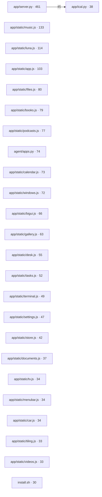
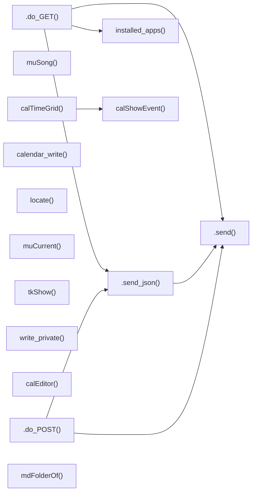

# Codemap: adleros

← [README](README.md)

> Generated from commit `9c153b0` by `scripts/codemap.py`. Regenerate it from the workspace root with `python3 scripts/codemap.py adleros`; don't edit it by hand.

## Files

Each box is a source file and its function count; an arrow means calls into that file.

(23 smaller files not drawn.)

## Hubs

The most connected functions: where a change reaches furthest.

| Function | Where | Called by | Calls |
|---|---|---|---|
| `.do_GET()` | `app/server.py:6940` | 1 | 53 |
| `.send_json()` | `app/server.py:6881` | 39 | 1 |
| `muSong()` | `app/static/music.js:58` | 34 | 0 |
| `.do_POST()` | `app/server.py:7090` | 0 | 33 |
| `calendar_write()` | `app/server.py:4623` | 1 | 29 |
| `locate()` | `app/server.py:5735` | 24 | 2 |
| `muCurrent()` | `app/static/music.js:62` | 25 | 0 |
| `tkShow()` | `app/static/tasks.js:186` | 18 | 7 |
| `write_private()` | `app/server.py:174` | 25 | 0 |
| `.send()` | `app/server.py:6867` | 24 | 0 |
| `installed_apps()` | `app/server.py:272` | 20 | 3 |
| `calEditor()` | `app/static/calendar.js:1122` | 2 | 20 |
| `calShowEvent()` | `app/static/calendar.js:692` | 4 | 17 |
| `calTimeGrid()` | `app/static/calendar.js:556` | 1 | 20 |
| `mdFolderOf()` | `app/static/luna.js:27` | 21 | 0 |

## Functions

### `agent/agent.py`

- `stamp()` L60
- `log()` L64
- `write_private()` L70
- `rewrite()` L79
- `save_job()` L89 → `write_private()`
- `prune_jobs()` L93
- `read_request()` L102
- `load_actions()` L119
- `validate_params()` L131
- `set_config()` L159 → `rewrite()`
- `expand()` L176
- `run()` L192 → `save_job()`
- `run_for_result()` L217
- `process()` L236 → `read_request()`, `log()`, `stamp()`, `validate_params()`, `save_job()`, `set_config()`, `expand()`, `run_for_result()`, `run()`
- `main()` L304 → `load_actions()`, `process()`, `prune_jobs()`

### `agent/apps.py`

- `say()` L110
- `read_env()` L114
- `rewrite()` L132
- `compose_file()` L153
- `folder_compose_files()` L165 → `compose_file()`
- `setting()` L182 → `read_env()`
- `catalog()` L186
- `registry_app()` L202
- `registry_apps()` L220 → `registry_app()`
- `catalog_app()` L246 → `folder_compose_files()`
- `every_app()` L252 → `read_env()`, `catalog()`, `catalog_app()`, `registry_apps()`, `store_templates()`
- `all_apps()` L273 → `every_app()`
- `docker_env()` L280
- `compose()` L286 → `untrusted()`, `say()`, `docker_env()`
- `run_installer()` L297 → `say()`, `docker_env()`
- `containers()` L305 → `docker_env()`
- `app_status()` L336 → `containers()`, `summarize()`
- `usage()` L363 → `docker_env()`, `app_status()`, `parse_bytes()`
- `scoped()` L400
- `pre_start()` L405 → `untrusted()`, `say()`, `docker_env()`, `read_env()`
- `start()` L419 → `pre_start()`, `say()`, `compose()`, `first_failure()`, `scoped()`
- `stop()` L430 → `compose()`, `first_failure()`, `scoped()`
- `restart()` L434 → `app_status()`, `say()`, `start()`, `compose()`, `first_failure()`, `scoped()`
- `update()` L441 → `compose()`, `first_failure()`, `scoped()`, `say()`, `start()`
- `logs()` L450 → `scoped()`, `docker_env()`
- `remove_containers()` L468 → `compose()`, `first_failure()`, `scoped()`
- `set_chosen()` L475 → `read_env()`, `catalog()`, `rewrite()`
- `set_setting()` L491 → `rewrite()`
- `set_roots()` L506 → `untrusted()`, `set_setting()`, `say()`
- `write_record()` L526 → `write_private()`
- `set_registry_installed()` L533 → `write_record()`
- `delete()` L537 → `remove_containers()`, `say()`, `forget()`, `set_registry_installed()`, `set_chosen()`, `run_installer()`
- `install()` L555 → `set_registry_installed()`, `start()`, `store_install()`, `set_chosen()`, `say()`, `run_installer()`
- `image_path()` L570
- `known_apps()` L580
- `classify()` L598 → `image_path()`, `known_apps()`
- `host_address()` L626 → `setting()`
- `new_app_id()` L648 → `slug()`, `catalog()`
- `store_install()` L704 → `apps_dir()`, `registry_apps()`, `free_port()`, `setting()`, `render_env()`, `rewrite()`, `make_mount_dirs()`, `say()`, `host_address()`, `compose()`, +1
- `plan_file()` L746 → `classify()`, `backing()`
- `record_for()` L788 → `backing()`, `web_port()`, `image_path()`, `new_app_id()`, `host_address()`
- `discover()` L814 → `setting()`, `say()`, `every_app()`, `known_apps()`, `web_writable()`, `find_compose_files()`, `services()`, `plan_file()`, `record_for()`, `write_record()`, +1
- `proxy_hosts()` L859 → `host_address()`, `registry_apps()`
- `use_proxy_addresses()` L886 → `proxy_hosts()`, `registry_apps()`, `host_address()`, `services()`, `write_record()`, `say()`
- `first_failure()` L919
- `web_writable()` L932 → `setting()`
- `untrusted()` L944 → `web_writable()`
- `importable()` L949 → `untrusted()`
- `services()` L963 → `docker_env()`
- `find_compose_files()` L997 → `compose_file()`
- `scan()` L1016 → `every_app()`, `find_compose_files()`, `importable()`, `taken_services()`, `services()`
- `import_app()` L1054 → `importable()`, `services()`, `every_app()`, `taken_services()`, `new_app_id()`, `classify()`, `write_record()`, `say()`
- `add_site()` L1100 → `every_app()`, `new_app_id()`, `write_record()`, `say()`
- `forget()` L1130 → `registry_app()`, `say()`
- `set_url()` L1144 → `registry_app()`, `host_address()`, `say()`, `write_record()`
- `firefox_container()` L1168 → `docker_env()`
- `firefox_prefs()` L1204 → `rewrite()`
- `firefox_quit()` L1224 → `registry_apps()`, `firefox_container()`, `firefox_prefs()`, `docker_env()`
- `firefox_url()` L1238 → `registry_apps()`, `firefox_container()`, `firefox_prefs()`, `docker_env()`
- `main()` L1281 → `firefox_url()`, `firefox_quit()`, `discover()`, `scan()`, `set_roots()`, `import_app()`, `add_site()`, `forget()`, `set_url()`, `all_apps()`, +4
- … and 14 less-connected functions

### `agent/connect.py`

- `say()` L39
- `read_env()` L43
- `set_setting()` L62
- `Install` L85
- `.__init__()` L89 → `.registry()`, `read_env()`
- `.registry()` L118
- `.env()` L128 → `read_env()`
- `.url()` L131 → `.env()`
- `.folder()` L138
- `call()` L144
- `said()` L161
- `wait_for()` L172 → `say()`
- `Terminal` L191
- `.__init__()` L194
- `.ask()` L202
- `.yes()` L210 → `.ask()`
- `.password()` L213
- `.new_password()` L216 → `.password()`, `say()`
- `paperless()` L229 → `read_env()`, `call()`, `wait_for()`, `set_setting()`, `said()`, `say()`
- `immich()` L256 → `call()`, `wait_for()`, `said()`, `say()`, `set_setting()`
- `subsonic_ok()` L300 → `call()`
- `navidrome()` L308 → `call()`, `wait_for()`, `say()`, `said()`, `subsonic_ok()`, `set_setting()`
- `main()` L350 → `Install`, `Terminal`, `say()`

### `agent/files.py`

- `setting()` L35
- `folder()` L48
- `places()` L53 → `folder()`, `setting()`
- `Refused` L64
- `locate()` L68 → `Refused`
- `files_path()` L96
- `good_name()` L101
- `changeable()` L106 → `Refused`
- `unique_name()` L112
- `move()` L121
- `copy()` L134
- `op_text()` L143 → `locate()`, `changeable()`, `Refused`, `files_path()`
- `op_mkdir()` L165 → `locate()`, `good_name()`, `Refused`, `files_path()`
- `op_rename()` L176 → `locate()`, `changeable()`, `good_name()`, `Refused`, `files_path()`
- `op_delete()` L188 → `Refused`, `locate()`, `changeable()`, `files_path()`, `move()`
- `op_restore()` L202 → `locate()`, `move()`, `unique_name()`
- `op_transfer()` L225 → `locate()`, `Refused`, `changeable()`, `unique_name()`, `copy()`, `move()`, `files_path()`
- `read_request()` L245 → `Refused`
- `main()` L265 → `read_request()`, `setting()`, `Refused`, `places()`

### `agent/maint`

- `run()` L9

### `agent/tailscale.py`

- `ts()` L24
- `status()` L28 → `ts()`
- `host_path()` L46 → `places()`, `locate()`
- `get()` L58 → `places()`, `host_path()`, `ts()`
- `send()` L75 → `host_path()`, `ts()`

### `agent/terminal.py`

- `log()` L51
- `setting()` L55
- `enabled()` L68 → `setting()`
- `login_shell()` L72
- `start_folder()` L85 → `setting()`
- `ours()` L94
- `write_ended()` L103
- `read_small()` L110
- `set_size()` L116
- `Session` L122
- `.__init__()` L123 → `login_shell()`, `start_folder()`, `set_size()`, `log()`
- `.pump_output()` L148
- `.pump_input()` L161 → `ours()`
- `.check_size()` L184 → `ours()`, `read_small()`, `set_size()`
- `.wanted_closed()` L197
- `.end()` L200 → `write_ended()`, `log()`
- `new_requests()` L230 → `ours()`, `read_small()`, `log()`, `write_ended()`
- `tidy()` L263 → `ours()`
- `main()` L281 → `enabled()`, `new_requests()`, `write_ended()`, `Session`, `log()`, `tidy()`

### `app/ical.py`

- `parse()` L22 → `parse_line()`
- `parse_line()` L45
- `text()` L76
- `prop()` L81
- `props()` L89
- `zones()` L95 → `prop()`, `named_zone()`
- `named_zone()` L117
- `value_of()` L132 → `named_zone()`
- `values_of()` L153 → `value_of()`
- `duration()` L158
- `local()` L168
- `events()` L180 → `zones()`, `prop()`, `value_of()`, `local()`, `duration()`, `text()`, `props()`, `values_of()`
- `rrule()` L218
- `month_days()` L241
- `nth()` L247
- `period()` L260 → `day_in()`, `month_days()`, `nth()`
- `day_in()` L321 → `month_days()`
- `periods_before()` L326
- `starts()` L340 → `periods_before()`, `period()`
- `until_of()` L373 → `value_of()`, `local()`
- `instant()` L387
- `expand()` L392 → `rrule()`, `local()`, `starts()`, `until_of()`, `add_occurrence()`
- `sort_key()` L437
- `add_occurrence()` L441 → `instant()`, `iso()`
- `iso()` L471
- `escape()` L477
- `fold()` L482
- `param_text()` L497
- `serialize()` L504 → `fold()`
- `emit()` L509 → `param_text()`
- `_reindex()` L525
- `remove()` L531 → `_reindex()`
- `put()` L537 → `_reindex()`
- `add()` L551
- `when_text()` L555
- `offset_text()` L569
- `vtimezone()` L576 → `offset_text()`, `month_days()`
- `rrule_text()` L612

### `app/musictags.py`

- `read_tags()` L36 → `_mp3()`, `_flac()`, `_ogg()`, `_mp4()`, `_wav()`, `_tidy()`
- `read_cover()` L58 → `_id3()`, `_flac()`, `_ogg()`, `_mp4()`
- `read_comment()` L76 → `_id3()`
- `read_lyrics()` L84 → `_id3()`, `_flac()`, `_ogg()`, `_mp4()`
- `_number()` L106
- `_genre()` L112
- `_tidy()` L123 → `_number()`, `_genre()`
- `_syncsafe()` L168
- `_unsync()` L172
- `_id3_text()` L176
- `_id3_split_desc()` L196
- `_id3_decode()` L207
- `_id3()` L212 → `_syncsafe()`, `_unsync()`, `_id3_split_desc()`, `_image_mime()`, `_id3_decode()`, `_sylt()`, `_id3_text()`
- `_sylt()` L327 → `_id3_split_desc()`, `_id3_decode()`
- `_image_mime()` L343
- `_mp3()` L365 → `_id3()`, `_mp3_length()`
- `_mp3_length()` L388
- `_vorbis_comments()` L421 → `_flac_picture()`
- `_flac_picture()` L458 → `_image_mime()`
- `_pick_cover()` L470
- `_flac()` L476 → `_vorbis_comments()`, `_flac_picture()`, `_pick_cover()`
- `_ogg_packets()` L513
- `_ogg()` L530 → `_ogg_packets()`, `_vorbis_comments()`, `_pick_cover()`
- `_atoms()` L563
- `_mp4()` L586 → `_atoms()`, `_mp4_items()`
- `_mp4_items()` L621 → `_atoms()`, `_image_mime()`
- `_wav()` L665

### `app/server.py`

- `write_private()` L174
- `read_env_file()` L184
- `installed_apps()` L272 → `registry_apps()`, `read_env_file()`, `read_catalog()`
- `available_apps()` L358 → `read_env_file()`, `read_catalog()`, `registry_apps()`, `store_apps()`
- `load_settings()` L393
- `save_settings()` L401 → `load_settings()`, `write_private()`
- `admin_on()` L424 → `admin_until()`
- `install_setting()` L574 → `read_env_file()`
- `device_info()` L758 → `read_env_file()`, `cpu_usage()`, `beszel_system()`
- `queue_action()` L971 → `unfinished_jobs()`, `busy_job()`, `stamp()`, `write_private()`
- `place_on()` L1560 → `place_host()`
- `places_on()` L1565 → `place_on()`
- `radio_stations()` L1925
- `radio_logo_find()` L2240 → `_logo_core()`, `_logo_words()`, `_logo_stream()`, `radio_open()`, `_radio_browser()`, `_logo_stem()`, `_logo_site()`, `_logo_named()`, `_web_get()`, `_StationPage`, +1
- `music_dir()` L2481 → `install_setting()`, `locate()`, `place_path()`
- `music_item()` L2587 → `locate()`, `music_dir()`, `place_path()`
- `navidrome_bring()` L2940 → `navidrome_matcher()`, `navidrome_songs()`, `match()`, `navidrome_call()`, `music_favorites()`, `save_favorites()`, `navidrome_id()`
- `abs_conn()` L3663 → `install_setting()`, `installed_apps()`
- `abs_json()` L3689 → `abs_open()`
- `pods_local()` L4033 → `pods_scan()`
- `calendar_state()` L4434 → `caldav()`, `caldav_home()`, `caldav_calendars()`, `caldav_events()`
- `calendar_write()` L4623 → `caldav()`, `calendar_state()`, `calendar_fields()`, `cal_times()`, `cal_text()`, `add()`, `cal_rule()`, `put()`, `cal_stamp()`, `cal_zones_used()`, +19
- `cal_split()` L4844 → `prop()`, `events()`, `rrule()`, `starts()`, `put()`, `props()`, `values_of()`, `cal_wall()`, `remove()`, `add()`, +2
- `vk()` L4955 → `vikunja()`
- `tasks_move_in()` L5124 → `tasks_local()`, `vk_projects()`, `vk_all()`, `vk()`, `vk_body()`, `tasks_local_save()`
- `tasks_read()` L5248 → `tasks_connected()`, `tasks_read_local()`, `vk_projects()`, `vk_all()`, `vk_id()`, `vk()`, `vk_task()`, `vk_date()`
- `tasks_write()` L5320 → `tasks_connected()`, `tasks_local()`, `tasks_write_local()`, `tasks_local_save()`, `vk_id()`, `task_fields()`, `vk()`, `vk_body()`, `vk_projects()`, `vk_task()`
- `locate()` L5735 → `place_on()`, `nested()`
- `place_path()` L5757
- `jf_json()` L6531 → `jf_open()`
- `.client()` L6815 → `._from_proxy()`
- `.send()` L6867
- `.send_json()` L6881 → `.send()`
- `.settings_payload()` L6910 → `read_env_file()`, `display_name()`, `search_url()`, `selected_wallpaper_id()`, `wallpaper_options()`, `installed_apps()`, `device_info()`, `backups_info()`, `action_summary()`, `load_actions()`, +4
- `.do_GET()` L6940 → `.send()`, `.serve_static()`, `.logged_in()`, `selected_wallpaper_id()`, `.send_json()`, `wallpaper_path()`, `.serve_file()`, `dock_icon_path()`, `installed_apps()`, `placed()`, +43
- `.do_POST()` L7090 → `.cross_site()`, `.send_json()`, `.login()`, `.session_token()`, `revoke()`, `.cookie_header()`, `.send()`, `.logged_in()`, `.read_json()`, `.update_settings()`, +23
- `.login()` L7178 → `.client()`, `lockout_remaining()`, `.send_json()`, `.read_json()`, `password_ok()`, `record_failure()`, `.cookie_header()`, `new_session()`
- `.update_settings()` L7195 → `.send_json()`, `installed_apps()`, `collection_choices()`, `app_folders()`, `app_order()`, `widget_catalog()`, `valid_search_url()`, `wallpaper_path()`, `placements()`, `save_settings()`
- `.change_password()` L7288 → `.client()`, `lockout_remaining()`, `.send_json()`, `password_ok()`, `record_failure()`, `hash_password()`, `save_settings()`, `.cookie_header()`, `new_session()`
- `.files_get()` L7308 → `places_on()`, `.send_json()`, `trash_items()`, `search_files()`, `admin_on()`, `locate()`, `list_folder()`, `place_path()`, `root_writes()`, `terminal_enabled()`, +2
- `.notes_get()` L7417 → `places_on()`, `.send_json()`, `load_settings()`, `vault_list()`, `default_vault()`, `vault_index()`, `vault_search()`
- `.notes_post()` L7434 → `places_on()`, `.send_json()`, `vault_rename()`, `load_settings()`, `locate()`, `good_name()`, `place_path()`, `save_settings()`, `vault_list()`
- `.music_get()` L7477 → `radio_logos_soon()`, `.send_json()`, `radio_listed()`, `.radio_get()`, `places_on()`, `navidrome_sync()`, `music_counts()`, `music_favorites()`, `music_plays()`, `music_library()`, +8
- `.radio_get()` L7529 → `radio_stations()`, `.send_json()`, `radio_logo_file()`, `.send()`, `radio_open()`, `radio_title()`
- `.radio_post()` L7607 → `.send_json()`, `radio_stations()`, `radio_save()`, `radio_logo_forget()`, `radio_listed()`, `radio_logos_soon()`, `radio_parse()`, `locate()`, `radio_url()`, `radio_add()`
- `.music_post()` L7680 → `.radio_post()`, `places_on()`, `.send_json()`, `music_item()`, `music_played()`, `navidrome_scrobble()`, `music_favorite()`, `music_dir()`, `music_library()`, `.music_list_file()`, +4
- `.books_get()` L7745 → `books_dir()`, `books_list()`, `books_abs_items()`, `books_abs_match()`, `books_state()`, `.send_json()`, `pods_status()`, `abs_open()`, `write_private()`, `.send()`, +7
- `.books_post()` L7846 → `.send_json()`, `pods_connect()`, `book_path()`, `books_save_state()`, `abs_conn()`, `book_key()`, `write_private()`, `.send()`
- `.podcasts_get()` L7891 → `.send_json()`, `pods_status()`, `abs_library()`, `abs_error()`, `pods_local_library()`, `abs_item()`, `pods_local_item()`, `pods_cover()`, `.send()`, `pods_local_file()`, +5
- `.iptv_get()` L7986 → `.send_json()`, `iptv_settings()`, `iptv_channels()`, `iptv_via()`, `iptv_sign()`, `.send()`, `.iptv_relay()`
- `.videos_get()` L8108 → `.send_json()`, `videos_status()`, `videos_local()`, `.videos_stream()`, `.videos_image()`, `jf_home()`, `jf_library()`, `jf_detail()`, `jf_search()`, `jf_error()`
- `.podcasts_post()` L8220 → `.send_json()`, `pods_connect()`, `abs_play()`, `pods_local_play()`, `abs_sync()`, `pods_local()`, `pods_local_file()`, `pods_progress_set()`, `abs_json()`, `abs_subscribe()`, +3
- `.gallery_get()` L8292 → `gallery_status()`, `.send_json()`, `gallery_query()`, `immich_json()`, `.gallery_local_reply()`, `.gallery_local_thumb()`, `.gallery_album_zip()`, `.gallery_stream()`
- `.documents_get()` L8372 → `documents_status()`, `.send_json()`, `documents_local()`, `documents_query()`, `paperless_json()`, `paperless_all()`, `.paperless_stream()`
- `.documents_post()` L8525 → `locate()`, `.send_json()`, `paperless_post_file()`, `good_name()`, `unique_name()`, `paperless_open()`, `place_path()`
- `.files_post()` L8675 → `places_on()`, `.send_json()`, `locate()`, `is_top()`, `.root_change()`, `place_path()`, `good_name()`, `is_kept()`, `.root_refused()`, `to_trash()`, +5
- `.do_PUT()` L8803 → `.send()`, `.cross_site()`, `.send_json()`, `.logged_in()`, `.documents_upload()`, `places_on()`, `locate()`, `good_name()`, `unique_name()`, `place_path()`
- `.open_terminal()` L8850 → `admin_on()`, `.send_json()`, `terminal_enabled()`, `terminal_sessions()`, `close_abandoned()`, `terminal_append()`, `write_private()`
- `.terminal_request()` L8877 → `admin_on()`, `.send_json()`, `terminal_folder()`, `terminal_append()`, `write_private()`, `.send()`
- `.set_admin()` L8902 → `.send_json()`, `.client()`, `lockout_remaining()`, `password_ok()`, `record_failure()`, `save_settings()`, `close_terminals()`, `admin_left()`
- … and 401 less-connected functions

### `app/static/app.js`

- `el()` L58
- `svg()` L71
- `api()` L90
- `monogram()` L149 → `hue()`, `initials()`
- `plateFor()` L156 → `el()`, `monogram()`
- `tile()` L170 → `ownTile()`, `plateFor()`, `el()`, `svg()`, `opensHere()`, `openApp()`, `setStatus()`
- `ownTile()` L201 → `el()`
- `setStatus()` L217
- `layout()` L239 → `geometry()`, `phoneLayout()`, `homeGroups()`, `gridKey()`, `draw()`
- `gridKey()` L294
- `homeGroups()` L327 → `ownApps()`, `groupApps()`
- `draw()` L361 → `el()`, `setPageCount()`, `tile()`, `goToPage()`
- `setPageCount()` L390 → `el()`, `goToPage()`, `updatePager()`
- `goToPage()` L407 → `pageGlideStop()`, `updatePager()`
- `updatePager()` L415
- `pageShow()` L458
- `pageGlideStop()` L466
- `pageGlide()` L473 → `pageGlideStop()`, `pageShow()`, `goToPage()`
- `onPagesWheel()` L503 → `arranging()`, `goToPage()`
- `onPagesDown()` L521 → `arranging()`, `phoneLayout()`, `pageGlideStop()`, `pageUnrubber()`, `pageShow()`
- `onPagesMove()` L537 → `pageRubber()`, `pageShow()`
- `onPagesUp()` L566 → `pageGlide()`, `phoneLayout()`
- `appById()` L604
- `pinFor()` L638 → `appById()`
- `phoneLayout()` L642
- `bounce()` L644
- `fixedDockItem()` L650 → `el()`, `bounce()`, `toast()`
- `builtinDockItem()` L665 → `el()`, `bounce()`
- `pinnedDockItem()` L681 → `builtinDockItem()`, `el()`, `plateFor()`, `bounce()`, `opensHere()`, `openApp()`
- `buildDock()` L700 → `phoneLayout()`, `dockKeyFor()`, `el()`
- `setPinned()` L740 → `toast()`, `api()`, `showLock()`, `buildDock()`
- `dockDims()` L762 → `phoneLayout()`
- `magnify()` L786 → `phoneLayout()`, `dockDims()`
- `toast()` L800
- `openMenu()` L815 → `el()`, `closeMenu()`
- `closeMenu()` L840
- `opensHere()` L851
- `openApp()` L858 → `toast()`
- `menuFor()` L883 → `openWindowFor()`, `closeItem()`, `menuForItem()`
- `menuForItem()` L895 → `appById()`, `isPinned()`, `setPinned()`, `newWindowItem()`, `openApp()`, `collectionDialog()`, `toast()`
- `onContextMenu()` L943 → `menuFor()`, `openMenu()`
- `onPressStart()` L955 → `arranging()`, `menuFor()`, `openMenu()`
- `onPressMove()` L968 → `sortable()`, `closeMenu()`, `startArranging()`, `beginDrag()`
- `arranging()` L1007
- `clearMerge()` L1052
- `dropOnDock()` L1064 → `pinFor()`, `setPinned()`, `toast()`
- `onSortMove()` L1078 → `beginDrag()`, `overDock()`, `edgeTurn()`, `holdOver()`, `mergeZone()`, `clearMerge()`, `moveBefore()`
- `dropAcrossPages()` L1138 → `collectionOrder()`, `appById()`, `placeApp()`
- `beginDrag()` L1144 → `closeMenu()`
- `onSortUp()` L1180 → `clearMerge()`, `dropOnDock()`, `overDock()`, `dropAcrossPages()`, `saveArrangement()`
- `placeApp()` L1213 → `api()`, `showLock()`, `toast()`, `layout()`, `refresh()`, `appById()`, `goToPage()`
- `collectionDialog()` L1238 → `el()`, `placeApp()`
- `saveArrangement()` L1271 → `collectionOrder()`, `api()`, `showLock()`, `toast()`, `buildDock()`, `layout()`, `gridKey()`, `homeGroups()`
- `closeSearch()` L1344
- `renderResults()` L1361 → `searchFilesSoon()`, `el()`, `plateFor()`, `svg()`, `select()`, `runResult()`
- `runResult()` L1414 → `closeSearch()`, `openApp()`, `webSearch()`, `confirmLogout()`
- `showLock()` L1454 → `stopRefresh()`, `stopArranging()`, `closeSearch()`, `closeMenu()`
- `showDesktop()` L1520 → `refresh()`, `buildDock()`, `startRefresh()`
- `refresh()` L1549 → `api()`, `showLock()`, `greeting()`, `layout()`, `setStatus()`, `buildDock()`
- `startRefresh()` L1579 → `stopRefresh()`, `refresh()`
- … and 43 less-connected functions

### `app/static/bigui.js`

- `bigOn()` L43
- `bigBuild()` L47
- `bigOpen()` L62 → `bigBuild()`, `bigViewerClose()`, `bigRail()`, `bigDraw()`
- `bigOpenPage()` L81 → `bigOpen()`, `bigOn()`, `bigPush()`
- `bigClose()` L86 → `bigViewerClose()`
- `bigBack()` L97 → `bigDraw()`, `bigClose()`, `bigOn()`, `bigViewerClose()`
- `bigRemember()` L108
- `bigPush()` L114 → `bigRemember()`, `bigDraw()`
- `bigRail()` L122 → `bigTick()`
- `bigTick()` L137 → `bigOn()`, `bigMini()`, `bigNowUpdate()`
- `bigDraw()` L147 → `bigHeadBack()`, `bigContent()`, `bigMini()`
- `bigHeadBack()` L203
- `bigContent()` L210 → `bigNowPage()`, `bigHero()`, `bigSection()`
- `bigHero()` L219
- `bigSection()` L235 → `bigRow()`, `bigTile()`
- `bigPress()` L254 → `bigOn()`, `bigOpenPage()`, `bigPush()`
- `bigBar()` L262
- `bigArt()` L270
- `bigRow()` L272 → `bigPress()`, `bigArt()`, `bigBar()`
- `bigTile()` L280 → `bigArt()`, `bigBar()`, `bigPress()`
- `bigMini()` L288
- `bigListen()` L319 → `bigClose()`, `bigOn()`, `bigBuild()`, `bigRail()`, `bigRemember()`, `bigDraw()`
- `bigNowPage()` L338
- `bigLyricsLoad()` L358 → `bigLyricsDraw()`
- `bigLyricsDraw()` L369 → `bigLyricsFollow()`
- `bigLyricsFollow()` L384
- `bigNowUpdate()` L403 → `bigLyricsLoad()`, `bigLyricsDraw()`
- `bigViewerOpen()` L447 → `bigViewerZoom()`, `bigViewerStep()`, `bigViewerPlace()`, `bigViewerShow()`
- `bigViewerShow()` L489
- `bigViewerStep()` L502 → `bigViewerShow()`, `bigViewerZoom()`
- `bigViewerZoom()` L512 → `bigViewerPlace()`
- `bigViewerPlace()` L523
- `bigViewerClose()` L530
- `bigKeys()` L539 → `bigViewerStep()`
- `bigMusicReady()` L557
- `bigCount()` L563
- `bigAlbumItem()` L565 → `bigAlbumPage()`
- `bigListItem()` L568 → `bigCount()`, `bigPlaylistPage()`
- `bigMusicRecent()` L574 → `bigAlbumItem()`, `bigListItem()`
- `bigMusicRoot()` L588 → `bigMusicReady()`, `bigCount()`, `bigListen()`, `bigMusicRecent()`, `bigArtistPage()`
- `bigSongs()` L602 → `bigListen()`
- `bigPlayButtons()` L612 → `bigListen()`
- `bigAlbumPage()` L617 → `bigPlayButtons()`, `bigSongs()`
- `bigPlaylistPage()` L621 → `bigCount()`, `bigPlayButtons()`, `bigSongs()`
- `bigArtistPage()` L625 → `bigCount()`, `bigListen()`, `bigSongs()`
- `bigPodsReady()` L635
- `bigPodContinue()` L641 → `bigListen()`
- `bigPodItem()` L651 → `bigCount()`, `bigPodPage()`
- `bigPodsRoot()` L657 → `bigPodsReady()`, `bigPodContinue()`, `bigEpisode()`
- `bigEpisode()` L669 → `bigListen()`
- `bigPodPage()` L677 → `bigListen()`, `bigCount()`, `bigEpisode()`
- `bigVideoItem()` L696 → `bigPlayVideo()`, `bigVideoPage()`
- `bigPlayVideo()` L705
- `bigVideosRoot()` L719 → `bigVideoItem()`
- `bigVideoPage()` L740 → `bigPlayVideo()`
- `bigPhotoTiles()` L759 → `bigViewerOpen()`
- `bigPhotosRoot()` L780 → `bigPhotoTiles()`, `bigTimeline()`
- `bigDayName()` L836
- `bigEventPage()` L848 → `bigDayName()`
- `bigCalendarRoot()` L854 → `bigEvents()`, `bigDayName()`
- … and 6 less-connected functions

### `app/static/books.js`

- `bkGet()` L37
- `bkPost()` L44
- `bkSavePrefs()` L51
- `openBooks()` L55 → `bkBuild()`, `bkLoad()`
- `bkBuild()` L69 → `bkRender()`, `bkSaveNow()`, `bkCloseBook()`, `bkResizeSoon()`, `bkRenderSide()`
- `bkLoad()` L94 → `bkCoversSoon()`, `bkGet()`, `bkRender()`, `bkRenderSide()`
- `bkRenderSide()` L112 → `bkRender()`
- `bkConnectPage()` L138 → `bkLoad()`, `bkPost()`
- `bkRender()` L193 → `bkConnectPage()`, `bkGrid()`
- `bkCover()` L230 → `bkCoverImg()`
- `bkCoverImg()` L240
- `bkGrid()` L247 → `bkCover()`, `bkOpenBook()`
- `bkHero()` L258 → `bkCover()`, `bkOpenBook()`
- `bkCoversSoon()` L269 → `bkDrawCover()`, `bkPost()`, `bkCoverImg()`
- `bkPdfOpen()` L289
- `bkDrawCover()` L295 → `bkPdfOpen()`
- `bkOpenBook()` L318 → `bkById()`, `bkSaveNow()`, `bkCloseBook()`, `bkGet()`, `bkSmallScreen()`, `bkReaderBuild()`, `bkPdfOpen()`, `bkPdfText()`, `bkLayout()`
- `bkCloseBook()` L361 → `bkSaveNow()`, `bkLoad()`
- `bkReaderBuild()` L376 → `bkCloseBook()`, `bkContents()`, `bkSetView()`, `bkSetRtl()`, `bkFont()`, `bkCountText()`, `bkGo()`, `bkTurn()`, `bkPointer()`, `bkResizeSoon()`
- `bkSetRtl()` L417 → `bkSavePrefs()`, `bkDirMark()`, `bkShow()`
- `bkDirMark()` L428
- `bkSetView()` L441 → `bkPosExact()`, `bkPdfText()`, `bkSavePrefs()`, `bkLayout()`, `bkSaveSoon()`
- `bkFont()` L455 → `bkPosExact()`, `bkSavePrefs()`, `bkLayout()`
- `bkResizeSoon()` L468 → `bkLayout()`, `bkPosExact()`
- `bkSmallScreen()` L481
- `bkMeasureBox()` L485 → `bkSmallScreen()`
- `bkLayout()` L506 → `bkMeasureBox()`, `bkDirMark()`, `bkShow()`, `bkStart()`, `bkSections()`, `bkFlow()`
- `bkStart()` L532
- `bkSectionHtml()` L565 → `bkGet()`
- `bkFlowEl()` L574
- `bkPlace()` L581 → `bkFlowEl()`, `bkSectionHtml()`
- `bkFlow()` L598 → `bkPosSection()`, `bkPlace()`, `bkColumns()`, `bkColumnOf()`, `bkRecount()`, `bkShow()`, `bkStart()`, `bkFootUpdate()`, `bkPosNow()`
- `bkPosSection()` L647
- `bkTextNodes()` L663
- `bkColOfRect()` L674
- `bkColumnOf()` L680 → `bkPlace()`, `bkColOfRect()`, `bkTextNodes()`
- `bkOffsetOf()` L703 → `bkPlace()`, `bkTextNodes()`, `bkColOfRect()`
- `bkWhere()` L727
- `bkPosExact()` L734 → `bkWhere()`, `bkOffsetOf()`, `bkPosNow()`
- `bkPosNow()` L746 → `bkWhere()`
- `bkFace()` L763 → `bkPdfFace()`, `bkWhere()`, `bkFlowEl()`, `bkSectionHtml()`
- `bkPdfFace()` L788 → `bkPdfDraw()`
- `bkPdfDraw()` L801
- `bkShow()` L835 → `bkStart()`, `bkFace()`, `bkFootUpdate()`, `bkSaveSoon()`, `bkPdfDraw()`
- `bkCountText()` L856
- `bkFootUpdate()` L862 → `bkCountText()`
- `bkGo()` L874 → `bkStart()`, `bkShow()`, `bkTurn()`
- `bkTurn()` L886 → `bkCurlAuto()`, `bkSlideAuto()`
- `bkCurlStart()` L947 → `bkFace()`
- `bkCurlDraw()` L986 → `bkShade()`, `bkFold()`, `bkPoly()`
- `bkCurlAnimate()` L1023 → `bkCurlDraw()`
- `bkCurlAuto()` L1036 → `bkCurlStart()`, `bkCurlRetarget()`, `bkCurlDraw()`, `bkCurlAnimate()`, `bkCurlEnd()`
- `bkCurlEnd()` L1074 → `bkShow()`
- `bkSlideAuto()` L1082 → `bkFace()`, `bkShow()`
- `bkPointer()` L1103 → `bkMx()`, `bkCurlStart()`, `bkLocal()`, `bkCurlDraw()`, `bkSlideStart()`, `bkSlideMove()`, `bkTurn()`, `bkCurlAnimate()`, `bkCurlEnd()`, `bkSlideEnd()`, +1
- `bkGoTo()` L1284 → `bkGo()`, `bkPosSection()`, `bkColumnOf()`
- `bkFollow()` L1291 → `bkWhere()`, `bkGoTo()`
- `bkPdfText()` L1301 → `bkNoText()`, `bkGet()`, `bkPageText()`, `bkPost()`
- `bkSaveSoon()` L1384 → `bkPosExact()`, `bkSaveNow()`
- `bkSaveNow()` L1389 → `bkPosNow()`
- … and 19 less-connected functions

### `app/static/calendar.js`

- `CAL_HOUR()` L32
- `calYmd()` L44
- `calFromYmd()` L45
- `calAdd()` L46
- `calMidnight()` L47
- `calSameDay()` L48
- `calDays()` L49 → `calMidnight()`
- `calZone()` L50
- `calWeekStart()` L62 → `calAdd()`, `calMidnight()`
- `calTime()` L64
- `calLong()` L65
- `calRange()` L68 → `calAdd()`, `calWeekStart()`
- `calView()` L75
- `openCalendar()` L79 → `calBuild()`, `calCheck()`, `calRender()`, `calTick()`
- `calKeepFocus()` L90
- `calBuild()` L103 → `calMidnight()`, `calGo()`, `calSetView()`, `calListsPop()`, `calNew()`, `calStep()`, `calPopClose()`, `calEdit()`, `calDelete()`, `calDraw()`
- `calTick()` L173 → `calNowLine()`, `calLoad()`, `calDraw()`, `calSameDay()`
- `calSave()` L194
- `calSetView()` L196 → `calSave()`, `calRender()`
- `calGo()` L203 → `calMidnight()`, `calRender()`
- `calStep()` L209 → `calView()`, `calAdd()`, `calSameDay()`, `calMidnight()`, `calRender()`
- `calLoad()` L221 → `calRange()`, `calYmd()`, `calZone()`, `calRender()`, `calNoteError()`, `calDraw()`, `calRenderSide()`
- `calColor()` L255
- `calCalendar()` L257
- `calEventColor()` L259 → `calCalendar()`, `calColor()`
- `calLong24()` L267
- `calLastDay()` L270 → `calMidnight()`
- `calRender()` L274 → `calView()`, `calRenderNote()`, `calRenderSide()`, `calRange()`, `calYmd()`, `calDraw()`
- `calDraw()` L291 → `calKeepFocus()`
- `calDrawNow()` L293 → `calView()`, `calTitle()`, `calPopClose()`, `calVisible()`, `calMonth()`, `calTimeGrid()`
- `calTitle()` L305 → `calLong()`, `calRange()`
- `calRenderSide()` L348 → `calKeepFocus()`
- `calRenderSideNow()` L350 → `calRenderSide()`, `calWeekStart()`, `calAdd()`, `calRange()`, `calLong()`, `calSameDay()`, `calView()`, `calGo()`, `calListsBox()`
- `calListsBox()` L380 → `calColor()`, `calSave()`, `calRenderSide()`, `calDraw()`
- `calListsPop()` L410 → `calPopClose()`, `calListsBox()`, `calPopOpen()`
- `calMonth()` L417 → `calRange()`, `calAdd()`, `calLong()`, `calYmd()`, `calSameDay()`, `calNew()`, `calCanEdit()`, `calDraw()`, `calRenderSide()`, `calGo()`, +7
- `calChip()` L520 → `calEventColor()`, `calTime()`, `calShowEvent()`, `calEventHooks()`, `calDayDrag()`
- `calAgenda()` L536 → `calAdd()`, `calLong()`, `calLong24()`, `calTime()`, `calEventColor()`, `calShowEvent()`
- `calTimeGrid()` L556 → `calRange()`, `CAL_HOUR()`, `calAdd()`, `calLong()`, `calSameDay()`, `calGo()`, `calSave()`, `calLong24()`, `calDays()`, `calLastDay()`, +10
- `calNowLine()` L680 → `calYmd()`, `CAL_HOUR()`, `calMidnight()`
- `calShowEvent()` L692 → `calEventColor()`, `calCalendar()`, `calLastDay()`, `calLong()`, `calSameDay()`, `calAdd()`, `calMidnight()`, `calTime()`, `calZone()`, `calRuleParse()`, +7
- `calPopOpen()` L749 → `calPopClose()`
- `calPopClose()` L771 → `calKeepFocus()`
- `calCanEdit()` L775
- `calMinutes()` L776
- `calWhen()` L782 → `calYmd()`
- `calFocus()` L787
- `calSend()` L789 → `calZone()`, `calLoad()`
- `calScope()` L801 → `calFocus()`
- `calEventHooks()` L819 → `calCanEdit()`, `calShowEvent()`, `calEdit()`, `calDelete()`
- `calColumnHooks()` L835 → `calCanEdit()`, `calNew()`, `calTime()`
- `calTimeDrag()` L883 → `calCanEdit()`, `calTime()`, `calShifted()`, `calDraw()`, `calCommit()`
- `calDayDrag()` L946 → `calCanEdit()`, `calFromYmd()`, `calAdd()`, `calRange()`, `calView()`, `calEventColor()`, `calYmd()`, `calDays()`, `calCommit()`, `calShifted()`
- `calCommit()` L1001 → `calScope()`, `calDraw()`, `calWhen()`, `calSend()`
- `calDelete()` L1013 → `calPopClose()`, `calScope()`, `calFocus()`, `calDraw()`, `calSend()`
- `calNew()` L1032 → `calCanEdit()`, `calMidnight()`, `calAdd()`, `calEditor()`, `calSameDay()`
- `calEdit()` L1048 → `calPopClose()`, `calEditor()`
- `calRuleParse()` L1056 → `calYmd()`
- `calRuleSentence()` L1099 → `calWdName()`, `calList()`, `calMonthName()`, `calFromYmd()`
- `calEditor()` L1122 → `calAdd()`, `calYmd()`, `calMinutes()`, `calRuleParse()`, `calRulePreset()`, `calFromYmd()`, `calRuleSentence()`, `calWdName()`, `calMonthName()`, `calCalendar()`, +10
- … and 13 less-connected functions

### `app/static/car.js`

- `carOn()` L39
- `setCar()` L41 → `carOn()`, `carShow()`
- `carLeave()` L58 → `setCar()`
- `carBuild()` L67 → `carSeekBar()`, `carLyricsMode()`, `carFull()`, `carMusicReady()`, `carPods()`, `carNavigate()`, `carLeave()`, `carPaging()`
- `carPaging()` L115
- `carShow()` L169 → `carBuild()`, `carUpdate()`, `carPlacesLoad()`, `carNextEvent()`
- `carDuration()` L182 → `carPods()`, `carMusicReady()`
- `carClock()` L187
- `carShowAt()` L192 → `carDuration()`, `carClock()`
- `carSeekBar()` L201 → `carDuration()`, `carShowAt()`, `carPods()`, `carUpdate()`
- `carPods()` L229
- `carMusicReady()` L230
- `carToggle()` L232 → `carPods()`, `carMusicReady()`
- `carUpdate()` L243 → `carOn()`, `carNextEvent()`, `carEventShow()`, `carPods()`, `carMusicReady()`, `carLyricsLoad()`, `carShowAt()`
- `carLyricsWanted()` L293
- `carLyricsLoad()` L295 → `carLyricsWanted()`, `carMusicReady()`, `carPods()`, `carLyricsDraw()`
- `carLyricsDraw()` L314 → `carPods()`, `carLyricsFollow()`
- `carLyricsFollow()` L327 → `carLyricsWanted()`
- `carLyricsMode()` L348 → `carGlide()`, `carLyricsLoad()`
- `carGlide()` L356
- `carFull()` L371 → `carMorph()`, `carLyricsLoad()`
- `carMorph()` L390 → `carLyricsFollow()`
- `carNextEvent()` L404 → `carEventShow()`
- `carEventShow()` L411
- `carPlacesClean()` L426
- `carPlaces()` L430 → `carPlacesClean()`
- `carPlacesLoad()` L432 → `carPlaces()`, `carPlacesClean()`, `carPlacesSave()`
- `carPlacesSave()` L443 → `carPlacesClean()`
- `carGo()` L452 → `carPlaces()`, `carPlacesSave()`
- `carPlacesChange()` L464 → `carPlaces()`, `carPlacesSave()`
- `carNavigate()` L473 → `carGo()`, `carNavigateDraw()`, `carPlacesLoad()`
- `carCorner()` L489
- `carNavigateDraw()` L495 → `carPlaces()`, `carCorner()`, `carPlacesChange()`, `carGo()`
- `carNameIt()` L531 → `carPlaces()`, `carPlacesChange()`, `carNavigateDraw()`, `carCorner()`

### `app/static/contacts.js`

- `ctOnline()` L26
- `ctGet()` L28
- `ctPost()` L35
- `openContacts()` L44 → `ctBuild()`, `ctLoad()`
- `toggleContacts()` L49 → `openContacts()`
- `closeContacts()` L50
- `ctBuild()` L52 → `ctLoadList()`, `ctShow()`
- `ctLoad()` L78 → `ctGet()`, `ctSource()`, `ctList()`, `ctOnline()`, `ctShow()`, `ctLoadList()`, `ctRender()`
- `ctLoadList()` L86 → `ctList()`, `ctOnline()`, `ctGet()`
- `ctAvatar()` L105
- `ctList()` L110 → `ctOnline()`, `ctAvatar()`, `ctShow()`
- `ctSource()` L134 → `ctOnline()`, `ctShow()`
- `ctShow()` L141 → `ctRender()`
- `ctRender()` L148 → `ctConnectPage()`, `ctOnline()`, `ctPersonPage()`, `ctEditPage()`
- `ctPersonPage()` L164 → `ctGet()`, `ctShow()`, `ctPost()`, `ctLoadList()`, `ctAvatar()`
- `ctEditPage()` L256 → `ctGet()`, `ctShow()`, `ctPost()`, `ctLoadList()`
- `ctConnectPage()` L287 → `ctOnline()`, `ctPost()`, `ctLoad()`, `ctShow()`

### `app/static/desk.js`

- `widgetSize()` L27
- `deskApps()` L48
- `onDesk()` L56 → `deskApps()`
- `setOnDesk()` L57 → `deskApps()`, `deskPlaces()`, `saveDeskPlaces()`, `pinName()`, `renderDesk()`
- `pinName()` L68
- `deskHomeNode()` L73 → `deskRows()`, `placeIcon()`
- `deskAppNodes()` L85 → `deskPlaces()`, `deskApps()`, `deskHomeNode()`, `deskRows()`, `placeIcon()`
- `deskWidgetList()` L103
- `saveDeskWidgets()` L111
- `deskCols()` L114
- `underWidget()` L118 → `deskWidgetList()`, `widgetSize()`
- `fitsWidget()` L124 → `deskRows()`, `underWidget()`
- `widgetSpot()` L133 → `deskRows()`, `deskCols()`, `fitsWidget()`
- `iconUnderWidget()` L146 → `underWidget()`
- `separateWidgets()` L152 → `deskWidgetList()`, `widgetSize()`, `widgetSpot()`, `saveDeskWidgets()`
- `clearUnderWidgets()` L167 → `separateWidgets()`
- `addDeskWidget()` L171 → `deskWidgetList()`, `widgetSize()`, `deskCols()`, `widgetSpot()`, `saveDeskWidgets()`, `clearUnderWidgets()`, `renderDesk()`
- `removeDeskWidget()` L181 → `deskWidgetList()`, `saveDeskWidgets()`, `renderDesk()`
- `deskWidgetNodes()` L187 → `deskWidgetList()`, `widgetSize()`, `deskRows()`
- `updateDeskWidgets()` L209
- `deskWidgetPicker()` L215 → `addDeskWidget()`
- `deskPlaces()` L237
- `saveDeskPlaces()` L240
- `deskRows()` L243
- `placeIcon()` L246
- `deskNode()` L251
- `iconsOverlap()` L255
- `placeKey()` L263
- `slotRow()` L264
- `deskOrder()` L265 → `deskIcons()`
- `deskTaken()` L272 → `deskWidgetList()`, `widgetSize()`, `deskIcons()`, `placeKey()`
- `cellFree()` L285 → `deskRows()`
- `nearestFree()` L291 → `deskRows()`, `deskCols()`, `cellFree()`
- `firstFree()` L304 → `deskCols()`, `cellFree()`, `deskRows()`
- `deskLayout()` L314 → `deskPlaces()`, `deskTaken()`, `deskOrder()`, `placeKey()`, `slotRow()`, `deskRows()`, `cellFree()`, `placeIcon()`, `nearestFree()`, `firstFree()`, +2
- `deskPut()` L353 → `slotRow()`, `deskTaken()`, `cellFree()`, `nearestFree()`
- `refreshDesk()` L360 → `renderDesk()`
- `renderDesk()` L371 → `deskAppNodes()`, `deskWidgetNodes()`, `deskLayout()`, `deskPlaces()`, `deskRows()`, `placeIcon()`, `deskPickedFiles()`, `deskIcons()`, `deskPick()`, `deskKey()`
- `deskIcons()` L412
- `deskKey()` L413
- `deskPickedFiles()` L414 → `deskIcons()`
- `deskSetPicked()` L416 → `deskIcons()`, `deskKey()`
- `deskPick()` L421 → `deskKey()`, `deskIcons()`, `deskSetPicked()`
- `deskDown()` L442 → `deskSetPicked()`
- `deskTarget()` L455
- `deskMove()` L470 → `deskIcons()`, `deskTarget()`
- `deskUp()` L500 → `moveDeskWidget()`, `deskGroupUp()`, `deskPlace()`, `deskTarget()`, `deskMoveTo()`
- `deskGroupUp()` L526 → `deskTarget()`, `deskPlaces()`, `saveDeskPlaces()`, `deskCellAt()`, `iconCell()`, `deskPut()`, `deskLayout()`
- `moveDeskWidget()` L564 → `deskCellAt()`, `deskWidgetList()`, `widgetSize()`, `widgetSpot()`, `saveDeskWidgets()`, `clearUnderWidgets()`, `renderDesk()`
- `deskMoveTo()` L579 → `deskPlaces()`, `saveDeskPlaces()`
- `deskCellAt()` L591 → `deskRows()`
- `iconCell()` L597 → `deskRows()`
- `rememberDeskPlace()` L601 → `deskPut()`, `iconCell()`, `saveDeskPlaces()`
- `deskPlace()` L607 → `deskCellAt()`, `iconCell()`, `deskPut()`, `saveDeskPlaces()`, `deskLayout()`
- `deskMenu()` L614 → `setOnDesk()`, `deskWidgetList()`, `removeDeskWidget()`, `deskKey()`, `deskSetPicked()`, `deskPickedFiles()`, `deskCellAt()`, `deskWidgetPicker()`

### `app/static/documents.js`

- `docGet()` L33
- `docDate()` L40
- `docColor()` L41
- `openDocuments()` L45 → `docsBuild()`, `docsCheck()`
- `toggleDocuments()` L51 → `openDocuments()`
- `closeDocuments()` L53
- `docsBuild()` L55 → `docNav()`, `docRenderSide()`, `docShow()`, `docUpload()`, `docSendable()`, `docCopyLocal()`, `docUploadPaths()`
- `docsCheck()` L110 → `docGet()`, `docIndexMeta()`, `docRenderSide()`, `docRender()`
- `docIndexMeta()` L119
- `docSavePrefs()` L124
- `docRenderSide()` L128 → `docColor()`, `docShow()`, `docSavePrefs()`, `docCopyLocal()`, `docUploadPaths()`
- `docShow()` L176 → `docRender()`
- `docNav()` L187 → `docRender()`, `docRenderSide()`
- `docRender()` L198 → `docSetupPage()`, `docLocalDoc()`, `docDocView()`
- `docSetupPage()` L213 → `docShow()`
- `docTitleFor()` L235
- `docParams()` L245
- `docListView()` L256 → `docTitleFor()`, `docRender()`, `docSavePrefs()`, `docFilterChips()`, `docMore()`
- `docMore()` L278 → `docGet()`, `docParams()`, `docCard()`, `docRow()`
- `docFilterChips()` L292 → `docShow()`
- `docTagChips()` L309 → `docColor()`
- `docHighlights()` L321
- `docCard()` L337 → `docDate()`, `docTagChips()`, `docHighlights()`, `docShow()`
- `docRow()` L351 → `docHighlights()`, `docTagChips()`, `docDate()`, `docShow()`
- `docSendable()` L371
- `docUploadPaths()` L372 → `docsRefreshSoon()`
- `docCopyLocal()` L388
- `docReloadLocal()` L395 → `docGet()`, `docRenderSide()`, `docRender()`
- `docDownloadTo()` L403
- `docInfoToggle()` L417
- `docDocView()` L422 → `docGet()`, `docNav()`, `docShow()`, `docDownloadTo()`, `docColor()`, `docDate()`, `docInfoToggle()`
- `docUpload()` L483 → `docsRefreshSoon()`
- `docsRefreshSoon()` L507 → `docGet()`, `docIndexMeta()`, `docRenderSide()`, `docRender()`
- `docLocalNote()` L522 → `docShow()`
- `docLocalName()` L537
- `docLocalList()` L539 → `docLocalName()`, `docRender()`, `docSavePrefs()`, `docLocalNote()`, `docShow()`
- `docLocalDoc()` L568 → `docNav()`, `docShow()`, `docDownloadTo()`, `docLocalName()`, `docLocalNote()`, `docInfoToggle()`

### `app/static/drawer.js`

- `drawerOpen()` L9
- `toggleDrawer()` L11 → `closeDrawer()`, `drawerOpen()`, `openDrawer()`
- `openDrawer()` L16 → `renderDrawer()`
- `closeDrawer()` L30 → `drawerOpen()`
- `drawerMatches()` L38
- `builtIns()` L69
- `builtInTile()` L71 → `closeDrawer()`
- `renderLibrary()` L90 → `builtIns()`, `closeDrawer()`
- `renderDrawer()` L122 → `renderLibrary()`, `drawerMatches()`, `builtIns()`

### `app/static/files.js`

- `makeFileWin()` L29 → `wireFiles()`, `filesNav()`
- `filesHere()` L40
- `filesWent()` L41
- `filesNav()` L46 → `filesHere()`, `showTrash()`, `showFolder()`
- `frontFiles()` L54 → `mainFiles()`
- `fileWinOf()` L55
- `join()` L76
- `parentOf()` L77
- `placeOf()` L78
- `fileUrl()` L79
- `when()` L81
- `filesHome()` L94
- `toggleFiles()` L95 → `filesHome()`, `openFiles()`
- `openFiles()` L97 → `showFolder()`
- `newFilesWindow()` L105 → `filesHome()`, `openFiles()`, `makeFileWin()`, `closeFiles()`
- `closeFiles()` L123
- `showFolder()` L133 → `filesHere()`, `filesWent()`, `renderFiles()`
- `crumbs()` L159 → `showFolder()`
- `renderPlaces()` L171 → `tsOpen()`, `tsStale()`, `tsStatus()`, `showFolder()`, `showTrash()`
- `tsStale()` L206
- `tsStatus()` L207 → `tsStale()`
- `tsExplain()` L223
- `tsReceive()` L241 → `tsStatus()`, `tsExplain()`, `refreshFiles()`
- `tsOpen()` L259 → `tsReceive()`, `showFolder()`
- `tsItem()` L264 → `tsReceive()`
- `tsSendItem()` L268 → `tsSend()`
- `tsSend()` L269 → `tsStatus()`, `tsExplain()`
- `renderFiles()` L302 → `renderPlaces()`, `renderNote()`, `renderTools()`, `renderTrash()`, `crumbs()`, `hiddenShown()`, `sortEntries()`, `join()`, `when()`, `openEntry()`, +6
- `filesSort()` L349
- `sortEntries()` L353 → `filesSort()`, `byName()`, `extOf()`
- `setFilesSort()` L361 → `filesSort()`, `renderFiles()`
- `renderTools()` L366 → `filesSort()`
- `entryKeys()` L386 → `pickedPaths()`, `deletePaths()`, `renamePath()`, `clip()`, `clipPaths()`, `pickable()`, `setPicked()`, `entryMenu()`
- `pickable()` L418
- `pickedPaths()` L419
- `setPicked()` L421
- `pickRow()` L426 → `setPicked()`, `pickable()`
- `manyMenu()` L445 → `tsSendable()`, `tsSendItem()`, `clipPaths()`, `deletePaths()`
- `entryMenu()` L516 → `openEntry()`, `newFilesWindow()`, `editFile()`, `downloadFile()`, `tsSendable()`, `tsSendItem()`, `clip()`, `renamePath()`, `deletePaths()`
- `openEntry()` L539 → `filesOpen()`, `frontFiles()`, `openFiles()`, `showFolder()`, `viewFile()`, `downloadFile()`
- `downloadFile()` L553 → `fileUrl()`
- `nameDialog()` L582
- `rootOk()` L603 → `placeOf()`
- `filesPost()` L615
- `newFolder()` L641 → `rootOk()`, `nameDialog()`, `filesPost()`, `refreshFiles()`
- `newTextFile()` L647 → `rootOk()`, `nameDialog()`, `filesPost()`, `join()`, `refreshFiles()`
- `renamePath()` L657 → `rootOk()`, `nameDialog()`, `filesPost()`, `refreshFiles()`
- `deletePaths()` L663 → `rootOk()`, `filesPost()`, `refreshFiles()`
- `refreshFiles()` L674 → `showFolder()`
- `clip()` L681 → `renderTools()`
- `clipPaths()` L687 → `clip()`, `renderTools()`
- `paste()` L694 → `rootOk()`, `filesPost()`, `watchTask()`, `refreshFiles()`
- `watchTask()` L707 → `pollTasks()`
- `copyInto()` L752 → `filesPost()`, `watchTask()`, `refreshFiles()`
- `uploadFiles()` L760 → `placeOf()`, `showFolder()`
- `showTrash()` L789 → `filesHere()`, `filesWent()`, `renderFiles()`
- `renderTrash()` L803 → `rootOk()`, `filesPost()`, `fromLabel()`, `showTrash()`, `when()`
- `fileDropTarget()` L863 → `fileWinOf()`, `appDropTarget()`
- `fileUp()` L904 → `fileDropTarget()`, `deletePaths()`, `parentOf()`, `rootOk()`, `filesPost()`, `watchTask()`, `fromLabel()`, `refreshFiles()`
- `wireFiles()` L935 → `pickedPaths()`, `deletePaths()`, `clipPaths()`, `closeFiles()`, `setFilesSort()`, `filesSort()`, `newFolder()`, `newTextFile()`, `paste()`, `copyInto()`, +9
- … and 20 less-connected functions

### `app/static/folders.js`

- `folderTile()` L13 → `openFolder()`
- `saveFolders()` L29 → `renderFolder()`
- `orderOf()` L49
- `copyFolders()` L54
- `newFolderId()` L56
- `mergeOnto()` L63 → `copyFolders()`, `orderOf()`, `saveFolders()`, `newFolderId()`
- `addToFolder()` L81 → `copyFolders()`, `orderOf()`, `saveFolders()`
- `removeFromFolder()` L90 → `closeFolder()`, `saveFolders()`, `copyFolders()`, `orderOf()`
- `dissolveFolder()` L108 → `copyFolders()`, `orderOf()`, `closeFolder()`, `saveFolders()`
- `renameFolder()` L120 → `copyFolders()`, `saveFolders()`
- `folderDialog()` L129 → `addToFolder()`, `copyFolders()`, `newFolderId()`, `orderOf()`, `saveFolders()`
- `openFolder()` L160 → `renderFolder()`
- `closeFolder()` L168
- `renderFolder()` L179 → `closeFolder()`
- `folderDragEnd()` L200 → `removeFromFolder()`, `copyFolders()`, `saveFolders()`

### `app/static/gallery.js`

- `gaThumb()` L37
- `gaQuery()` L38
- `gaRowHeight()` L39
- `gaLocal()` L43
- `gaDay()` L46
- `gaDayLabel()` L47 → `gaDay()`
- `gaMonthLabel()` L54
- `gaDuration()` L55
- `gaGet()` L60
- `openGallery()` L69 → `galleryBuild()`, `galleryCheck()`
- `toggleGallery()` L75 → `openGallery()`
- `closeGallery()` L77 → `gaCloseViewer()`
- `galleryBuild()` L82 → `gaRenderSide()`, `gaShow()`
- `galleryCheck()` L108 → `gaGet()`, `gaRenderSide()`, `gaRender()`
- `gaRenderSide()` L123 → `gaShow()`, `gaImmichApp()`
- `gaImmichApp()` L144
- `gaShow()` L152 → `gaRender()`
- `gaNav()` L162 → `gaStep()`, `gaRender()`, `gaRenderSide()`
- `gaRender()` L174 → `gaStopTimeline()`, `gaSetupPage()`, `gaLocalPhotos()`, `gaPhotosView()`, `gaTimelineInto()`, `gaAlbumsView()`, `gaAlbumView()`, `gaPersonView()`, `gaSearchView()`, `gaPlacesView()`, +1
- `gaSetupPage()` L215 → `gaShow()`
- `gaTimelineInto()` L242 → `gaGet()`, `gaQuery()`, `gaEstimate()`, `gaMonthLabel()`, `gaHideBucket()`, `gaShowBucket()`
- `gaStopTimeline()` L268
- `gaEstimate()` L273 → `gaRowHeight()`
- `gaLoadBucket()` L279 → `gaGet()`, `gaQuery()`
- `gaShowBucket()` L289 → `gaLoadBucket()`, `gaDrawBucket()`
- `gaDrawBucket()` L297 → `gaLayout()`, `gaTile()`
- `gaHideBucket()` L307
- `gaRelayout()` L316 → `gaDrawFaces()`, `gaDrawBucket()`, `gaEstimate()`
- `gaLayout()` L330 → `gaRowHeight()`, `gaLocal()`, `gaDay()`, `gaDayLabel()`
- `gaTile()` L360 → `gaThumb()`, `gaDuration()`, `gaOpen()`
- `gaPhotosView()` L378 → `gaGet()`, `gaThumb()`, `gaOpen()`, `gaTimelineInto()`
- `gaAlbumsView()` L401 → `gaGet()`, `gaThumb()`, `gaShow()`
- `gaAlbumView()` L421 → `gaGet()`, `gaDownloadAlbum()`, `gaTimelineInto()`
- `gaDownloadAlbum()` L433 → `gaGet()`
- `gaPlacesView()` L450 → `gaGet()`, `gaThumb()`, `gaShow()`
- `gaPeopleView()` L463 → `gaGet()`, `gaShow()`, `gaRender()`
- `gaPersonView()` L481 → `gaGet()`, `gaTimelineInto()`
- `gaSearchView()` L492 → `gaLayout()`, `gaTile()`
- `gaOpen()` L526 → `gaBuildViewer()`, `gaShowAsset()`
- `gaPhotoWindow()` L536 → `gaViewerKeys()`
- `gaBuildViewer()` L549 → `gaPlayLive()`, `gaRenderInfo()`, `gaDownload()`, `gaStep()`, `gaCloseViewer()`, `gaPhotoWindow()`
- `gaCloseViewer()` L585
- `gaNeighbor()` L596 → `gaLoadBucket()`
- `gaFind()` L616
- `gaStep()` L622 → `gaNeighbor()`, `gaShowAsset()`
- `gaShowAsset()` L629 → `gaFind()`, `gaShowFile()`, `gaThumb()`, `gaDayLabel()`, `gaLocal()`, `gaNeighbor()`, `gaGet()`, `gaWhen()`, `gaDrawFaces()`, `gaRenderInfo()`
- `gaDrawFaces()` L682
- `gaWhen()` L704
- `gaRenderInfo()` L709 → `gaCloseViewer()`, `gaShow()`, `gaWhen()`, `gaGet()`
- `gaPlayLive()` L752 → `gaFind()`
- `gaDownload()` L762
- `gaViewerKeys()` L771 → `gaCloseViewer()`, `gaStep()`, `gaRenderInfo()`
- `gaTileUrl()` L786
- `gaMapView()` L793 → `gaGet()`, `gaMercator()`
- `draw()` L828 → `gaTileUrl()`, `gaThumb()`, `openCluster()`, `fit()`
- `fit()` L898
- `openCluster()` L911 → `fit()`, `gaThumb()`, `gaOpen()`
- `gaLocalNote()` L1008 → `gaShow()`
- `gaLocalPhotos()` L1023 → `gaLocalNote()`, `gaEstimate()`, `gaMonthLabel()`, `gaHideBucket()`, `gaShowBucket()`
- `gaShowFile()` L1057 → `gaDayLabel()`, `gaLocal()`, `gaNeighbor()`
- … and 3 less-connected functions

### `app/static/iptv.js`

- `ltGet()` L28
- `ltPost()` L34
- `openIptv()` L43 → `ltBuild()`, `ltLoad()`
- `toggleIptv()` L48 → `openIptv()`
- `closeIptv()` L49 → `ltStop()`
- `ltBuild()` L54 → `ltRender()`
- `ltLoad()` L80 → `ltGet()`, `ltSide()`, `ltRender()`
- `ltGroups()` L103
- `ltSide()` L109 → `ltGroups()`
- `ltShow()` L127 → `ltSide()`, `ltRender()`
- `ltVisible()` L135
- `ltRender()` L143 → `ltPlaylistsPage()`, `ltVisible()`, `ltTile()`
- `ltTile()` L162 → `ltPost()`, `ltSide()`, `ltPlay()`
- `ltHls()` L186
- `ltPlay()` L197 → `ltStop()`, `ltHls()`
- `ltStop()` L239
- `ltKeys()` L251 → `ltStop()`, `ltPlay()`
- `ltPlaylistsPage()` L265 → `ltPost()`, `ltLoad()`

### `app/static/keyboard.js`

- `topLayer()` L43
- `visible()` L53
- `focusables()` L62
- `focusItem()` L67
- `focusStart()` L76 → `focusables()`, `focusItem()`
- `center()` L92
- `nearest()` L95 → `center()`
- `turnPage()` L118 → `topLayer()`
- `pageAcross()` L126 → `focusItem()`
- `moveFocus()` L142 → `topLayer()`, `focusables()`, `focusStart()`, `nearest()`, `center()`, `pageAcross()`, `focusItem()`
- `moveArranged()` L159
- `menuForFocused()` L179
- `keyboardHelp()` L190
- `typing()` L204
- `caretAtStart()` L211

### `app/static/luna.js`

- `mdIsNote()` L25
- `mdNoteName()` L26
- `mdFolderOf()` L27
- `mdFull()` L28
- `mdSetting()` L29
- `mdTab()` L30
- `mdResolve()` L39 → `mdFolderOf()`, `mdNorm()`
- `mdLinkTo()` L62 → `mdSetting()`, `mdFolderOf()`, `mdRelative()`, `mdNoteName()`
- `openLuna()` L87 → `mdBuild()`, `mdWelcome()`, `mdLoadVault()`, `mdOpen()`, `mdRel()`
- `mdLoadVault()` L102 → `mdSaveAll()`, `mdIndex()`, `mdFolderThere()`, `mdNewTab()`, `mdApplyLook()`, `mdDrawAll()`, `mdTab()`, `mdLoadTab()`, `mdRefreshIndex()`
- `mdRefreshIndex()` L131 → `mdIndex()`, `mdLoadTab()`, `mdRenderSide()`, `mdRenderRight()`, `mdTab()`, `mdFolderSig()`, `mdRenderMain()`
- `mdIndex()` L150 → `mdIsNote()`, `mdResolve()`
- `mdBuild()` L246 → `mdPane()`, `mdOpenGraph()`, `mdSwitcher()`, `mdNewNote()`, `mdDailyNote()`, `mdToggleRight()`, `mdTab()`, `mdFilesFrom()`, `mdPasteFiles()`
- `mdKeys()` L296 → `mdSwitcher()`, `mdSave()`, `mdTab()`, `mdSetMode()`, `mdOpenGraph()`, `mdPane()`
- `mdDrawAll()` L332 → `mdRenderSide()`, `mdRenderTabs()`, `mdRenderMain()`, `mdRenderRight()`
- `mdRenderSide()` L341 → `mdVaultMenu()`, `mdNewNote()`, `mdNewFolder()`, `mdTree()`, `mdSearchPane()`, `mdTagsPane()`
- `mdTree()` L364 → `mdFolderOf()`, `mdTab()`, `mdFolderMenu()`, `mdDragRow()`, `mdIsNote()`, `mdNoteName()`, `mdOpen()`, `mdFileMenu()`, `mdMoveInto()`
- `mdMoveInto()` L426 → `mdFolderOf()`, `mdRename()`
- `mdFileMenu()` L431 → `mdOpen()`, `mdRenameDialog()`, `mdMoveDialog()`, `mdDelete()`, `mdFull()`, `mdIsNote()`, `mdFolderOf()`
- `mdFolderMenu()` L443 → `mdOpenFolder()`, `mdNewFolder()`, `mdNewNote()`, `mdDelete()`, `mdRenameDialog()`, `mdFull()`
- `mdSearchFor()` L506 → `mdPane()`
- `mdNewTab()` L513
- `mdOpen()` L520 → `mdIsNote()`, `mdNewTab()`, `mdTab()`, `mdSave()`, `mdWent()`, `mdActivate()`
- `mdNav()` L553 → `mdTab()`, `mdLocThere()`, `mdSave()`, `mdNewTab()`, `mdLoc()`, `mdActivate()`
- `mdActivate()` L571 → `mdKeepTabs()`, `mdTab()`, `mdRenderTabs()`, `mdRenderSide()`, `mdLoadTab()`, `mdRenderMain()`, `mdRenderRight()`
- `mdCloseTab()` L589 → `mdSave()`, `mdKeepTabs()`, `mdDrawAll()`, `mdTab()`, `mdLoadTab()`
- `mdRenderTabs()` L600 → `mdTabName()`, `mdCloseTab()`
- `mdLoadTab()` L620 → `mdFull()`, `mdRenderMain()`, `mdRenderRight()`, `mdRenderTabs()`, `mdTab()`
- `mdRenderMain()` L635 → `mdTab()`, `mdNewNote()`, `mdSwitcher()`, `mdGraphView()`, `mdFolderView()`, `mdFileView()`, `mdBaseView()`, `mdNoteView()`
- `mdNoteView()` L655 → `mdNoteName()`, `mdFolderOf()`, `mdRename()`, `mdSetMode()`, `mdNoteMenu()`, `mdCrumbs()`, `mdLiveNote()`, `mdCtx()`, `mdDirty()`, `mdWireEditor()`, +4
- `mdLiveNote()` L713 → `mdDirty()`, `mdCtx()`, `mdWireEditor()`, `mdSave()`, `mdNoteDrops()`
- `mdWireEditor()` L739 → `mdComplete()`, `mdSourceKeys()`, `mdPasteFiles()`
- `mdNoteMenu()` L796 → `mdMoveDialog()`, `mdRenameDialog()`, `mdSetting()`, `mdInsertTemplate()`, `mdOpenGraph()`, `mdLinkTo()`, `mdNoteName()`, `mdFull()`, `mdFolderOf()`, `mdDelete()`
- `mdCtx()` L812 → `mdSetting()`, `mdResolve()`, `mdFollow()`, `mdSearchFor()`, `mdDirty()`, `mdVaultEmbed()`, `mdFull()`, `mdBaseCtx()`
- `mdFollow()` L837 → `mdScrollToHeading()`, `mdIsNote()`, `mdCreate()`, `mdOpen()`
- `mdEmbedTools()` L859 → `mdOpen()`, `mdFull()`, `mdTab()`, `mdUnembed()`, `mdRefreshIndex()`
- `mdUnembed()` L897 → `mdTab()`, `mdEmbedBlock()`, `mdDirty()`, `mdRenderMain()`
- `mdVaultEmbed()` L1048 → `mdResolve()`, `mdFull()`, `mdEmbedTools()`, `mdPdfDrawn()`, `mdPdfPages()`, `mdBaseCtx()`, `mdText()`, `mdNoteName()`, `mdIsNote()`, `mdOpen()`
- `mdCrumbs()` L1118 → `mdFolderOf()`, `mdFolderNote()`, `mdFileHome()`, `mdUpNote()`, `mdNoteName()`, `mdNav()`, `mdOpen()`, `mdOpenFolder()`
- `mdOpenFolder()` L1183 → `mdNewTab()`, `mdTab()`, `mdSave()`, `mdWent()`, `mdActivate()`
- `mdFolderView()` L1217 → `mdTabName()`, `mdFolderOf()`, `mdFolderMenu()`, `mdNewFolder()`, `mdNewNote()`, `mdFolderThere()`, `mdFolderItems()`, `mdFolderSig()`, `mdCrumbs()`, `mdOpen()`, +6
- `mdCompleteDraw()` L1363 → `mdFolderOf()`, `mdNoteName()`, `mdCompletePick()`
- `mdCompletePick()` L1383 → `mdLinkTo()`, `mdNoteName()`, `mdCompleteClose()`
- `mdPasteFiles()` L1418 → `mdAttachmentDir()`, `mdFull()`, `mdLineEnd()`, `mdFileName()`, `mdUpload()`, `mdLinkTo()`, `mdDirty()`, `mdRenderMain()`, `mdRefreshIndex()`
- `mdDirty()` L1513 → `mdRenderTabs()`, `mdSave()`
- `mdSave()` L1522 → `mdFull()`, `mdNoteName()`, `mdLoadTab()`, `mdCreate()`, `mdRenderTabs()`, `mdTab()`
- `mdCreate()` L1560 → `mdFull()`, `mdIndex()`, `mdRenderSide()`, `mdRefreshIndex()`
- `mdNewNote()` L1573 → `mdNewNoteDir()`, `mdTab()`, `mdCreate()`, `mdOpen()`
- `mdNewFolder()` L1592 → `mdFull()`, `mdRefreshIndex()`
- `mdRename()` L1604 → `mdSetting()`, `mdSave()`, `mdPost()`, `mdRefreshIndex()`, `mdKeepTabs()`, `mdDrawAll()`, `mdTab()`, `mdLoadTab()`
- `mdRenameDialog()` L1630 → `mdIsNote()`, `mdNoteName()`, `mdFolderOf()`, `mdRename()`
- `mdDelete()` L1654 → `mdFull()`, `mdKeepTabs()`, `mdRefreshIndex()`, `mdDrawAll()`
- `mdRenderRight()` L1666 → `mdTab()`, `mdIsNote()`, `mdNoteName()`, `mdOpen()`, `mdFollow()`, `mdCaretToLine()`, `mdScrollToHeading()`, `mdSearchFor()`
- `mdSwitcher()` L1704 → `mdNoteName()`, `mdFolderOf()`, `mdNewNoteDir()`, `mdTab()`, `mdCreate()`, `mdOpen()`
- `mdDailyNote()` L1758 → `mdSetting()`, `mdDate()`, `mdOpen()`, `mdFill()`, `mdNoteName()`, `mdText()`, `mdCreate()`
- `mdInsertTemplate()` L1778 → `mdSetting()`, `mdFolderOf()`, `mdNoteName()`, `mdFill()`, `mdText()`, `mdDirty()`, `mdRenderMain()`
- `mdOpenGraph()` L1800 → `mdNewTab()`, `mdActivate()`
- `mdGraphView()` L1812 → `mdSetting()`, `mdGraphData()`, `mdOpen()`, `mdSearchFor()`
- `mdBaseView()` L1864 → `mdBaseCtx()`, `mdSetMode()`, `mdDirty()`, `mdSave()`, `mdCrumbs()`
- `mdBaseCtx()` L1878 → `mdFolderOf()`, `mdNoteName()`, `mdOpen()`, `mdResolve()`, `mdFull()`
- … and 54 less-connected functions

### `app/static/markdown.js`

- `yamlParse()` L18
- `scalar()` L24 → `splitFlow()`
- `splitFlow()` L42
- `block()` L56
- `node()` L70 → `scalar()`, `block()`
- `mdFrontmatter()` L112 → `yamlParse()`
- `mdIndent()` L146
- `mdSlug()` L147
- `mdRender()` L151 → `mdFrontmatter()`, `mdProperties()`, `mdBlocks()`, `mdInline()`, `mdSlug()`
- `mdProperties()` L169 → `mdInline()`
- `mdBlocks()` L178 → `mdHtml()`, `mdInline()`, `mdSlug()`, `mdQuote()`, `mdCells()`, `mdList()`, `mdSoloEmbed()`
- `mdShowable()` L300
- `mdSoloEmbed()` L301 → `mdShowable()`
- `mdCells()` L312
- `mdQuote()` L329 → `mdInline()`
- `mdList()` L345 → `mdIndent()`, `startsLikeBlock()`, `mdInline()`
- `startsLikeBlock()` L388
- `mdInline()` L425
- `mdLink()` L464 → `mdInline()`
- `mdEmbed()` L482 → `mdLink()`
- `mdHtml()` L523 → `mdHtmlNodes()`
- `mdHtmlNodes()` L528 → `mdHtmlElement()`
- `mdHtmlElement()` L548 → `mdHtmlStyle()`, `mdHtmlSrc()`
- `mdHtmlSrc()` L592
- `mdHtmlStyle()` L602
- `mdInlineHtml()` L615 → `mdHtmlElement()`, `mdInline()`

### `app/static/mdbases.js`

- `mdBase()` L15 → `baseRows()`, `baseCards()`, `baseTable()`
- `baseRows()` L39 → `baseFile()`, `baseFilter()`, `baseValue()`, `baseCompare()`
- `baseFile()` L64
- `baseFilter()` L75 → `baseEval()`, `baseTruthy()`
- `baseTruthy()` L87
- `baseCompare()` L89
- `baseValue()` L98 → `baseEval()`
- `baseTokens()` L104
- `baseEval()` L117 → `baseTokens()`, `baseCall()`, `baseMethod()`, `baseResolve()`, `baseProp()`, `baseTruthy()`, `baseArith()`, `baseCompare()`, `baseDateish()`
- `baseResolve()` L207 → `baseProp()`
- `baseProp()` L224
- `baseMethod()` L231 → `baseResolve()`
- `baseCall()` L256 → `baseResolve()`, `baseTruthy()`, `baseDateish()`
- `baseDuration()` L273
- `baseDateish()` L280
- `baseArith()` L287 → `baseDateish()`, `baseDuration()`
- `baseColumns()` L297
- `baseLabel()` L304
- `baseCell()` L311 → `baseValue()`
- `baseTable()` L327 → `baseColumns()`, `baseLabel()`, `baseCell()`
- `baseCards()` L334 → `baseColumns()`, `baseValue()`, `baseCell()`, `baseLabel()`

### `app/static/mdflow.js`

- `mdLiveCRLF()` L21
- `mdFlow()` L24 → `mdFlowMake()`
- `mdFlowStop()` L32
- `mdFlowOf()` L39
- `mfParts()` L50
- `mfLineKind()` L94
- `mfMk()` L108
- `mfTxt()` L109
- `mfTok()` L110
- `mfInline()` L118 → `mfTxt()`, `mfMk()`, `mfTok()`
- `mfLine()` L159 → `mfLineKind()`, `mfMk()`, `mfInline()`
- `mdFlowMake()` L182
- `plan()` L206 → `mfParts()`, `mfLine()`, `widget()`
- `widget()` L220
- `draw()` L231 → `plan()`
- `posOf()` L261
- `selection()` L280 → `posOf()`
- `domPoint()` L291
- `setCaret()` L308 → `activate()`, `domPoint()`
- `activate()` L319
- `follow()` L339 → `activate()`, `selection()`
- `setText()` L348 → `selection()`, `draw()`, `setCaret()`
- `change()` L365 → `setText()`
- `back()` L370 → `selection()`, `setText()`
- `.load()` L566 → `mdLiveCRLF()`
- `.stop()` L575

### `app/static/mdgraph.js`

- `mdGraph()` L10 → `groupTest()`
- `tick()` L48
- `fit()` L84
- `draw()` L100
- `frame()` L144 → `tick()`, `fit()`, `draw()`
- `nodeAt()` L154
- `groupTest()` L216

### `app/static/mdinsert.js`

- `mdEditorAt()` L21
- `mdHold()` L46
- `mdPut()` L61
- `mdWrap()` L80 → `mdPut()`
- `mdLines()` L89 → `mdPut()`
- `mdInsertHooks()` L163 → `mdSwapEmbed()`, `mdInsertMenu()`
- `mdInsertMenu()` L216 → `mdHold()`, `mdEditorAt()`, `mdPut()`, `mdInsertPalette()`
- `mdInsertButton()` L247 → `mdInsertMenu()`
- `mdInsertPalette()` L261 → `mdHold()`
- `mdTableDialog()` L306 → `mdHold()`, `mdPut()`
- `mdNewPage()` L336 → `mdHold()`, `mdPut()`
- `mdPickFiles()` L357 → `mdHold()`
- `mdNoteLink()` L373 → `mdHold()`, `mdPut()`
- `mdFootnote()` L409 → `mdPut()`
- `mdSwapEmbed()` L424
- `mdVaultFilePick()` L447 → `mdHold()`, `mdPut()`

### `app/static/menubar.js`

- `dndOn()` L27
- `mbButton()` L50
- `mbBuild()` L58 → `mbButton()`, `mbLogoItems()`, `mbMenu()`, `mbAppItems()`, `mbWindowItems()`, `mbGoItems()`, `mbLyricsBox()`, `mbCloseAll()`, `ccToggle()`, `ncToggle()`, +3
- `mbTick()` L79
- `mbUpdate()` L89 → `ncOpen()`
- `mbLyricsOn()` L103
- `mbLyricsBox()` L105 → `mbCloseAll()`
- `mbLyricsLoad()` L112 → `mbLyricsShow()`
- `mbLyricsShow()` L127 → `mbLyricsOn()`
- `setMenuLyrics()` L150 → `mbLyricsShow()`
- `mbMenu()` L158 → `ccClose()`, `ncClose()`
- `mbCloseAll()` L169 → `ccClose()`, `ncClose()`
- `mbLogoItems()` L175
- `mbAppItems()` L188
- `mbWindowItems()` L202
- `mbGoItems()` L211
- `ccOpen()` L221
- `ccClose()` L222 → `ccOpen()`
- `ccToggle()` L227 → `ccClose()`, `ccOpen()`, `ncClose()`, `ccRender()`
- `ccRow()` L244
- `ccTile()` L250
- `ccSlider()` L256
- `ccRender()` L265 → `ccNowPlaying()`, `ccRow()`, `ccClose()`, `ccTile()`, `dndOn()`, `ccSlider()`, `ccSystem()`
- `ccNowPlaying()` L298 → `ccPodcastPlaying()`, `ccClose()`
- `ccPodcastPlaying()` L319 → `ccClose()`
- `ccSystem()` L335 → `ccClose()`
- `ncOpen()` L349
- `ncClose()` L350 → `ncOpen()`, `mbUpdate()`
- `ncToggle()` L359 → `ncClose()`, `ncOpen()`, `ccClose()`, `ncRender()`, `mbUpdate()`
- `ncClear()` L389 → `ncRender()`
- `ncCard()` L398 → `ncClear()`, `ncClose()`
- `ncRender()` L412 → `ncCard()`, `ncWidgets()`
- `ncWidgets()` L441 → `ncClose()`
- `mbWidgetsUpdate()` L465 → `ncOpen()`, `ccOpen()`, `ccSystem()`

### `app/static/music.js`

- `muSong()` L58
- `muIsStation()` L59
- `muNorm()` L60
- `muArtists()` L61
- `muCurrent()` L62
- `muTime()` L67
- `muLength()` L75 → `muSong()`
- `muCount()` L82
- `musicLoad()` L95 → `musicMessage()`, `musicIndex()`, `musicLoadStations()`, `musicSync()`, `musicRestore()`, `musicRenderSide()`, `musicRender()`
- `musicBuild()` L195 → `musicSearchBox()`, `musicBar()`, `musicMiniView()`, `miniRestore()`, `musicRenderSide()`, `musicMessage()`, `musicBarUpdate()`
- `musicRenderSide()` L254 → `musicShow()`, `musicListMenu()`, `musicDropOn()`, `musicNewList()`
- `musicShow()` L285 → `musicSetPanel()`, `musicRender()`
- `musicRender()` L310 → `musicAlbumView()`, `musicPlaylistView()`, `musicMarkPlaying()`
- `musicGo()` L332 → `musicShow()`
- `musicAlbumKey()` L333 → `muNorm()`
- `musicArt()` L337 → `muSong()`, `musicStationArt()`, `muCover()`
- `musicIconButton()` L355
- `musicHead()` L361
- `musicPlayButtons()` L366 → `musicButton()`, `musicPlayList()`, `musicRadio()`
- `musicArtistCard()` L395 → `muSong()`, `musicCard()`, `muCount()`, `musicArt()`, `musicGo()`, `musicPlayList()`, `musicIdsMenu()`
- `musicListArt()` L404 → `musicAlbumKey()`, `muSong()`, `musicArt()`
- `musicListCard()` L411 → `musicCard()`, `muCount()`, `musicListArt()`, `musicGo()`, `musicListMenu()`, `musicPlayList()`
- `musicTable()` L475 → `musicRow()`, `musicVirtual()`, `musicTableEvents()`
- `musicRow()` L488 → `muSong()`, `muNorm()`, `muCount()`, `musicAlbumKey()`, `musicArt()`, `muArtists()`, `musicFavButton()`, `muTime()`
- `musicTableEvents()` L504 → `musicPlayList()`, `musicToggleFavorite()`, `musicGo()`, `musicIdsMenu()`, `musicReorder()`
- `musicSongsView()` L558 → `musicRender()`, `musicSorted()`, `musicSave()`, `muCount()`, `muLength()`, `musicHead()`, `musicPlayButtons()`, `musicTable()`
- `musicToggleFavorite()` L603 → `musicMarkFavorites()`, `muSong()`
- `musicFavoritesView()` L629 → `musicSorted()`, `musicHead()`, `musicSave()`, `muCount()`, `muLength()`, `musicPlayButtons()`, `musicTable()`
- `musicAlbumView()` L702 → `muSong()`, `muNorm()`, `musicGo()`, `musicIconButton()`, `musicIdsMenu()`, `musicArt()`, `muCount()`, `muLength()`, `musicPlayButtons()`, `musicDiscs()`, +1
- `musicArtistsView()` L728 → `musicVirtual()`, `musicArt()`, `muSong()`, `muCount()`, `musicGo()`, `musicIdsMenu()`, `musicHead()`
- `musicArtistView()` L753 → `muSong()`, `musicAlbumKey()`, `musicSorted()`, `musicArt()`, `muCount()`, `musicPlayButtons()`, `musicTable()`, `musicRender()`
- `musicPlaylistView()` L791 → `musicIconButton()`, `musicListMenu()`, `musicRenameList()`, `musicListArt()`, `muCount()`, `muLength()`, `musicPlayButtons()`, `musicTable()`
- `musicSaveList()` L805 → `musicRenderSide()`
- `musicListMenu()` L858 → `musicPlayList()`, `musicAddToQueue()`, `musicPlayNext()`, `musicRadio()`, `musicDeleteList()`, `musicRenameList()`
- `musicIdsMenu()` L918 → `muSong()`, `musicPlayNext()`, `musicAddToQueue()`, `musicRadio()`, `musicPickList()`, `musicToggleFavorite()`, `musicRender()`, `musicSaveList()`, `musicAlbumKey()`, `musicGo()`, +1
- `musicHomeView()` L958 → `musicAlbumKey()`, `muSong()`, `musicStations()`, `muCount()`, `musicHead()`, `musicButton()`, `musicRadio()`, `musicNavidromeNote()`, `musicShelf()`, `musicShow()`
- `musicSearchView()` L1059 → `muNorm()`, `musicHomeView()`, `musicHead()`, `muCount()`, `musicShelf()`, `musicTable()`
- `musicRadio()` L1145 → `musicRadioPick()`, `musicPlayList()`
- `musicPlayList()` L1161 → `muSong()`, `muShuffled()`, `musicStart()`
- `musicStart()` L1185 → `muCurrent()`, `musicNowPlaying()`, `muSong()`, `muUrl()`, `muIsStation()`, `musicStationWatch()`, `musicRadioMore()`, `musicSaveSoon()`
- `musicNext()` L1224 → `musicStart()`, `musicRadioMore()`, `musicBarUpdate()`
- `musicPlayNext()` L1242 → `muSong()`, `muCurrent()`, `musicPlayList()`, `musicRenderPanel()`, `musicSaveSoon()`
- `musicAddToQueue()` L1254 → `muSong()`, `muCurrent()`, `musicPlayList()`, `musicRenderPanel()`, `musicSaveSoon()`
- `musicSetShuffle()` L1267 → `muCurrent()`, `muShuffled()`, `musicBarUpdate()`, `musicRenderPanel()`, `musicSaveSoon()`
- `musicNowPlaying()` L1294 → `muCurrent()`, `muSong()`, `musicBarUpdate()`, `musicMarkPlaying()`, `musicRenderPanel()`, `musicMediaNext()`, `musicLyricsLoad()`, `muArtists()`, `muCover()`
- `musicBar()` L1320 → `muTime()`, `musicSaveSoon()`, `muCurrent()`, `muSong()`, `muNorm()`, `musicGo()`, `musicAlbumKey()`, `musicSetPanel()`, `musicIconButton()`, `musicToggleFavorite()`, +4
- `musicBarUpdate()` L1363 → `muCurrent()`, `muSong()`, `muArtists()`, `musicArt()`, `musicFavState()`, `musicBarTime()`, `musicMiniUpdate()`
- `musicBarTime()` L1397 → `muCurrent()`, `muSong()`, `muTime()`, `muIsStation()`, `musicMiniTime()`
- `musicMini()` L1448 → `miniSwitch()`, `muCurrent()`, `musicLyricsLoad()`, `musicMiniUpdate()`
- `musicMiniUpdate()` L1496 → `muCurrent()`, `muSong()`, `musicArt()`, `muCover()`, `muArtists()`, `musicMiniTime()`
- `musicMiniTime()` L1516 → `muCurrent()`, `muSong()`, `muTime()`, `muIsStation()`
- `musicSetPanel()` L1552 → `muCurrent()`, `musicLyricsLoad()`, `musicBarUpdate()`, `musicSaveSoon()`
- `musicRenderPanel()` L1562 → `musicMediaNext()`, `musicIconButton()`, `musicSetPanel()`, `musicLyricsBody()`, `musicLyricsFollow()`
- `musicQueueBody()` L1577 → `muCurrent()`, `muSong()`, `muArtists()`, `musicArt()`, `musicIconButton()`, `musicQueueRemove()`, `musicStart()`, `musicRenderPanel()`, `musicSaveSoon()`
- `musicLyricsLoad()` L1649 → `musicRenderPanel()`, `muSong()`, `musicParseLyrics()`, `musicMiniTime()`
- `musicLogosWatch()` L1801 → `musicSetStations()`, `musicRender()`, `muCurrent()`, `muIsStation()`, `musicNowPlaying()`
- `musicNetCard()` L1864 → `muCurrent()`, `musicCard()`, `musicStationArt()`, `muSong()`, `musicNetMenu()`, `musicPlayStation()`
- `musicStationsPost()` L1881 → `musicSetStations()`, `musicRender()`, `musicLogosWatch()`
- `musicSaveSoon()` L2031
- `musicRestore()` L2037 → `muIsStation()`, `muSong()`, `musicSetPanel()`, `musicBarUpdate()`, `musicStart()`
- … and 73 less-connected functions

### `app/static/notepad.js`

- `newNotepadWindow()` L22 → `makePad()`, `setPadFile()`, `showPad()`
- `openNotepad()` L29 → `showPad()`, `makePad()`, `setPadFile()`
- `makePad()` L55 → `closePad()`, `padFileMenu()`, `padViewMenu()`, `setPadDirty()`, `renderPadPreview()`, `padKeys()`, `padStatus()`, `savePad()`, `savePadAs()`, `padOpenFile()`, +2
- `showPad()` L103
- `setPadFile()` L112 → `setPadDirty()`, `renderPadPreview()`
- `setPadDirty()` L125 → `padStatus()`
- `padStatus()` L133
- `padFileMenu()` L140 → `openNotepad()`, `showPad()`, `padOpenFile()`, `savePad()`, `savePadAs()`, `padLoadVault()`, `closePad()`
- `padViewMenu()` L152 → `setPadWrap()`, `setPadMode()`
- `setPadWrap()` L165
- `setPadMode()` L170 → `renderPadPreview()`
- `renderPadPreview()` L182 → `setPadDirty()`, `padMdCtx()`, `continueList()`
- `padMdCtx()` L202 → `normalizePath()`, `padKind()`, `setPadDirty()`
- `normalizePath()` L235
- `padKind()` L244
- `padKeys()` L254 → `setPadDirty()`, `continueList()`, `renderPadPreview()`
- `continueList()` L270
- `savePad()` L290 → `savePadAs()`, `setPadDirty()`
- `savePadAs()` L307 → `filePicker()`, `setPadDirty()`
- `padMayLeave()` L326 → `choiceDialog()`, `savePad()`
- `closePad()` L337 → `padMayLeave()`
- `padOpenFile()` L350 → `filePicker()`, `setPadFile()`, `openNotepad()`
- `padLoadVault()` L363 → `padMayLeave()`, `closePad()`
- `choiceDialog()` L373
- `filePicker()` L394
- `go()` L407

### `app/static/notifications.js`

- `ago()` L23
- `notesOpen()` L32
- `loadNotes()` L34 → `notesOpen()`, `renderNotes()`
- `startNotes()` L55 → `stopNotes()`, `loadNotes()`
- `stopNotes()` L61 → `closeNotes()`
- `openTarget()` L67
- `renderNotes()` L74 → `ago()`, `closeNotes()`, `openTarget()`
- `openNotes()` L94 → `loadNotes()`, `renderNotes()`
- `closeNotes()` L106 → `notesOpen()`

### `app/static/phone.js`

- `applyPhone()` L15
- `tickPhoneClock()` L26
- `scrollParent()` L36
- `sheetSwipeable()` L46
- `sheetTouchStart()` L55 → `scrollParent()`
- `sheetTouchMove()` L67
- `sheetTouchEnd()` L87 → `settleSheet()`
- `settleSheet()` L106
- `homeTouchStart()` L114
- `homeTouchMove()` L120

### `app/static/podcasts.js`

- `pcKey()` L46
- `pcTime()` L49
- `pcLong()` L58
- `pcState()` L79 → `pcKey()`, `pcLong()`, `pcTime()`
- `pcGet()` L89
- `pcPost()` L96
- `openPodcasts()` L106 → `pcBuild()`, `pcLoad()`
- `pcBuild()` L127 → `pcShow()`, `pcBar()`, `pcMiniView()`, `pcNav()`, `pcRenderSide()`, `pcMessage()`, `pcBarUpdate()`
- `pcSavePrefs()` L173
- `pcLoad()` L179 → `pcGet()`, `pcMessage()`, `pcRenderSide()`, `pcRender()`
- `pcRenderSide()` L210 → `pcShow()`
- `pcShow()` L241 → `pcRender()`
- `pcNav()` L248 → `pcRenderSide()`, `pcRender()`
- `pcRender()` L259 → `pcItemPage()`, `pcFindPage()`, `pcDiscoverPage()`, `pcConnectPage()`, `pcNowPage()`
- `pcHead()` L278
- `pcArt()` L284
- `pcBarLine()` L302
- `pcTile()` L309 → `pcState()`, `pcLong()`, `pcArt()`, `pcBarLine()`, `pcShow()`, `pcItemMenu()`
- `pcItemMenu()` L323 → `pcShow()`, `pcState()`, `pcPlay()`, `pcMarkPlayed()`
- `pcShelf()` L333
- `pcContinueCard()` L359 → `pcEpisodeTitle()`, `pcArt()`, `pcLong()`, `pcTime()`, `pcBarLine()`, `pcDetail()`, `pcPlay()`, `pcShow()`, `pcMarkPlayed()`, `pcHide()`
- `pcNowPage()` L383 → `pcHead()`, `pcNothingYet()`, `pcContinueList()`, `pcShelf()`, `pcEpisodeRow()`
- `pcLibraryPage()` L417 → `pcRender()`, `pcSavePrefs()`, `pcHead()`, `pcLong()`, `pcShow()`, `pcSorted()`
- `pcFindPage()` L440 → `pcHead()`, `pcShelf()`, `pcEpisodeRow()`
- `pcDetail()` L454 → `pcGet()`
- `pcItemPage()` L461 → `pcNav()`, `pcShow()`, `pcItemDraw()`, `pcDetail()`
- `pcItemDraw()` L475 → `pcState()`, `pcToggle()`, `pcPlay()`, `pcKey()`, `pcMarkPlayed()`, `pcPost()`, `pcRefreshItem()`, `pcFeedDialog()`, `pcLong()`, `pcArt()`, +5
- `pcChapterRow()` L538 → `pcTime()`, `pcPlay()`, `pcSeek()`
- `pcEpisodeRow()` L548 → `pcState()`, `pcPlay()`, `pcToggle()`, `pcMarkPlayed()`, `pcShow()`, `pcKey()`, `pcArt()`, `pcDate()`, `pcBarLine()`
- `pcRefreshItem()` L575 → `pcLoad()`, `pcRender()`
- `pcFeedDialog()` L581 → `pcGet()`, `pcDate()`, `pcLong()`, `pcPost()`, `pcRefreshItem()`
- `pcDiscoverPage()` L617 → `pcHead()`, `pcShow()`, `pcGet()`
- `pcResult()` L645 → `pcShow()`, `pcPost()`, `pcLoad()`
- `pcConnectPage()` L669 → `pcHead()`, `pcLoad()`, `pcPost()`, `pcShow()`
- `pcNow()` L728 → `pcChapter()`
- `pcPlay()` L735 → `pcSync()`, `pcSeek()`, `pcPost()`, `pcBarUpdate()`, `pcRenderPanel()`, `pcMedia()`, `pcMarkRows()`
- `pcPos()` L773
- `pcSeek()` L782 → `pcTrackAt()`, `pcChapter()`, `pcBarTime()`
- `pcToggle()` L830 → `pcPos()`, `pcSeek()`
- `pcSkip()` L840 → `pcPos()`, `pcSeek()`
- `pcRate()` L842 → `pcSavePrefs()`, `pcBarUpdate()`, `pcPosition()`
- `pcChapter()` L851 → `pcPos()`
- `pcSync()` L862 → `pcPos()`, `pcKey()`, `pcPost()`
- `pcSleepOff()` L924 → `pcBarUpdate()`
- `pcSleepSet()` L931 → `pcSleepOff()`, `pcChapter()`
- `pcSleepMenu()` L960 → `pcSleepSet()`, `pcSleepOff()`
- `pcBar()` L979 → `pcSkip()`, `pcPanel()`, `pcBarUpdate()`, `pcMini()`, `pcTime()`, `pcSeek()`, `pcSavePrefs()`, `pcIcon()`, `pcToggle()`, `pcRateMenu()`, +2
- `pcMiniView()` L1013 → `pcTime()`, `pcSeek()`, `pcMini()`, `pcSkip()`, `pcToggle()`
- `pcMini()` L1043 → `pcMiniUpdate()`
- `pcMiniUpdate()` L1050 → `pcArt()`, `pcMiniTime()`
- `pcMiniTime()` L1070 → `pcPos()`, `pcNow()`, `pcTime()`
- `pcBarUpdate()` L1085 → `pcMiniUpdate()`, `pcArt()`, `pcBarTime()`
- `pcBarTime()` L1113 → `pcPos()`, `pcNow()`, `pcTime()`, `pcChapter()`, `pcMarkChapter()`, `pcMedia()`, `pcMiniTime()`
- `pcMarkRows()` L1136 → `pcKey()`, `pcMarkChapter()`
- `pcPanel()` L1152 → `pcRenderPanel()`, `pcBarUpdate()`
- `pcRenderPanel()` L1159 → `pcIcon()`, `pcTime()`, `pcSeek()`, `pcMarkChapter()`
- `pcMarkChapter()` L1182 → `pcChapter()`
- `pcMarkPlayed()` L1199 → `pcPost()`, `pcKey()`, `pcRender()`
- `pcHide()` L1208 → `pcKey()`, `pcPost()`, `pcRender()`
- `pcMedia()` L1222 → `pcNow()`, `pcAction()`, `pcSkip()`, `pcSeek()`, `pcPosition()`
- … and 17 less-connected functions

### `app/static/settings.js`

- `connectionState()` L77
- `connectionRow()` L89 → `closeSettings()`, `connectionState()`
- `icon()` L119
- `bytes()` L123
- `duration()` L132
- `lookup()` L142
- `loadCatalog()` L147
- `openSettings()` L157 → `loadCatalog()`, `loadSettings()`, `settingsFilter()`, `renderFilters()`, `renderRows()`, `refreshLive()`
- `closeSettings()` L178
- `markDockOpen()` L186
- `loadSettings()` L190 → `closeSettings()`, `renderSide()`
- `refreshLive()` L209 → `loadSettings()`
- `renderSide()` L216 → `duration()`
- `forMode()` L279
- `categoryLabel()` L287
- `renderFilters()` L291 → `categoryLabel()`, `settingsFilter()`, `renderRows()`
- `settingsFilter()` L306
- `matches()` L321 → `forMode()`
- `renderRows()` L329 → `matches()`, `categoryLabel()`, `updateApplyBar()`
- `buildRow()` L344 → `renderSide()`, `wallpaperPicker()`, `configInput()`, `adminSwitch()`, `connectionRow()`, `maintSetupRow()`, `maintTaskRow()`, `runAction()`, `lookup()`, `icon()`
- `wallpaperPicker()` L473 → `renderSide()`
- `configInput()` L496 → `updateApplyBar()`
- `configRows()` L523
- `updateApplyBar()` L527 → `configRows()`
- `discardPending()` L533 → `renderRows()`
- `applyPending()` L538 → `configRows()`, `confirmDialog()`, `startAction()`, `renderRows()`
- `maintLoad()` L580
- `maintWhen()` L591
- `maintSetupRow()` L595 → `maintLoad()`
- `maintTaskRow()` L617 → `maintLogs()`, `maintRun()`, `maintLoad()`, `maintWhen()`
- `maintRun()` L641 → `confirmDialog()`, `maintLoad()`, `renderRows()`, `startAction()`
- `maintLogs()` L653 → `maintLoad()`, `openModal()`
- `runAction()` L677 → `confirmDialog()`, `startAction()`
- `startAction()` L687 → `jobDialog()`
- `adminSwitch()` L705 → `adminDialog()`, `setAdmin()`
- `setAdmin()` L712 → `showAdmin()`, `armAdmin()`
- `showAdmin()` L729 → `renderRows()`, `renderSide()`
- `armAdmin()` L748 → `noteAdmin()`
- `noteAdmin()` L752 → `showAdmin()`
- `adminDialog()` L760 → `setAdmin()`, `openModal()`
- `openModal()` L791 → `closeModal()`
- `closeModal()` L801
- `confirmDialog()` L811 → `closeModal()`, `openModal()`
- `passwordDialog()` L826 → `openModal()`
- `jobDialog()` L867 → `waitForRestart()`, `loadSettings()`, `openModal()`
- `waitForRestart()` L922
- `settingsSearchResults()` L941 → `forMode()`

### `app/static/store.js`

- `normImage()` L26
- `checkUpdates()` L33 → `renderApps()`
- `hasUpdate()` L41 → `normImage()`
- `isOpen()` L68
- `toggleStore()` L73
- `openStore()` L75 → `renderStore()`, `checkApps()`, `checkUpdates()`
- `closeStore()` L87 → `isOpen()`
- `waitForJob()` L97
- `postAction()` L120
- `actionDone()` L134 → `postAction()`, `waitForJob()`
- `checkApps()` L142 → `postAction()`, `renderApps()`, `waitForJob()`
- `appAction()` L171 → `postAction()`, `renderStore()`, `waitForJob()`, `normImage()`, `renderApps()`, `checkApps()`
- `renderApps()` L246 → `renderStore()`
- `storeMatches()` L250
- `renderStore()` L255 → `renderImport()`
- `button()` L306
- `siteCard()` L314 → `addressDialog()`, `appAction()`, `button()`
- `addressDialog()` L330 → `actionDone()`, `renderStore()`
- `siteDialog()` L370 → `postAction()`, `waitForJob()`, `renderStore()`
- `storeCard()` L425 → `renderStore()`, `siteCard()`, `hasUpdate()`, `button()`, `appAction()`, `logsDialog()`, `addressDialog()`
- `logsDialog()` L492 → `postAction()`, `waitForJob()`
- `availableCard()` L523 → `button()`, `appAction()`
- `startImport()` L565 → `renderStore()`
- `leaveImport()` L572 → `renderStore()`
- `titleCase()` L577
- `freeServices()` L581
- `webPort()` L585
- `appDefaults()` L590 → `webPort()`, `titleCase()`
- `guessOwner()` L602
- `reassignOwners()` L617 → `freeServices()`, `guessOwner()`
- `defaultAnswer()` L627 → `freeServices()`, `appDefaults()`, `reassignOwners()`
- `scanFolder()` L636 → `renderStore()`, `postAction()`, `waitForJob()`
- `renderImport()` L667
- `importHead()` L672
- `actionsRow()` L676
- `importPathStep()` L680 → `scanFolder()`, `importHead()`, `actionsRow()`, `button()`
- `importPickStep()` L695 → `renderStore()`, `button()`, `defaultAnswer()`, `importHead()`, `actionsRow()`
- `plannedApps()` L726 → `freeServices()`
- `importFileStep()` L736 → `appDefaults()`, `reassignOwners()`, `renderStore()`, `plannedApps()`, `button()`, `runImports()`, `actionsRow()`
- `plannedAll()` L843 → `plannedApps()`
- `runImports()` L847 → `plannedAll()`, `renderStore()`, `webPort()`, `postAction()`, `waitForJob()`, `checkApps()`
- `importRunStep()` L880 → `plannedAll()`, `importHead()`, `actionsRow()`, `button()`

### `app/static/tasks.js`

- `tkGet()` L35
- `tkSend()` L42
- `tkProject()` L50
- `tkLabel()` L51
- `tkColor()` L52
- `tkMode()` L53
- `tkYmd()` L54
- `tkZone()` L55
- `tkDue()` L58
- `openTasks()` L73 → `tkBuild()`, `tkCheck()`
- `toggleTasks()` L80 → `openTasks()`
- `closeTasks()` L82
- `tkBuild()` L84 → `tkShow()`
- `tkCheck()` L111 → `tkGet()`, `tkLoadMeta()`, `tkProject()`, `tkShow()`
- `tkLoadMeta()` L122 → `tkGet()`, `tkRenderSide()`
- `tkSave()` L129
- `tkRenderNote()` L132
- `tkRenderSide()` L151 → `tkKeepFocus()`
- `tkRenderSideNow()` L153 → `tkColor()`, `tkShow()`, `tkProject()`, `tkProjectMenu()`, `tkDropOnProject()`
- `tkShow()` L186 → `tkSave()`, `tkRenderSide()`, `tkMode()`, `tkGet()`, `tkYmd()`, `tkZone()`, `tkRender()`
- `tkRender()` L223 → `tkKeepFocus()`
- `tkRenderNow()` L225 → `tkProject()`, `tkMode()`, `tkSetMode()`, `tkProjectMenu()`, `tkBoard()`, `tkList()`, `tkMarkSelected()`
- `tkSetMode()` L248 → `tkSave()`, `tkShow()`
- `tkList()` L257 → `tkAddRow()`, `tkYmd()`, `tkDue()`, `tkRow()`, `tkReorder()`, `tkShow()`
- `tkAddRow()` L303 → `tkSend()`, `tkShow()`
- `tkRow()` L322 → `tkToggleDone()`, `tkDue()`, `tkProject()`, `tkLabel()`, `tkLabelChip()`, `tkColor()`, `tkOpen()`, `tkTaskMenu()`
- `tkLabelChip()` L344 → `tkColor()`
- `tkToggleDone()` L352 → `tkSend()`, `tkShow()`, `tkDue()`
- `tkReorder()` L366 → `tkSend()`
- `tkBoard()` L399 → `tkRenameBucket()`, `tkBucketMenu()`, `tkCard()`, `tkAddRow()`, `tkDropColumn()`, `tkNewBucket()`
- `tkCard()` L418 → `tkDue()`, `tkLabel()`, `tkLabelChip()`, `tkColor()`, `tkOpen()`, `tkTaskMenu()`, `tkRender()`, `tkBoardCounts()`
- `tkBoardCounts()` L443
- `tkDropColumn()` L452 → `tkBoardCounts()`, `tkSend()`, `tkShow()`
- `tkDropOnProject()` L487 → `tkSend()`, `tkProject()`, `tkShow()`
- `tkTaskMenu()` L502 → `tkOpen()`, `tkToggleDone()`, `tkEndOf()`, `tkPatch()`, `tkDelete()`
- `tkEndOf()` L512
- `tkPatch()` L514 → `tkSend()`, `tkOpen()`, `tkShow()`
- `tkDelete()` L520 → `tkFocus()`, `tkClose()`, `tkSend()`, `tkShow()`
- `tkProjectMenu()` L529 → `tkSetMode()`, `tkShow()`, `tkRenameProject()`, `tkDeleteProject()`
- `tkBucketMenu()` L539 → `tkRenameBucket()`, `tkFocus()`, `tkSend()`, `tkShow()`
- `tkAsk()` L550 → `tkFocus()`
- `tkNewProject()` L556 → `tkAsk()`, `tkSend()`, `tkLoadMeta()`, `tkShow()`
- `tkRenameProject()` L565 → `tkAsk()`, `tkLoadMeta()`, `tkRender()`, `tkSend()`
- `tkDeleteProject()` L570 → `tkFocus()`, `tkSend()`, `tkLoadMeta()`, `tkShow()`
- `tkNewBucket()` L578 → `tkAsk()`, `tkSend()`, `tkShow()`
- `tkRenameBucket()` L583 → `tkAsk()`, `tkSend()`, `tkShow()`
- `tkClose()` L590 → `tkMarkSelected()`, `tkFocus()`
- `tkMarkSelected()` L598
- `tkOpen()` L604 → `tkSend()`, `tkShow()`, `tkToggleDone()`, `tkYmd()`, `tkKeepFocus()`, `tkColor()`, `tkAsk()`, `tkDelete()`, `tkMarkSelected()`
- `tkKeepFocus()` L714
- `tkFocus()` L720
- `tkKeys()` L725 → `tkClose()`, `tkToggleDone()`, `tkOpen()`, `tkDelete()`, `tkSetMode()`

### `app/static/terminal.js`

- `color256()` L18
- `TermScreen` L31
- `.constructor()` L32 → `.reset()`
- `.reset()` L43 → `.blankLine()`, `.scheduleDraw()`
- `.blankLine()` L66
- `.resize()` L70 → `.pushBack()`, `.scheduleDraw()`
- `.write()` L99 → `.feed()`, `.scheduleDraw()`
- `.feed()` L104 → `.escape()`, `.csiChar()`, `.endOsc()`, `.control()`, `.put()`
- `.control()` L129 → `.lineFeed()`
- `.put()` L140 → `.lineFeed()`
- `.lineFeed()` L152 → `.scrollUp()`
- `.pushBack()` L157 → `.fillRow()`
- `.scrollUp()` L164 → `.pushBack()`, `.bgAttr()`, `.blankLine()`
- `.scrollDown()` L173 → `.bgAttr()`, `.blankLine()`
- `.bgAttr()` L181
- `.escape()` L183 → `.lineFeed()`, `.scrollDown()`, `.reset()`
- `.endOsc()` L203
- `.csiChar()` L209 → `.csi()`
- `.csi()` L219 → `.eraseDisplay()`, `.eraseLine()`, `.blank()`, `.bgAttr()`, `.scrollDown()`, `.scrollUp()`, `.sgr()`, `.mode()`
- `.mode()` L286 → `.altScreen()`
- `.altScreen()` L298 → `.blankLine()`
- `.sgr()` L314 → `color256()`
- `.blank()` L345 → `.bgAttr()`
- `.eraseLine()` L351 → `.blank()`
- `.eraseDisplay()` L357 → `.eraseLine()`, `.blank()`
- `.scheduleDraw()` L372 → `.draw()`
- `.fillRow()` L379
- `.draw()` L412 → `.fillRow()`
- `keySequence()` L432
- `makeTerm()` L463 → `wireTerminal()`
- `mainTerm()` L473
- `terminalOpen()` L474
- `toggleTerminal()` L476
- `openTerminal()` L480 → `mainTerm()`, `showTerminalWindow()`, `terminalReady()`, `startTerminal()`, `newTerminal()`
- `newTerminalWindow()` L499 → `openTerminal()`, `terminalReady()`, `makeTerm()`, `closeTerminal()`, `hideTerminal()`, `newTerminal()`
- `terminalReady()` L522 → `terminalOffDialog()`
- `terminalOffDialog()` L531
- `newTerminal()` L543 → `showTerminalWindow()`, `measureTerminal()`, `startTerminal()`
- `measureTerminal()` L558
- `showTerminalWindow()` L572
- `startTerminal()` L574 → `showTerminalWindow()`, `measureTerminal()`, `TermScreen`, `readTerminal()`
- `readTerminal()` L588 → `endTerminal()`
- `endTerminal()` L621
- `sendTerminal()` L628 → `flushTerminal()`
- `flushTerminal()` L635
- `resizeTerminal()` L649 → `measureTerminal()`
- `closeTerminal()` L663 → `hideTerminal()`
- `hideTerminal()` L676
- `wireTerminal()` L685 → `closeTerminal()`, `keySequence()`, `sendTerminal()`, `resizeTerminal()`

### `app/static/tiling.js`

- `tilingOn()` L20
- `windowLayout()` L23
- `setWindowLayout()` L24 → `windowLayout()`, `winLayout()`
- `tilesReset()` L32
- `wsOf()` L39
- `wsHere()` L40 → `wsOf()`
- `wsClaim()` L41
- `wsWindows()` L45 → `wsOf()`
- `switchWorkspace()` L49 → `wsWindows()`, `wsOf()`, `winLayout()`, `wsOsd()`
- `moveToWorkspace()` L75 → `switchWorkspace()`
- `wsBox()` L88 → `tilingOn()`
- `wsOsd()` L100 → `wsMapAway()`, `wsWindows()`, `wsBox()`
- `wsMapAway()` L134
- `tileLeaves()` L142
- `tilePath()` L143
- `tileInsert()` L149 → `tileLeaves()`, `tilePath()`, `tileArea()`
- `tileRemove()` L164 → `tilePath()`
- `tileArea()` L174
- `tileLay()` L179
- `tiledHere()` L197 → `tilingOn()`, `wsOf()`
- `tileBox()` L204 → `tiledHere()`
- `winLayout()` L208 → `tileLeaves()`, `tileRemove()`, `tileInsert()`, `tileArea()`, `tileLay()`
- `tileDrop()` L224 → `tileLeaves()`, `tileSwap()`
- `tileSwap()` L232 → `tilePath()`
- `toggleFloating()` L242 → `tilingOn()`, `centerWindow()`, `winLayout()`
- `centerWindow()` L253 → `tileBox()`
- `resizeActive()` L266 → `tileBox()`, `tilePath()`, `winLayout()`
- `windowToward()` L295 → `wsHere()`
- `focusToward()` L313 → `windowToward()`, `wsHere()`
- `moveToward()` L321 → `tileBox()`, `windowToward()`, `tileSwap()`, `winLayout()`
- `powerMenu()` L343
- `closeActive()` L358
- `openOrNew()` L367

### `app/static/tv.js`

- `tvOn()` L74
- `setTv()` L76 → `tvOn()`, `tvShow()`, `tvControlCenterClose()`
- `tvBuild()` L90 → `tvControlCenterClose()`, `tvOn()`, `tvTiles()`
- `tvShow()` L116 → `tvBuild()`, `tvTiles()`, `tvFeed()`
- `tvColumns()` L136
- `tvAppList()` L139
- `tvTiles()` L143 → `tvAppList()`, `tvColumns()`
- `tvIcon()` L159
- `tvTile()` L169 → `tvIcon()`, `tvFocusSoon()`, `tvFocused()`, `tvTiltReset()`, `tvTilt()`
- `tvFocused()` L187 → `tvScrollTo()`, `tvShelf()`
- `tvScrollTo()` L199
- `tvScrolled()` L206
- `tvTilt()` L211
- `tvTiltReset()` L220
- `tvNudge()` L223
- `tvFeedItems()` L236
- `tvFeed()` L248 → `tvFeedItems()`, `tvHoverFocus()`
- `tvHoverFocus()` L274
- `tvVideoList()` L280
- `tvBackdrop()` L302
- `tvHead()` L321
- `tvCard()` L326
- `tvShelf()` L334 → `tvBackdrop()`, `tvHead()`, `tvVideosShelf()`, `tvFeedShelf()`, `tvCard()`
- `tvFeedShelf()` L371 → `tvFeedItems()`, `tvBackdrop()`, `tvHoverFocus()`, `tvHead()`
- `tvVideosShelf()` L386 → `tvVideoList()`, `tvBackdrop()`, `tvHead()`, `tvCard()`, `tvFocusSoon()`
- `tvControlCenter()` L409 → `tvControlCenterClose()`, `tvFocusSoon()`
- `tvControlCenterClose()` L449
- `tvScope()` L464
- `tvShown()` L475
- `tvFocusFirst()` L483 → `tvScrollTo()`
- `tvFocusLost()` L499 → `tvScope()`, `tvShown()`
- `tvFocusSoon()` L512 → `tvOn()`, `tvScope()`, `tvFocusFirst()`, `tvFocusLost()`
- `tvMove()` L526 → `tvScope()`, `tvShown()`, `tvNudge()`
- `tvBack()` L552 → `tvControlCenterClose()`, `tvFocusSoon()`, `tvFocusFirst()`, `tvFocusLost()`, `tvScrollTo()`

### `app/static/usage.js`

- `toggleUsage()` L30
- `openUsage()` L32 → `buildUsage()`, `tickUsage()`, `measureApps()`
- `closeUsage()` L44
- `percent()` L54
- `push()` L56
- `tickUsage()` L63 → `push()`, `percent()`, `usageSource()`
- `measureApps()` L90 → `renderByApp()`
- `svgEl()` L117
- `lineChart()` L126 → `svgEl()`, `usageAgo()`
- `usageAgo()` L189
- `usageSource()` L195
- `usageMeter()` L211
- `usageTile()` L221
- `usageLevel()` L232
- `buildUsage()` L236 → `usageTile()`, `lineChart()`, `usageLevel()`, `usageMeter()`, `percent()`, `renderTabs()`
- `renderTabs()` L296 → `renderByApp()`
- `renderByApp()` L311

### `app/static/videos.js`

- `vdTime()` L31
- `vdOnline()` L36
- `vdGet()` L38
- `vdPost()` L45
- `openVideos()` L54 → `vdBuild()`, `vdLoad()`
- `toggleVideos()` L59 → `openVideos()`
- `closeVideos()` L60 → `vdStop()`
- `vdBuild()` L65 → `vdShow()`, `vdStop()`
- `vdLoad()` L91 → `vdGet()`, `vdOnline()`, `vdSide()`, `vdRender()`
- `vdSide()` L102 → `vdOnline()`
- `vdShow()` L120 → `vdSide()`, `vdRender()`
- `vdBack()` L127 → `vdRender()`, `vdSide()`
- `vdRender()` L129 → `vdConnectPage()`, `vdHomePage()`, `vdLocalHome()`, `vdOnline()`, `vdFolderPage()`, `vdSearchPage()`
- `vdArt()` L150
- `vdSub()` L164 → `vdTime()`
- `vdCard()` L170 → `vdArt()`, `vdSub()`, `vdPlay()`, `vdShow()`, `vdMenu()`
- `vdMenu()` L182 → `vdPlay()`, `vdMark()`, `vdShow()`
- `vdShelf()` L193 → `vdCard()`
- `vdHomePage()` L201 → `vdShelf()`
- `vdLocalHome()` L209 → `vdShelf()`
- `vdFolderPage()` L219 → `vdCard()`
- `vdLibraryPage()` L226 → `vdGet()`, `vdRender()`, `vdCard()`
- `vdSearchPage()` L238 → `vdOnline()`, `vdCard()`, `vdGet()`
- `vdItemPage()` L252 → `vdGet()`, `vdButton()`, `vdEpLabel()`, `vdPlay()`, `vdClock()`, `vdMark()`, `vdRender()`, `vdArt()`, `vdSub()`, `vdEpisodeRow()`, +1
- `vdClock()` L283
- `vdEpLabel()` L284
- `vdButton()` L286
- `vdEpisodeRow()` L292 → `vdArt()`, `vdClock()`, `vdTime()`, `vdPlay()`, `vdMenu()`
- `vdMark()` L302 → `vdPost()`
- `vdConnectPage()` L311 → `vdOnline()`, `vdPost()`, `vdLoad()`, `vdShow()`
- `vdPlay()` L355 → `vdStop()`, `vdEpLabel()`, `vdSave()`
- `vdSave()` L389 → `vdPost()`
- `vdStop()` L401 → `vdSave()`, `vdGet()`, `vdOnline()`, `vdRender()`

### `app/static/welcome.js`

- `welcomeOpen()` L18
- `openWelcome()` L20 → `welcomeLinks()`, `renderWelcome()`
- `closeWelcome()` L38 → `welcomeOpen()`, `spotlight()`
- `goWelcome()` L48 → `renderWelcome()`
- `welcomeTo()` L54 → `closeWelcome()`
- `renderWelcome()` L61 → `spotlight()`
- `spotlight()` L85
- `welcomeText()` L97
- `welcomeKnown()` L144
- `lookForApps()` L153 → `welcomeKnown()`, `goWelcome()`, `welcomeOpen()`
- `welcomeLinks()` L291
- `layeredState()` L302
- `welcomeChip()` L331 → `welcomeLinks()`, `layeredState()`
- `welcomeHow()` L363 → `welcomeMapKey()`
- `welcomeMapKey()` L432

### `app/static/widgets.js`

- `pct()` L21
- `value()` L57
- `statText()` L76
- `bar()` L83
- `arc()` L93
- `wDay()` L230
- `wTime()` L237
- `wYmd()` L238
- `wZone()` L239
- `wGet()` L240
- `appWidgetValue()` L301
- `update()` L371
- `widgetDef()` L393
- `openWidget()` L397
- `widgetNode()` L407 → `openWidget()`
- `drawWidgets()` L427 → `widgetNode()`
- `redrawWidgets()` L445 → `drawWidgets()`
- `homeWidgetsChosen()` L452 → `widgetDef()`
- `loadWidgetCatalog()` L457
- `refreshWidgets()` L464 → `loadWidgetCatalog()`, `redrawWidgets()`, `update()`
- `startWidgets()` L485 → `stopWidgets()`, `refreshWidgets()`
- `stopWidgets()` L494
- `saveWidgets()` L499 → `redrawWidgets()`
- `removeWidget()` L516 → `saveWidgets()`
- `editWidgets()` L523 → `loadWidgetCatalog()`, `refreshWidgets()`, `widgetNode()`, `saveWidgets()`

### `app/static/windows.js`

- `desktopMode()` L22
- `computerScreen()` L28
- `smallTouch()` L33
- `markSmallTouch()` L34 → `smallTouch()`
- `dockAway()` L35 → `desktopMode()`, `smallTouch()`
- `winLoad()` L37
- `winSave()` L45
- `sideToggle()` L55 → `winSave()`, `winLoad()`
- `glassLevel()` L81 → `winLoad()`
- `setGlass()` L85 → `winSave()`
- `appsInTabs()` L89 → `winLoad()`
- `liquidLevel()` L95 → `winLoad()`
- `setLiquid()` L99 → `liquidFilter()`, `winSave()`
- `liquidFilter()` L110
- `setDesktopMode()` L127 → `computerScreen()`, `desktopMode()`, `switchDesktopMode()`, `winSave()`
- `currentMode()` L140 → `desktopMode()`
- `modeName()` L141
- `setMode()` L142 → `modeName()`, `setDesktopMode()`
- `modeItems()` L150 → `computerScreen()`, `currentMode()`, `setMode()`
- `registerWindow()` L183 → `winFrame()`, `winZoomApply()`
- `winFrame()` L191 → `minimizeWindow()`, `toggleMaximize()`, `winZoom()`, `winPointerDown()`, `winMenu()`
- `isActive()` L246 → `desktopMode()`
- `openWindow()` L250 → `desktopMode()`, `winPlace()`, `raiseWindow()`, `winDock()`, `winGenie()`
- `closeWindow()` L281 → `winGenieIcon()`, `desktopMode()`, `winOnTop()`, `winGenie()`, `winActivateTop()`, `winFocusNext()`, `winDock()`, `winGenieStop()`
- `toggleWindow()` L314 → `desktopMode()`, `raiseWindow()`, `minimizeWindow()`
- `raiseWindow()` L322 → `desktopMode()`, `winGenie()`, `winDock()`
- `winActivateTop()` L345 → `raiseWindow()`
- `deactivateWindows()` L352 → `winDock()`
- `winOnTop()` L361
- `minimizeWindow()` L365 → `desktopMode()`, `winOnTop()`, `winGenie()`, `winActivateTop()`, `winFocusNext()`, `winDock()`
- `winGenieIcon()` L388 → `desktopMode()`
- `winGenieStop()` L398
- `winGenie()` L404 → `winGenieStop()`
- `winFocusNext()` L444
- `winTop()` L453 → `desktopMode()`
- `winArea()` L454 → `dockAway()`, `winTop()`
- `winPlace()` L460 → `winArea()`, `winApply()`
- `winApply()` L476 → `winArea()`, `winTop()`
- `winRemember()` L508 → `winSave()`
- `winSnap()` L514 → `winApply()`, `winRemember()`
- `toggleMaximize()` L522 → `desktopMode()`, `winSnap()`
- `winPointerDown()` L528 → `desktopMode()`, `winDragStart()`
- `winDragStart()` L533 → `raiseWindow()`, `winTop()`
- `winPointerMove()` L543 → `winTop()`, `winSnapHint()`, `winApply()`
- `winPointerUp()` L591 → `winSnapHint()`, `winTop()`, `winApply()`, `winRemember()`
- `winSnapHint()` L608 → `winArea()`, `winTop()`
- `winKeys()` L622 → `raiseWindow()`, `winTop()`
- `winMenu()` L643 → `reloadAppWindow()`, `winZoomable()`, `winZoom()`, `winZoomOf()`, `toggleMaximize()`, `winSnap()`, `winKeys()`, `minimizeWindow()`
- `winZoomKind()` L678
- `winZoomable()` L679
- `winZoomOf()` L680 → `winLoad()`, `winZoomKind()`
- `winZoomApply()` L682 → `winZoomable()`, `winZoomOf()`
- `winZoom()` L695 → `winZoomable()`, `winZoomOf()`, `winLoad()`, `winZoomKind()`, `winSave()`, `winZoomApply()`
- `winCycle()` L753 → `raiseWindow()`, `deactivateWindows()`
- `winDock()` L770 → `desktopMode()`, `winDockItem()`
- `winDockItem()` L806 → `openWindow()`, `toggleWindow()`
- `openAppWindow()` L833 → `toggleWindow()`, `frameCheck()`, `openInFirefox()`, `raiseWindow()`, `closeWindow()`, `headButton()`, `reloadAppWindow()`, `registerWindow()`, `openWindow()`
- `openInFirefox()` L889 → `appsInTabs()`, `desktopMode()`
- `reloadAppWindow()` L907
- `navWindow()` L927 → `isActive()`
- … and 12 less-connected functions

### `install.sh`

- `say()` L32
- `step()` L33
- `info()` L34
- `warn()` L35
- `die()` L36
- `interactive()` L40
- `env_get()` L43
- `env_set()` L50
- `ask()` L63 → `env_get()`, `interactive()`, `env_set()`
- `guess_networks()` L73
- `guess_host()` L77
- `guess_roots()` L85
- `guess_root()` L96
- `guess_tz()` L104
- `configure()` L108 → `step()`, `env_set()`, `ask()`, `warn()`, `info()`
- `helper_possible()` L146 → `warn()`, `die()`
- `install_power()` L162 → `die()`
- `install_units()` L182
- `install_agent()` L200 → `step()`, `helper_possible()`, `install_power()`, `install_units()`, `info()`, `install_terminal()`
- `install_terminal()` L211 → `info()`, `install_units()`
- `connect()` L232 → `step()`, `interactive()`, `warn()`
- `discover()` L240 → `step()`, `warn()`
- `start()` L249 → `step()`, `env_get()`, `say()`
- `homelab_get()` L268
- `copy_in_place()` L273
- `use_docker()` L276
- `homelab_configure()` L282 → `step()`, `die()`, `env_set()`, `ask()`, `copy_in_place()`, `env_get()`, `info()`
- `homelab_helper()` L311 → `step()`, `helper_possible()`, `install_power()`, `install_units()`, `info()`, `install_terminal()`
- `homelab_start()` L320 → `step()`, `use_docker()`, `warn()`, `info()`
- `main()` L331 → `die()`, `connect()`, `homelab_configure()`, `homelab_helper()`, `homelab_start()`, `configure()`, `install_agent()`, `discover()`, `start()`
