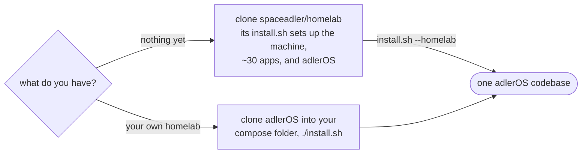
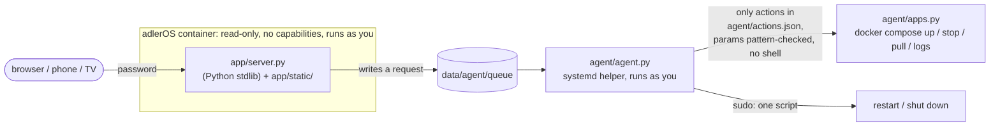
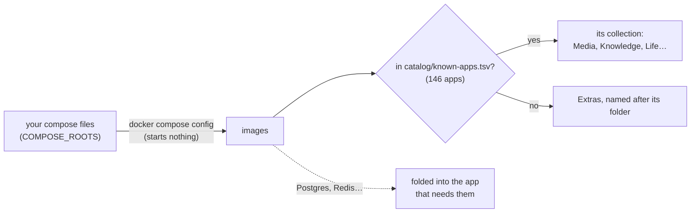

# adlerOS

> A home screen and App Store for the Docker apps on your homelab: umbrelOS's look, on any machine with Docker, and your compose files stay yours.


<!-- screenshot: the desktop, at 1440×900 or larger, see docs/screenshots/README.md -->


## Overview

Point it at the folders where your `docker compose` files live. It finds every app, sorts it into a collection (Media, Knowledge, Files…), and gives you one place to open, start, stop, update, read the logs of and delete them, plus a store of apps to install. It sits **on top of** your homelab, never instead of it: everything keeps working with adlerOS stopped.

## Install



```bash
cd ~/docker   # wherever your compose folders are: adlerOS is one of them
git clone https://github.com/spaceadler/adleros.git
cd adleros && ./install.sh
```

It asks your name, this machine's address, where your compose files are and your timezone, then prints the address (`http://<this machine>:8686`) and a password, and offers to connect Music, Gallery and Documents to Navidrome, Immich and Paperless. On a phone, *Add to Home Screen* opens it like an app. Details: [standalone](docs/standalone.md) · [in a homelab](docs/homelab.md).

## Architecture



The web app has **no Docker and no root access**. A compromised home screen can only queue one of the listed actions ([security](docs/security.md)). Keep it on your own network or a VPN such as Tailscale; don't publish it to the internet.

## How It Sorts Your Apps



One compose file holding two apps becomes two apps, each starting and stopping only its own containers. Collections: **Core** (admin mode) · **System** · **Media** · **Knowledge** · **Productivity** · **Life** · **Files** · **Extras**.

## What You Get

| | |
|---|---|
| **Home** | Desktop with widgets, a magnifying dock, All apps, search (Alt+Space or `/`), notifications, a first-login welcome and tour |
| **Manage** | The App Store (start, stop, restart, update, logs, delete, install), import of apps it didn't find, websites as apps, Live Usage |
| **Work** | Desktop mode (windows you drag and snap), My Computer, Notepad, Luna (Obsidian-style notes), a terminal, Firefox from the store |
| **Your data** | Music (Navidrome), Gallery (Immich), Documents (Paperless), Tasks (Vikunja), Calendar (CalDAV): each falls back to your own files without its app |
| **Control** | Keyboard first, so a TV and a keyboard are enough (`?` for keys); admin mode, behind your password, for restart, shut down and deletes |

The whole list, word for word: **[docs/features.md](docs/features.md)**. A tour of every screen: **[docs/guide.md](docs/guide.md)**.

<!-- screenshot: the App Store with a few apps, one card's containers open -->


## Documentation

| Doc | What's in it |
|---|---|
| [docs/features.md](docs/features.md) | Everything adlerOS does, and how it sorts apps |
| [docs/guide.md](docs/guide.md) | A tour: everything on the screen and what it does |
| [docs/keyboard.md](docs/keyboard.md) | Every key, for a keyboard and a TV |
| [docs/standalone.md](docs/standalone.md) | Installing on any homelab, your compose folders, the store, updating, removing |
| [docs/homelab.md](docs/homelab.md) | How spaceadler/homelab runs it |
| [docs/customizing.md](docs/customizing.md) | Wallpapers, dock icons, widgets, settings, actions, known apps, store apps |
| [docs/security.md](docs/security.md) | The trust model, in detail |
| [docs/screenshots/README.md](docs/screenshots/README.md) | The screenshots these docs use, and how to take them |
| [CODEMAP.md](CODEMAP.md) | Files, hub functions and the call graph, generated from the code |

## Layout

```text
adleros/
├── install.sh            # the installer: your own homelab, or --homelab for spaceadler/homelab
├── docker-compose.yml    # the adlerOS container (standalone) · .env.example: its settings
├── homelab/              # its container, nginx route and helper units inside spaceadler/homelab
├── app/                  # the web app: server.py (Python standard library) + static/
├── agent/                # agent.py (the helper) · actions.json (all it will do) · apps.py ·
│                         #   terminal.py · files.py · power (root-owned, for sudo)
├── catalog/              # known-apps.tsv (image → app → collection) · store/<app>/
└── docs/
```

Made by `install.sh` and never committed: `.env`, `data/`, `registry/`, `apps/`, `wallpaper/`, `icons/`.

## Credits

- **Design:** modelled on the umbrelOS desktop by [Umbrel](https://umbrel.com). Its layout, sizes and behaviour were studied from umbrelOS's public source and reimplemented here in plain HTML, CSS and JS. No umbrelOS code or artwork is included.
- **Dock icons:** drawn for adlerOS (`app/static/dock/`). The App Store icon is its own design, not Apple's.
- **Font:** [Inter](https://rsms.me/inter/) by Rasmus Andersson, under the SIL Open Font License (`app/static/fonts/OFL.txt`).
- **Wallpapers:** NASA photographs from the ISS and the Space Shuttle, in the public domain: the aurora (`iss072e159172`) and a sunrise over Earth's limb (`STS052-23-022`), from [images.nasa.gov](https://images.nasa.gov).
- **App icons:** fetched at runtime from [dashboard-icons](https://github.com/homarr-labs/dashboard-icons), or else from the app's own page (its apple-touch-icon or favicon). Each icon belongs to its app's project.

## Licence

adlerOS is under the [BSD 3-Clause License](LICENSE), copyright spaceadler: use it, change it and share it, keeping the copyright notice; don't use the name to promote what you make from it without asking. Fonts, pdf.js and the other files in `app/static/vendor/` and `app/static/fonts/` keep their own licences, next to them.

---
*powered by logic, coffee, and many sleepless nights*
